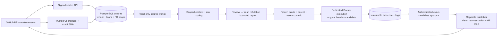

# Sir Patchington 🎩

An organization-aware PR review and repair control plane. Models propose findings
and patches. Deterministic code controls source access, verification, approvals,
and publication.

**Implemented and locally exercised; production deployment and model quality are
not certified.** No live model generation was used to test this repository.
Default policies permit investigation and candidate construction, disable GitHub
comments and pushes, and never merge. Publishing requires authenticated approval
of the exact independently tested candidate.



## Run the complete offline demonstration

Prerequisites: Python 3.12+, `uv`, Git, and a local Docker daemon. Provision the
trusted check image once; the demonstration itself uses no model or GitHub API.

```sh
uv sync --locked
docker pull python@sha256:2f17fc044b579bab302c2e8054d3a686e2cb9a83de48e70534b94cd8ebbe06a9
uv run patchington demo --output .local/demo
```

Use a new output directory for each run. `receipt.json` separates actual Docker,
ASGI authentication and local bare-Git compare-and-swap evidence from simulated
model responses, GitHub metadata and CI. The demo introduces a delivery-fee
boundary bug, proves the original head fails owner-owned probes, verifies the
fix, approves it, pushes to a disposable local remote, reads the exact Git
objects back, observes fixture CI, and rereviews. It touches no existing repo.

## Reusable modules

| Block | Code | What it enforces |
| --- | --- | --- |
| Identity / policy | [contracts](src/patchington/contracts.py), [config](src/patchington/config.py) | Immutable strict contracts; enrollment; protected paths; bounded checks |
| Durable coordination | [store](src/patchington/store.py) | PostgreSQL leases, fencing, per-PR exclusion, tenant concurrency, deduplication, audit/outbox, schema-version refusal |
| Context | [context](src/patchington/context.py), [gitwork](src/patchington/gitwork.py) | Revision/tenant/team scope, bounded retrieval, secret-pattern filtering, explicit omissions |
| Investigation | [models](src/patchington/models.py), [pipeline](src/patchington/pipeline.py) | Tool-free structured model output, mandatory risk lanes, refutation, bounded repair and generation reuse |
| Candidate / proof | [gitwork](src/patchington/gitwork.py), [artifacts](src/patchington/artifacts.py), [records](src/patchington/records.py) | Canonical commits, independent proof generations, immutable content hashes |
| Execution | [execution](src/patchington/execution.py), [probes](src/patchington/probes.py) | Fresh original/candidate containers; no network/secrets; resource limits; external regression assertions |
| GitHub | [github](src/patchington/github.py) | Scoped App tokens, bounded pagination, authoritative PR/thread capture, anchored summaries, open-PR listing |
| Approval / publication | [api](src/patchington/api.py), [publisher](src/patchington/publisher.py) | Tenant/team roles; exact approval; revocation checks; clean reconstruction; expected-head Git CAS and readback |
| Lifecycle | [cli](src/patchington/cli.py), [pipeline](src/patchington/pipeline.py) | Role-separated startup, reconciliation, trusted current-SHA CI observation and rereview |
| Deployment | [Compose](compose.yaml), [Kubernetes renderer](deploy/render.py) | Nonroot roles, separated secrets, durable state, restricted execution-daemon access, opt-in live workers |

The modules have injectable transports/model/verifier boundaries. There is no
dependency on a vendor's private reviewer service and no copied proprietary code.

## Organization deployment

Read [operations](docs/OPERATIONS.md), [security](SECURITY.md), and the
[research-to-code map](docs/RESEARCH-TO-CODE.md). Start from
[production configuration](deploy/config.production.toml). It intentionally has
no enrollment and refuses production startup until real repository identities,
trusted acceptance checks, requirements, principals and secrets are supplied.

Run multiple API/worker replicas against the same PostgreSQL schema and shared
durable artifact volume. Queue claims enforce per-tenant capacity and one active
job per PR across review, reporting, publishing and CI observation. All replicas
must use the same trusted quota/configuration. Kubernetes requires real external
PostgreSQL, a shared RWX artifact storage class and a dedicated execution daemon;
the renderer does not provision them. Organization-scale throughput, recovery
and isolation remain deployment qualification work, not a result of adding replicas.

Use a read App in workers and a separate write App in publishers, with their
actual distinct installation IDs. API processes have no App key. Untrusted code
runs only in constrained check containers on a dedicated daemon. Workers and
publishers start at zero replicas in rendered defaults. There is no automatic
merge, branch-protection bypass or production release authority.

## Validate

```sh
uv run ruff check src tests deploy
uv run pytest -q
docker build --platform linux/amd64 -t sir-patchington:local .
PATCHINGTON_TEST_SERVICE_IMAGE=sir-patchington:local uv run pytest tests/test_deployment.py -q
```

Real PostgreSQL tests require `PATCHINGTON_TEST_DATABASE_URL` pointing to a
dedicated disposable database whose role may create schemas. Without it, those
tests report skips; SQLite is never presented as PostgreSQL evidence. Docker
tests execute real local containers. No test authenticates a model or invokes
real model generation. See [qualification](docs/QUALIFICATION.md) for measured
results, scope, and remaining deployment gates.

## Research and learning material

- [In-depth research](docs/research/Automated-Code-Review-Research.md) · [Word report](docs/research/Automated-Code-Review-Research.docx)
- [Beginner field guide](docs/research/Automated-PR-Bot-Field-Guide.md) · [Word guide](docs/research/Automated-PR-Bot-Field-Guide.docx)
- [Executive presentation](docs/research/Automated-Code-Review-Executive-Summary.pptx)
- [Architecture picture](docs/research/Architecture-Map.png) · [Architecture slide](docs/research/Architecture-Map.pptx)
- [Source index](docs/research/Source-Index.md) · [Pinned evidence](docs/research/evidence)

Research is a dated design study. Its proposed complete architecture includes
capabilities this implementation deliberately marks as extensions. Historical
local environment links in the report are context, not portable runtime dependencies.

Original implementation: MIT. Dependency and inspiration boundaries are documented
in [provenance](docs/RESEARCH-TO-CODE.md).
