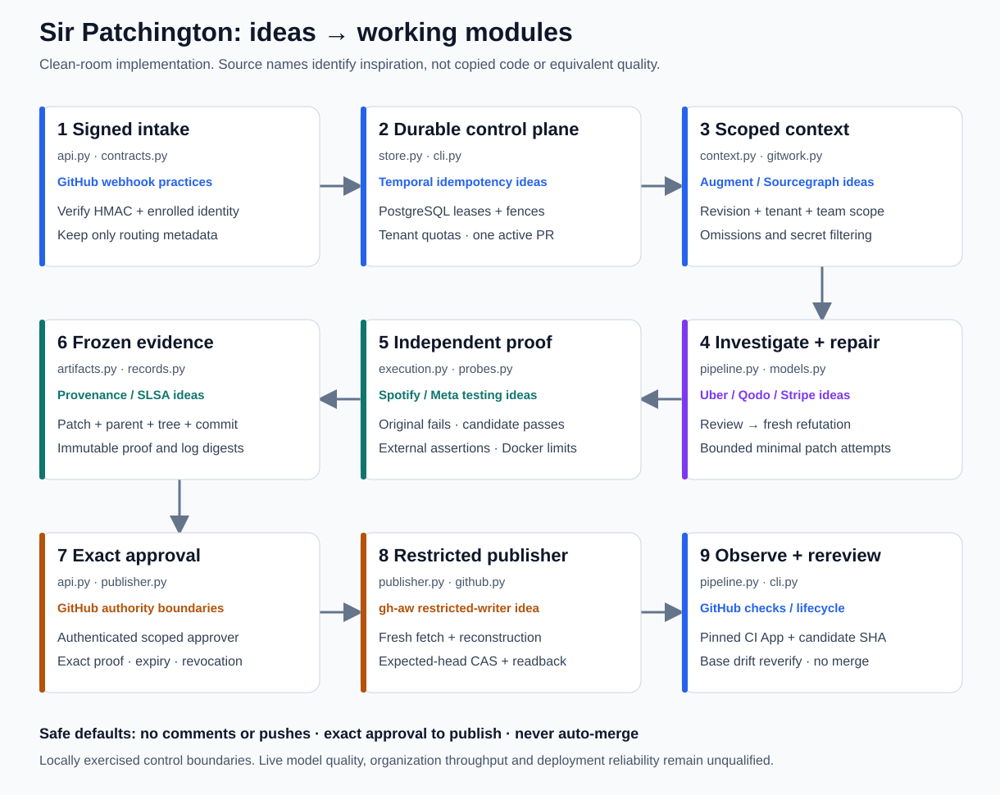

# Research → working code

The original research considered private and public systems equally as sources
of ideas. Code availability was never a design eligibility rule. This repository
is a clean-room implementation of selected mechanisms. It does **not** contain
Uber uReview, Bugbot, CodeRabbit, a private company agent, or their claimed
evaluation results. Similar architecture does not establish equivalent quality.

| Idea source | Why use the mechanism | Working local implementation | Boundary |
| --- | --- | --- | --- |
| [Uber uReview](https://www.uber.com/us/en/blog/ureview/) | Generate candidates, then validate/filter instead of posting every suspicion | `pipeline.py`: specialist proposals, fresh refutation, explicit finding states, bounded count | Same model adapter in separate calls, not independently trained validators; no uReview model/code |
| [Qodo blueprint](https://www.qodo.ai/resources/high-signal-ai-code-review-a-multi-agent-blueprint/), [Anthropic patterns](https://www.anthropic.com/research/building-effective-agents) | Separate investigation lanes and evidence judgments | Deterministic risk routing, structured review/refute contracts, lane-specific required checks | Specialists run bounded sequential calls; model intelligence is unqualified |
| [Augment context](https://www.augmentcode.com/blog/how-we-built-high-quality-ai-code-review-agent), [Sourcegraph navigation](https://sourcegraph.com/docs/code-navigation/precise-code-navigation) | Retrieve relevant dependencies with provenance rather than send every file | `context.py`: revision-scoped lexical/Python-AST imports/symbols; `gitwork.py`: bounded source slices | No SCIP ingestion, complete cross-language graph or automatic cross-repo crawling; explicitly scoped related indexes are supported |
| [Stripe blueprints](https://stripe.dev/blog/minions-stripes-one-shot-end-to-end-coding-agents-part-2) | Keep deterministic workflow decisions outside model reasoning | `pipeline.py`, strict contracts, owner commands, canonical candidate objects | No Stripe infrastructure/code dependency |
| [Spotify verifiers](https://engineering.atspotify.com/2025/12/feedback-loops-background-coding-agents-part-3), [Meta JIT tests](https://arxiv.org/abs/2601.22832) | A plausible patch needs independent behavioral evidence | Original-head/candidate execution; frozen owner checks; external probe supervisor defeats early process exit | This version uses owner-authored probes, not generated JIT tests or a learned verifier |
| [Temporal activity semantics](https://docs.temporal.io/activity-definition) | Durable receipts, bounded retries, idempotent effects and stale-worker rejection | `store.py`: SQL transactions, leases/fences, per-PR exclusion, quotas, audit/outbox; reconciler discovers missed PRs | Custom PostgreSQL queue, not a Temporal runtime; external operations cannot be globally exactly-once |
| [Open SWE finding ledger](https://github.com/langchain-ai/open-swe/blob/e8a31359226b192b1bb8af50265d2ff694d15f32/openswe/review/findings.py#L126-L168) | Preserve finding provenance and unresolved states | Fingerprinted findings, source snapshot records, supported/refuted/needs-evidence/requires-owner states | No transplanted Open SWE code or automatic reviewer-preference training |
| [Anthropic containment](https://www.anthropic.com/research/how-we-contain-claude), [Docker security](https://docs.docker.com/engine/security/) | The reviewed code must not inherit coordinator credentials | Role-separated services; networkless nonroot constrained check containers; remote dedicated daemon support | Docker kernel isolation, not VM/microVM proof; owner must provision a dedicated daemon |
| [GitHub agentic workflows restricted publication](https://github.com/github/gh-aw/blob/b76697cedc6f0c2f212f7ba7690df9baa7768205/actions/setup/js/push_signed_commits.cjs#L809-L908) | A credentialed writer must reconstruct and verify the selected artifact | `publisher.py`: HMAC exact approval, durable revocation, fresh fetch/reconstruction, expected-head Git CAS and object readback | Independent implementation; commits use canonical metadata and are not GPG/Sigstore-signed |
| [GitHub webhook practices](https://docs.github.com/en/webhooks/using-webhooks/best-practices-for-using-webhooks), [App scopes](https://docs.github.com/en/rest/apps/apps#create-an-installation-access-token-for-an-app) | Bind events and tokens to real repository/install identities | HMAC intake, enrollment, scoped short-lived tokens, separate read/write Apps, bounded pagination | GitHub Cloud only; no live App installation qualification |
| [SLSA provenance](https://slsa.dev/spec/v1.2/provenance) | Freeze the relationship between source, patch, environment and evidence | Content-addressed logs/evidence, canonical parent/tree/commit, immutable proof records | Internal evidence lineage; no claim of SLSA conformance or external attestation signing |
| [GitHub required checks / merge queue](https://docs.github.com/en/repositories/configuring-branches-and-merges-in-your-repository/configuring-pull-request-merges/managing-a-merge-queue) | A green check must belong to the exact revision and trusted producer | CI observer requires a unique successful required check from pinned App IDs on the candidate SHA; base drift queues rereview | Never merges; merge-group verification and release/canary gates remain external authority |

## Complete target versus this implementation

The 22-block ideal architecture remains in the
[research evidence](research/evidence/ideal-architecture-blocks.json). The working
core includes signed intake, scoped source/review capture, requirements, risk
routing, generation/refutation, bounded repair, isolated independent acceptance,
immutable evidence, authenticated exact approval, restricted publication,
current-revision CI observation, rereview, durable leases, reconciliation and
organization enrollment.

Extensions requiring additional implementation/qualification include full
cross-language semantic graphs; CodeQL/Semgrep/native/GPU adapters and prepared
images; generated JIT/property/mutation test workflows; hardware/performance
qualification; reviewer feedback datasets and calibrated precision/recall;
automatically learned team preferences; managed distributed artifact/object
storage; external signed attestations; merge queues; release canaries; and
post-release incident attribution. Existing check/risk/model/transport interfaces
are replaceable seams, not a claim that these integrations already exist.

SpaceX, OpenAI, Google, Meta and NVIDIA research appears in the report with
explicit public-evidence boundaries. No undisclosed internal architecture or
unavailable source was invented to fill a gap.

## Source and license boundaries

Original implementation uses the MIT license. No third-party project source was
vendored into the Python modules. Inspiration links identify mechanisms, not
authorship or an upstream license grant. Dependency versions and registry
integrity are recorded in `uv.lock` and the Claude npm lock. FastAPI, Pydantic,
SQLAlchemy, HTTPX, psycopg, PyJWT and other dependencies retain their own licenses.
The Docker image contains the proprietary official Claude Code client; its use,
redistribution and subscription authentication remain subject to Anthropic's
terms. Research reports/figures retain attribution to cited sources. Do not
assume the repository license relicenses third-party material or dependencies.
