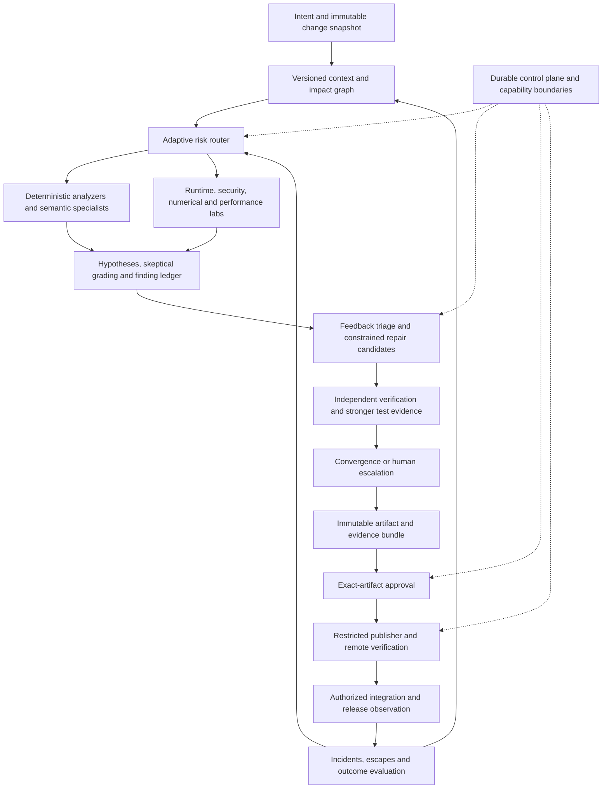
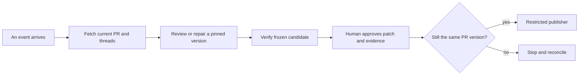

# Automated PR Review and Repair Research

# Reading map

This report explains how to build an automated PR reviewer and a controlled repair system from the ground up, then compares existing implementations and company architectures. The recommended direction selects the strongest ideas from public and private systems, then chooses which blocks to reuse, buy or build. Code availability does not limit the design.

Start with the companion field guide if the GitHub terms are new. The opening walkthrough below uses the same running example; the remaining chapters provide source code, alternatives, edge cases and the complete proposed system. The presentation has a short executive section followed by optional worked examples.

The research screens 35 public review and analysis repositories, assesses 21 repair and orchestration options, compares 18 company system families and 12 commercial architecture profiles, specifies 22 target blocks, and examines 10 AI Engineer talks through primary timestamped transcripts. These groups overlap. Screening is not deep source inspection of every item, and no finite survey establishes that every solution on the internet has been found. Evidence is checked as of 21 October 2026.

| Evidence label | What it means |
| --- | --- |
| Source inspected | A pinned implementation was read; it was not executed in this study |
| Documented | Current primary documentation states the behavior or constraint |
| Company reported | The company describes its own deployment or measurements |
| Transcript checked | Relevant timestamped speech was read; this is not a claim of full visual video viewing |
| Proposed | A recommended design or acceptance requirement, not installed behavior |
| Unknown | Available evidence does not establish the answer |

No third-party review platform or model-backed PR repair was installed or run, no repository protection settings were changed, and no code was pushed by this research. Example code and YAML are teaching configurations unless explicitly described as a source snapshot. They are not a ready-to-deploy system.

## Contents

1. Beginner walkthrough and vocabulary
2. Complete idea-first target architecture and provenance
3. Commercial and private architectural ideas
4. Company systems and AI Engineer talks
5. Open implementations and repair runtimes
6. GitHub settings and scenario atlas
7. Deployment compatibility and repository screening index


# How a review-and-fix bot actually works

This guide follows one tiny Python change all the way through a complete bot. The example, commit nicknames, results and approval record are **illustrative; none was executed**. They explain the design, not a performance claim about any product.

The bot has two jobs: investigate whether a proposed change causes a problem, then repair justified problems. Reliable automation also needs a controller that tracks the work, independent checks, and a restricted publisher. Those parts prevent an impressive-looking answer from becoming an unjustified code change.

## 1. Start with a change someone wants to merge

Imagine a project with this owner-approved rule:

> Delivery costs $5 below a $50 subtotal. Delivery is free at $50 or above.

The existing `fees.py` contains:

```python
def delivery_fee(subtotal):
    return 0 if subtotal >= 50 else 5
```

A developer opens a pull request, or PR, proposing a change. Its diff includes:

```diff
 def delivery_fee(subtotal):
-    return 0 if subtotal >= 50 else 5
+    return 0 if subtotal > 50 else 5
```

The `-` line was removed; the `+` line was added. The PR is a place to discuss this proposed change before combining it with the project's main work.

Give the snapshots friendly nicknames:

| Snapshot | Meaning here |
|---|---|
| **B1** | Comparison baseline, containing `>=` |
| **H1** | Proposed branch's current commit, containing `>` |
| **C1** | Candidate repair we will create later |

Real commits have identifiers called hashes. These nicknames are not real hashes. A branch name can move to a new commit; an existing commit identifies fixed contents and history. The controller records actual identifiers so everyone reviews and tests the same version.

GitHub's PR comparison usually starts from the branches' common ancestor. That is different from always comparing with the latest destination-branch contents. The system should record both its comparison baseline and the destination version used for integration checks. [GitHub comparison explanation](https://docs.github.com/en/pull-requests/reference/branches).

**Explain aloud:** “What changed? What behavior could that one character affect? Why is a branch name insufficient to identify what I tested?”

## 2. The reviewer makes a claim, not a verdict from nowhere

The reviewer reads the diff, the surrounding function, relevant tests and the delivery rule. It forms a hypothesis:

> At exactly $50, H1 charges $5 although the rule requires free delivery. The new `>` comparison excludes the boundary value. Restore `>=` and cover the boundary in a test.

That is a useful finding because it contains a location, triggering input, actual behavior, expected behavior and connection to the introduced change. Another person can challenge it.

Compare four kinds of comment:

| Comment | How to handle it |
|---|---|
| “At subtotal 50, this new comparison returns 5 instead of the required 0.” | Investigate the concrete defect |
| “This is bad code. Improve robustness.” | Too vague to authorize a repair |
| “Use the project's required spacing.” | Let a formatter or linter handle a mechanical rule |
| “The business should offer free delivery at $40.” | A product decision requiring owner intent |

A confident tone does not supply missing evidence. Neither does a severity badge. If the developer intended to change the free-delivery threshold, the reviewer must identify that possible requirement change instead of automatically restoring old behavior.

Repository context matters because a correct comparison cannot be determined from punctuation alone. The trusted requirement makes the claim meaningful.

**Explain aloud:** “What evidence makes this a bug rather than a style preference? What information would make me reject the finding?”

## 3. Validation tries to prove the reviewer wrong

A validator investigates the hypothesis before a fixer touches code. It checks whether the rule is current, whether another caller changes the input, and whether the problem already existed.

A tiny reproducer is:

```python
assert delivery_fee(50) == 0
```

Run it separately against B1 and H1. In this teaching example, the expected observations are:

| Input | Required fee | B1 (`>=`) | H1 (`>`) |
|---:|---:|---:|---:|
| 49 | 5 | 5 | 5 |
| 50 | 0 | 0 | **5: failure** |
| 51 | 0 | 0 | 0 |

The comparison shows why testing only 49 and 51 would miss the bug. Checking B1 also matters: if the same failure occurred there, the bot could not honestly call it newly introduced by this PR.

These observations would support a narrow conclusion: the changed comparison breaks the specified boundary case. They would not establish correctness for negative amounts, currency conversion, every caller, or the whole delivery system.

An LLM can propose the reproducer and reason about the result. A test runner must actually execute it before the system reports a test pass. If the environment cannot start, the result is “environment failed,” not “no bug.”

Some problems cannot be reproduced cheaply: device-specific behavior, concurrency failures and missing business requirements are examples. The bot should preserve the uncertainty and request judgment, rather than invent a harmless-looking edit.

**Explain aloud:** “What distinguishes a proposed test, an executed failure and a passing result? Why do I compare baseline and proposed code?”

## 4. A fixer makes a candidate in a separate workspace

After the finding is accepted as actionable, the fixer receives a specific task:

> Restore the documented $50 boundary. Add regression coverage. Keep unrelated behavior unchanged.

It works in a separate checkout or execution environment and proposes:

```diff
-    return 0 if subtotal > 50 else 5
+    return 0 if subtotal >= 50 else 5
```

It might also add `test_fees.py`:

```python
from fees import delivery_fee

def test_free_delivery_starts_at_50():
    assert delivery_fee(49) == 5
    assert delivery_fee(50) == 0
    assert delivery_fee(51) == 0
```

The output is a **candidate repair**, C1. Creating a commit or saying “fixed” does not establish that it works.

Keep the roles separate:

```text
Reviewer: “Here is the suspected problem.”
Validator: “Here is what supports or refutes it.”
Fixer: “Here is a patch addressing the accepted problem.”
Verifier: “Here are checks I independently ran on that patch.”
Publisher: “I can send only the authorized result to GitHub.”
```

A Git worktree separates files and branches; it is not a security sandbox. Repository tests and installation scripts can execute code. They should not receive the user's normal home directory, GitHub write token or other account credentials. An authenticated coding CLI and untrusted test execution need an explicit separation too.

The fixer should stop when the task is ambiguous, the permitted scope is insufficient, or bounded repair attempts fail.

**Explain aloud:** “Why is C1 only a candidate? What could a malicious test do if it inherited my normal machine's credentials?”

## 5. Independent verification checks the candidate, not the story

A clean verifier checks out C1 and runs owner-approved commands. For our example, its report might contain:

```text
Candidate: C1
Original boundary reproducer: failed on H1, passed on C1
Existing fee tests: passed
New boundary test: passed
Unrelated integration checks: not run
```

Again, these are illustrative results, not executed results.

“Independent” means the fixer cannot silently choose easier commands, replace the acceptance rule, edit the verifier's logs or swap the candidate afterward. Another model reading the same conversation is not sufficient independence.

The new test is useful, but the verifier should also use the trusted reproducer and existing checks. Otherwise the fixer could replace `assert fee == 0` with `assert fee >= 0` and declare victory. That weaker assertion would accept the incorrect $5 fee.

Different projects require different verification. A Python function may need unit tests. A numerical library can also need compilation, dtype/shape checks, numerical tolerances and supported devices. A passing Mac test does not prove an Intel GPU path ran.

After verification, freeze C1 and its evidence. Any subsequent edit creates a new candidate and requires corresponding checks. Concrete source projects illustrate why this separation matters: PR-Agent can check replacement applicability and Python syntax, but neither operation runs the project's regression suite. [Inspected validation implementation](https://github.com/The-PR-Agent/pr-agent/blob/729415c68b8ef55df8bcce919a419af7f5cebffb/pr_agent/tools/pr_code_suggestions.py#L1576-L1677).

**Explain aloud:** “Could a patch pass a test while leaving the bug? What exactly must stay unchanged after verification?”

## 6. Approval, push and merge are three different decisions

The human sees the exact diff and evidence, then approves a particular publication:

```text
Repository: example/shop
PR: 17
Expected current head: H1
Approved candidate: C1
Evidence: boundary reproduction + listed regression checks
Unresolved limits: integration checks not run
```

This is a teaching record, not a real approval or command.

The publisher owns the GitHub write credential. The fixer does not. Immediately before publishing, the publisher checks that PR 17 is still open and its head is still H1. The remote branch update must also enforce that expectation, so a concurrent change cannot slip between checking and pushing.

Suppose another developer pushes H2 while approval is waiting. The bot must stop and reconcile. It cannot quietly combine C1 with H2 and claim that the human approved and the verifier tested the new combination.

A push updates the remote feature branch. A merge combines approved work into the destination branch. Approving C1 for a push does not authorize merging the PR, deployment, or a later patch.

This separation appears in useful open architectures: Datadog's review workflow keeps its model job read-only and delegates posting to another job. That demonstrates credential separation for comments; it is not a complete tested-patch approval system. [Inspected job contract](https://github.com/DataDog/code-review-action/blob/fa0c1e83648c82ae0ac78dc1c261af462d9ffcb5/.github/workflows/code-review.yml#L13-L53).

**Explain aloud:** “What happens if the branch changes after approval? Why does permission to push one candidate not mean permission to merge?”

## 7. CI and rereview close the loop

After the authorized push, configured GitHub Actions may run tests and builds. Those automated jobs are CI: continuous integration. The bot waits for the required checks associated with the relevant new revision and reads their actual outcomes. A cancelled, skipped or missing check is different from a pass. [GitHub workflow concepts](https://docs.github.com/en/actions/concepts/workflows-and-actions/workflows), [check outcomes](https://docs.github.com/en/pull-requests/reference/status-checks).

The reviewer then reassesses the original finding against C1. It should see the boundary restored, examine the evidence, and mark its concern addressed according to the repository's policy. The system keeps the original thread and finding identity so it does not repost the same issue merely because line numbers moved.

A resolved conversation does not prove the repair was correct. A reviewer might resolve it by mistake. Likewise, a green test badge can coexist with missing coverage. Completion means the system has the required evidence, records remaining uncertainty, and hands the merge decision to the authorized human.

```text
Exact change → suspected defect → checked evidence → candidate repair
      → independent checks → exact approval → restricted push
      → CI at new revision → rereview → human merge decision
```

**Explain aloud:** “Which step establishes that code reached GitHub? Which establishes that a particular check passed? Which decides whether to merge?”

## 8. A tiny glossary you can use in conversation

| Term | Plain meaning |
|---|---|
| Repository / repo | The project's files plus their recorded Git history |
| Branch | A movable name pointing to a line of development |
| Commit | A recorded snapshot linked to its parent history, identified by a hash |
| Pull request / PR | A proposal and discussion for combining one branch's changes into another |
| Diff | The lines added, removed or changed between selected versions |
| Head | In a PR, the proposed branch; its head commit is its latest recorded version |
| Base | The destination branch; a comparison baseline commit must also be specified |
| Review | An assessment of proposed changes, possibly with comments or a verdict |
| Thread | A conversation attached to a particular comment or code location |
| Check | A reported automated result, such as a test job or security scan |
| CI | Automation that builds/tests changes as they are integrated |
| Access token | A credential permitting access; its permissions and account determine its authority |
| Sandbox | An execution boundary restricting what code can access or affect |
| Merge | Combine development histories/changes into a destination branch |
| Rebase | Replay changes on another starting point, creating new commit identities |
| Merge queue | A controlled sequence that checks proposed merges with other queued changes |

An LLM token means a unit of model text; it is unrelated to an access token.

**Explain aloud:** “Explain a PR using branch, commit, diff, head and base. Then explain why a rebase changes the identity of what was reviewed.”

## 9. Know what each piece of evidence can establish

| Evidence | Supports | Does not establish |
|---|---|---|
| Code inspection | A reasoned hypothesis about behavior | That the code was executed |
| Reproducer failure | A specific failure under stated conditions | That every deployment is affected |
| Candidate test pass | Checked behavior in the recorded environment | Absence of all bugs |
| Syntax check | Code parses/compiles at the checked level | Correct requirements or runtime behavior |
| Human approval | Authorization for its stated artifact/action | Technical correctness by itself |
| Remote commit read-back | Which change reached the branch | Successful tests or permission to merge |
| Resolved thread | Conversation state | Proof that the diagnosis or fix was right |

**Explain aloud:** “Tell the whole story without saying ‘the bot knows it is correct.’ Replace that phrase with the exact evidence collected and the limits still remaining.”


# The recommended complete design

The goal is a PR review and repair system that understands the intended change, investigates real risks, produces focused fixes, verifies the exact candidate and leaves an accountable person with a clear decision. It should learn from accepted and rejected findings and from failures after release. Selected authority remains human approval of each exact tested code push and no automatic merge; more autonomous delivery is a researched policy option, not enabled authority. That is a larger design than installing a reviewer bot or combining a few open-source repositories.

Select the strongest mechanisms first, regardless of whether the original company publishes code. Then choose whether to reuse an implementation, buy a service, or build an equivalent block. The implementation should preserve the mechanism's purpose and observable contract, not pretend to reproduce an undocumented proprietary backend.

## The big picture

The recommended quality engine has six connected responsibilities.

1. **Understand intent and consequences.** Establish what the change is supposed to do, which contracts it touches and what could break beyond the diff.
2. **Investigate with relevant evidence.** Select context, deterministic analyzers and specialist reviewers based on the change; let reviewers test specific hypotheses.
3. **Decide which findings deserve attention.** Refute unsupported claims, separate pre-existing debt, calibrate severity, and reconcile duplicates and older feedback.
4. **Repair and verify.** Turn justified findings into bounded patches, test the original failure and independent regressions, and stop oscillating repair loops.
5. **Control publication and release.** Keep exact candidate identities, human authority, privileged credentials, merge validation and rollback separate from model reasoning.
6. **Improve the system.** Learn where context, tools, policy or reasoning failed; replay incidents and clean changes, and turn stable repeated patterns into deterministic rules.

The separate architecture map names the idea source and reason for every major component. Public implementations in the report are build options for these responsibilities, not the boundaries of what the system may contain.

## The most consequential selections

| Block selected | Idea sources | Why it belongs in the target |
| --- | --- | --- |
| Versioned intent and acceptance criteria | Aviator Verify and decision logs; OpenAI harness engineering | Missing requirements prevent a complete judgment of intent; explicit invariants remain reviewable |
| Context graph with evidence provenance | Qodo context engine; Greptile; Sourcegraph; Microsoft CodePlan | The causal impact can be in another file, repository, schema or historical decision |
| Adaptive risk and review planning | Company risk tiers; specialist review systems; CodeScene | A spelling edit and an authentication or GPU-memory change need different evidence and effort |
| Specialist finding generation plus skeptical validation | Uber uReview; Claude Code Review; Greptile narrow hypotheses | Generating a plausible objection is much easier than establishing a useful defect |
| Runtime investigation environment | Greptile TREX; Google CodeMender; OpenAI tool and observability harness | Some hypotheses need a browser, debugger, reproduction, logs, traces or device execution |
| Incremental finding and feedback ledger | Ellipsis review cursors; PR-Agent identity; Google comment-resolution workflows | Moving lines and new commits must not cause repeated findings, lost feedback or stale repairs |
| Deterministic and agent steps in one constrained workflow | Stripe blueprints; Meta Fixit; established repair runtimes | Known mechanical work is predictable; reasoning should be reserved for unresolved context and behavior |
| Independent, domain-specific verification | Meta SapFix and JiTTests; Google security repair; SWE-bench harness concepts | A fix needs evidence about the target defect and damage elsewhere, including the relevant native environments |
| Convergence and escalation policy | Anthropic review rounds; accepted/rejected finding feedback | An author agent and reviewer agent can keep each other busy without improving the change |
| Exact artifact approval and restricted effects | Anthropic commit-specific approvals; gh-aw separation of effects; our stronger pre-push contract | Approval of earlier code does not authorize a later patch, and a model should not grant itself write authority |
| Release feedback and governed learning | OpenAI/Anthropic incident evaluation; Uber managed software factory | Pre-merge analysis misses bugs; production evidence should improve future checks without silently weakening policy |

These rows summarize the selection; the company and commercial idea catalogues give the exact mechanisms, primary links, rebuilding approach and evidence limits. The similarity of a design idea does not imply equal implementation quality or equal measured results.

## How these blocks work together on an actual change

Suppose a PR changes a Python wrapper around a native numerical operation. A basic diff reviewer may see a small signature change. The target system first identifies the intended compatibility contract and affected call sites, Cython declaration, generated template and package boundary. It records which repositories and dependency versions the context describes.

The planner chooses an API-compatibility reviewer and a numerical/native reviewer, plus deterministic checks. Each reviewer produces hypotheses rather than direct instructions to the fixer. A suspected dtype change must state an input, expected behavior, observed or predicted behavior, and the causal changed line. A code search result alone does not establish runtime behavior.

The evidence environment can run a targeted comparison with the intended NumPy or SciPy contract, inspect compiled-package provenance, and exercise shape, dtype, stride and device cases. If the required device is unavailable, the result remains incomplete. The validator can reject a false claim, ask for missing evidence, or admit the finding with the supported scope.

The repair planner groups findings by root cause and freezes the acceptance contract. A focused worker changes the correct source template rather than a generated artifact. Another environment runs trusted checks on the exact candidate, including the original failing case and applicable regression matrix. Changing a test tolerance or adding a skip is visible, not a shortcut to success.

The decision surface shows the patch, supported findings, test evidence and missing checks. If a person approves candidate C1, a later push H2 or a changed candidate invalidates that authorization. The publisher checks the current repository/ref and approval before a single permitted effect. Merge and release controls then check the combined base and operational outcome. Failures become adjudicated examples for the next evaluation cycle.

This scenario is proposed behavior. It is not an executed evaluation of these repositories or an assertion that one vendor already implements the whole path.

## The context engine is a real subsystem

Context should combine code symbols and dependencies, tests, schemas, owner-authored rules, selected issue and design history, review decisions and relevant runtime evidence. Keep every retrieved item tied to its source, version, access authority and freshness. The planner should be able to ask a precise question and receive a compact answer with references instead of dumping a whole codebase into a prompt.

Sourcegraph's August 2026 account describes sandboxed scripts around search APIs that filter and aggregate intermediate results before passing structured artifacts to the model. The transferable idea is query-time computation with provenance, not assuming that every large codebase should fit into one context window. [Sourcegraph search architecture](https://sourcegraph.com/blog/a-smarter-way-to-run-code-migrations-with-less-llm-context).

Microsoft CodePlan combines incremental dependency analysis, change-impact analysis and adaptive planning for multi-file edits. Use that idea for a repair dependency plan: changes that affect a public type can cause follow-up obligations elsewhere. Its published evaluation covers specific migration tasks; it does not establish universal PR review quality. [Microsoft CodePlan](https://www.microsoft.com/en-us/research/publication/codeplan-repository-level-coding-using-llms-and-planning-2/).

Persistent symbol or relationship indexes are therefore eligible target components. Their value depends on freshness, repository support and the kinds of misses they prevent. An index that returns stale or unauthorized information can make review worse. Start the design with an explicit context contract; choose the storage and retrieval method to satisfy it.

## Verification is a family of methods

Use different evidence for different claims. A compiler can refute an invalid call; a focused regression can demonstrate a boundary defect; a browser can reveal a broken interaction; a sanitizer can detect memory misuse; differential numerical tests can expose a contract mismatch; deployment telemetry can reveal a performance regression missed in unit tests. None covers every class of problem.

For selected critical functions with suitable formal contracts, a formal verifier can add another lane. Clover studies consistency among code, documentation and formal annotations using verification tools and models, with a hand-designed textbook-level Dafny dataset. Its results do not transfer into a promise that arbitrary C++, Python or distributed systems can be proved correct automatically. The design lesson is to make assumptions and specifications checkable where the domain supports it. [Clover paper](https://arxiv.org/abs/2310.17807).

The verifier must also evaluate the tests. A new test that passes on both the faulty head and the candidate does not demonstrate the claimed repair. A test that mirrors implementation can miss the same misunderstanding. Mutation, deliberately introduced faults, historical incident cases and independent oracles can expose weak checks. Report the evidence obtained and its limits rather than collapsing every lane into one green badge.

## Learning must be governed

Store feedback as structured outcomes: valid fixed defect, valid deferred issue, incorrect finding, intentional behavior, unclear requirement, duplicate, stale finding, environment failure and escaped defect. Review a sample of these labels independently. A line changing after a comment is a useful signal but not a final truth label.

Maintain separate layers for hard organizational standards, repository invariants, local preferences and experimental suggestions. A bot must not learn that a security rule is optional simply because authors often ignore its comments. Promote stable lessons through owner review into rules, tests, context files or tools. Re-evaluate the complete held-out corpus after changes to models, prompts, retrieval, tools or policy.

OpenAI's harness account gives a useful operating principle: make code, runtime behavior and repository knowledge legible to agents, and repair the environment when missing tools or context prevent a task. Its beta team's reported throughput is not a guarantee for this design. The relevant architectural idea is an evidence environment that makes the desired checks possible. [OpenAI harness engineering](https://openai.com/index/harness-engineering/).

## Personal and organization are execution profiles

Both versions should preserve intent, context provenance, finding quality, independent checks, state reconciliation and publication authority. They may differ in where they run, which model transport they use, how much investigation they can afford and which environments they support. Do not remove a conceptual block merely because its first implementation is small.

| Design decision | Personal implementation profile | Organization implementation profile |
| --- | --- | --- |
| Inference | Existing subscription transport is one constrained option; other approved transports use the same interfaces | Approved service identity, model deployments, data terms, budgets and capacity |
| Context | Versioned symbol, semantic and multi-repository context with provenance; local or hosted services at available scale | Access-controlled multi-repo context service with schemas, design history, source provenance and freshness |
| Investigation | Separate browser, debugger, telemetry and native execution services at available capacity; explicit unsupported environments | Managed browser/debugger/telemetry tools plus OS, compiler, hardware and dependency images |
| Review depth | Same risk model; report when a deep lane is unavailable instead of claiming equivalent assurance | Centrally governed routing and service capacity for expensive or sensitive changes |
| State and recovery | A small durable store and job controller can implement the contracts | PostgreSQL plus DBOS, Temporal or an equivalent durable workflow implementation selected as one authoritative control plane |
| Human decision | One clear bundle showing exact patch, evidence and unresolved risks | Owner and risk policy, separation of duties and auditable approval of exact artifacts |
| Publication | Dedicated narrow writer, separately authorized effects | Company-owned GitHub App and restricted publisher with repository/ref fencing and reconciliation |

The previously inspected launcher pins `claude-sonnet-5-5` and excludes provider fallback and nested agents. Those are current local implementation facts, not a reason to omit model diversity, context agents or runtime investigation from the ideal research. If the personal profile keeps those controls, implement compatible orchestration or explicitly report a missing capability. Do not silently break the controls while claiming compatibility. Current account quota and transport isolation were not live-qualified by this research.

## Build choices come after the quality contract

Choose one authoritative controller and one canonical finding, candidate and evidence schema. Reuse PR-Agent, reviewdog, OpenHands, official client integrations and durability libraries where their code satisfies a contract. Build missing context, planning, validation, memory or policy services when the design requires them. Use hosted services when they provide a better measured outcome and meet the relevant environment constraints.

No published architecture should be copied wholesale. Uber's comment filters do not supply your numerical test oracle. A proprietary graph product does not supply your source-control authorization. An excellent repair agent does not supply trustworthy requirements. The target is a composed system whose boundaries can be tested, with evidence for why each component exists.

The acceptance question is whether the complete system reduces important escaped defects and human effort while maintaining correct authority and honest evidence. Counting agents, comments or generated PRs cannot answer it. The report's evaluation specification defines how to test that question without presenting static research as an executed result.


# Ideal review-to-repair architecture: select the ideas before the tools

Date: 21 October 2026. This is the complete proposed target architecture, not an implementation or a vendor ranking. Primary engineering reports, product explanations, papers, standards and source snapshots support the individual ideas. No cited system was shown to implement this whole composition; no product performance or safety claim was independently executed here.

## Design principles

Private and public architectural mechanisms are equally eligible. Missing code is a build decision. Model, budget, licensing and deployment choices follow the capability design; they do not define its scope. Existing authority and safety requirements remain explicit.

The ideal system is an evidence-producing change-quality engine. It asks what the change intends, what behavior it affects, which concrete defect hypotheses survive challenge, whether a proposed repair resolves them without regression, and who may publish the exact result. It supports low-latency review and expensive, targeted security/native investigation through one common evidence contract.

## The full composition



All boxes are proposed capabilities. Some run concurrently, some only for the relevant risk class, and some govern every task. Twenty-two blocks do not imply twenty-two microservices or twenty-two agents. Cohesive modules can share a process while retaining explicit contracts; execution and publication privileges require actual separation.

## Block catalog

For each block, the source supplies an architectural idea; the implementation and failure handling are our proposed design. Product availability or open-source licensing does not determine inclusion.


### 01. Intent, contracts and requirement authority

**Source idea:** GitHub Spec Kit organizes specification before implementation; Qodo describes requirements-aware review. [GitHub Spec Kit: specification-driven development](https://github.blog/ai-and-ml/generative-ai/spec-driven-development-with-ai-get-started-with-a-new-open-source-toolkit/), [Qodo: multi-agent review blueprint](https://www.qodo.ai/resources/high-signal-ai-code-review-a-multi-agent-blueprint/).

**Why and how to build it:** Correct-looking code can implement the wrong behavior. The engine needs an explicit account of what must remain true. Compile accepted requirements, API contracts, architecture decisions and owner-approved examples into versioned obligations with source links, scope and ambiguity. Compare the PR against those obligations; treat the PR description as a claim, not final authority.

**Failure cases:** Invented intent, stale specifications and contradictory tests. Preserve disputes for owner judgment rather than letting a model rewrite requirements to match its patch.

### 02. Trusted intake and immutable change snapshots

**Source idea:** GitHub documents authenticated webhook delivery and delivery identities; review APIs associate comments with revisions. [GitHub: webhook validation and delivery identity](https://docs.github.com/en/webhooks/using-webhooks/best-practices-for-using-webhooks), [GitHub: review comments and source revision](https://docs.github.com/en/rest/pulls/comments).

**Why and how to build it:** Every later claim must refer to the same change and authorized request. Reconcile current repo/PR/base/head, actor permissions, feedback edits and policy; create an immutable generation. Deduplicate deliveries, but also reconcile missed/out-of-order events. Keep source content separate from executable instructions.

**Failure cases:** Spoofed requests, duplicated runs, deleted branches, shared PR branches and authorization inferred from a comment. An inaccessible state remains unknown.

### 03. Versioned context graph and adaptive retrieval

**Source idea:** Sourcegraph provides compiler-derived symbol navigation; Augment describes semantic retrieval and repository guidance beyond the diff. [Sourcegraph: precise code navigation](https://sourcegraph.com/docs/code-navigation/precise-code-navigation), [Augment: review architecture and context](https://www.augmentcode.com/blog/how-we-built-high-quality-ai-code-review-agent).

**Why and how to build it:** Cross-file and cross-repository failures require dependencies, history and design context that a patch alone cannot provide. Combine lexical/semantic search, AST/symbol/type edges, build/dependency and generated-code relationships, SCM history, incidents and trusted documents. Pin every item and permission to a revision. Start with an impact slice; expand through explicit unanswered questions and retain retrieval provenance.

**Failure cases:** Stale indexes, unsupported Cython/generated edges, wrong dependency versions, access leakage and plausible summaries with no source. Fall back visibly and expose missing graph coverage.

### 04. Impact analysis and adaptive risk routing

**Source idea:** Anthropic describes routing/orchestrator patterns; CodeQL distinguishes targeted local analysis from costlier global flow. [Anthropic: effective agent patterns](https://www.anthropic.com/research/building-effective-agents), [CodeQL: local/global data-flow analysis](https://codeql.github.com/docs/writing-codeql-queries/about-data-flow-analysis/).

**Why and how to build it:** A documentation correction and an authentication/FFT-runtime change need different effort and evidence. Calculate a transparent risk vector from interfaces, data flow, privilege, dependency fan-out, native boundaries, ownership and incident history. Route to fast, deep, security, compatibility, performance and hardware lanes, with escalation on uncertainty. Record why a lane was omitted.

**Failure cases:** A confident cheap classifier suppresses a severe defect. Human-defined mandatory triggers override learned routing; measure routing misses separately from reviewer misses.

### 05. Deterministic analysis as first-class evidence

**Source idea:** CodeQL models data flow/taint; Stripe interleaves deterministic steps with agent reasoning. [CodeQL: local/global data-flow analysis](https://codeql.github.com/docs/writing-codeql-queries/about-data-flow-analysis/), [Stripe: deterministic and agentic blueprint nodes](https://stripe.dev/blog/minions-stripes-one-shot-end-to-end-coding-agents-part-2).

**Why and how to build it:** Compilers, type checkers, linters, security/dependency scans and build tools catch different defects without model persuasion. Run approved analyzers against the relevant revision/environment and normalize diagnostics with rule/tool/version/coverage. Let agents investigate or explain output. Support custom domain rules and safe mechanical transforms where the behavior is known.

**Failure cases:** Incorrect build configuration, unsupported language paths, noisy rules, baseline debt and malicious tool configuration. Analyzer silence is scoped evidence, never proof of absence.

### 06. Specialist semantic proposals and model diversity

**Source idea:** Qodo describes parallel bug, rule and requirement specialists; Greptile discusses using different author/reviewer model families. [Qodo: multi-agent review blueprint](https://www.qodo.ai/resources/high-signal-ai-code-review-a-multi-agent-blueprint/), [Greptile: building a review agent](https://www.greptile.com/blog/how-to-build-a-code-review-agent).

**Why and how to build it:** Different expertise and search strategies can expose blind spots that a single generic review misses. Dispatch bounded correctness, security, API, numerical, concurrency and domain reviewers over shared immutable facts but independent working context. Allow heterogeneous models/tools; compare diversity against simpler alternatives on identical tasks. Specialists produce proposals, not public verdicts.

**Failure cases:** Correlated mistakes, duplicate alarms, specialists optimizing their own category and expensive discussion. Diversity is an experimental design choice, not a guarantee of statistical independence.

### 07. Hypothesis ledger and runtime investigation lab

**Source idea:** CodeMender combines root-cause reasoning, tools/debugging and validation; Greptile describes sandboxed runtime testing. [DeepMind: CodeMender research architecture](https://deepmind.google/blog/introducing-codemender-an-ai-agent-for-code-security/), [Greptile: building a review agent](https://www.greptile.com/blog/how-to-build-a-code-review-agent).

**Why and how to build it:** “This may break” should become a falsifiable question whenever practical. For each candidate record trigger, expected/observed behavior, causal changed line, affected component and competing explanations. Build a minimal reproducer, inspect runtime state and compare base/head. Use exploit or failure demonstrations only in contained authorized environments.

**Failure cases:** A fabricated reproducer, unrealistic mock or test that assumes the proposed fix. Separate observed failure, inferred cause and unresolved impact; inability to reproduce is not automatic disproof.

### 08. Skeptical grading, calibration and abstention

**Source idea:** Uber filters/validates candidate comments; Anthropic describes evaluator/optimizer separation. [Uber: uReview validation/filtering](https://www.uber.com/us/en/blog/ureview/), [Anthropic: effective agent patterns](https://www.anthropic.com/research/building-effective-agents).

**Why and how to build it:** User attention should be spent on defensible findings, while uncertain severe risks still reach the right human. A fresh critic tries to refute introduction, reachability, contract violation and severity using independent context and tools. Keep raw model scores separate from empirically calibrated category/repository confidence. Emit supported, refuted, needs-evidence or needs-owner-judgment; calibrate publication and escalation thresholds separately.

**Failure cases:** Persuasive consensus, judge bias and confidence treated as probability. Sparse labels and distribution shift invalidate calibration; retain rejected hypotheses for audits and missed-bug evaluation.

### 09. Causal deduplication and durable finding memory

**Source idea:** Uber deduplicates comments; Open SWE stores finding identities, lifecycle state and source SHAs. [Uber: uReview validation/filtering](https://www.uber.com/us/en/blog/ureview/), [Open SWE: finding lifecycle schema, pinned source](https://github.com/langchain-ai/open-swe/blob/e8a31359226b192b1bb8af50265d2ff694d15f32/openswe/review/findings.py#L126-L168).

**Why and how to build it:** Repeated comments and line-number churn destroy trust and destabilize repair loops. Own a finding ledger keyed by causal mechanism, affected symbol/contract and evidence, with separate source comments and locations. Reconcile status across generations; merge related manifestations while retaining evidence and human overrides.

**Failure cases:** Two distinct bugs collapse into one, or a moved line becomes a fresh issue. Semantic matching proposes equivalence; deterministic provenance and reviewer adjudication settle ambiguous merges.

### 10. Semantic triage of human and bot feedback

**Source idea:** GitHub distinguishes review bodies, inline comments and thread replies; Spotify checks changes against original instructions. [GitHub: review comments and source revision](https://docs.github.com/en/rest/pulls/comments), [Spotify: independent verifiers and scope judge](https://engineering.atspotify.com/2025/12/feedback-loops-background-coding-agents-part-3).

**Why and how to build it:** A repair agent should understand feedback, including when the requested fix is wrong. Read every page and current thread state; classify valid, already fixed, intentional, conflicting, obsolete, unclear or unsafe. Convert applicable feedback into an explicit repair obligation, reproduction and constraints. Preserve the requester’s authority separately from factual correctness.

**Failure cases:** Obeying hostile text, missing edited feedback, treating outdated as resolved, or quietly ignoring a maintainer. Return evidence and the specific unresolved decision.

### 11. Constrained repair and candidate alternatives

**Source idea:** Stripe makes implementation an agent node inside a controlled workflow; CodeMender seeks root-cause fixes with critique. [Stripe: deterministic and agentic blueprint nodes](https://stripe.dev/blog/minions-stripes-one-shot-end-to-end-coding-agents-part-2), [DeepMind: CodeMender research architecture](https://deepmind.google/blog/introducing-codemender-an-ai-agent-for-code-security/).

**Why and how to build it:** The engine must change behavior without optimizing merely to silence comments. Give the fixer accepted obligations, allowed scope and evidence. Permit several alternative focused candidates for hard tasks, score with frozen independent checks, and retain rejected alternatives. Extract an immutable patch/tree; require separate authorization for changing policy, tests or intended contracts.

**Failure cases:** Scope creep, symptom suppression, weakened assertions, leaked credentials and incompatible fixes. No repair worker owns the oracle, approval or publication credential.

### 12. Independent verification and differential replay

**Source idea:** Spotify activates independent verifiers from component contents and keeps pushing outside the agent. [Spotify: independent verifiers and scope judge](https://engineering.atspotify.com/2025/12/feedback-loops-background-coding-agents-part-3).

**Why and how to build it:** A fix claim needs evidence produced outside the fixer’s mutable workspace and reasoning. Apply the frozen candidate in a fresh controlled environment. Reproduce the target on the faulty head and candidate; compare earlier base behavior to establish introduction. Run trusted regression/build/package/security checks with immutable commands, logs, dependencies and outputs. Separate failure, flake, unsupported and unknown.

**Failure cases:** Tests run against the wrong installed package, zero collection, mutable source, pre-existing failures or a verifier that shares the fixer’s flawed oracle. Verify provenance and baseline outcomes.

### 13. Property, metamorphic, mutation and change-specific testing

**Source idea:** Hypothesis generates structured inputs; Stryker probes test sensitivity; Meta studies change-aware catching tests with rule/model assessors. [Hypothesis: structured input strategies](https://hypothesis.readthedocs.io/en/latest/reference/strategies.html), [Stryker: mutation-testing outcomes](https://stryker-mutator.io/docs/mutation-testing-elements/mutant-states-and-metrics/), [Meta: just-in-time catching tests paper](https://arxiv.org/abs/2601.22832).

**Why and how to build it:** Passing existing or generated tests can still mean that the tests fail to distinguish correct and broken behavior. Add owner-approved properties, metamorphic relations and differential reference implementations. Generate targeted negative cases, inject relevant mutants, shrink failures and test whether assertions detect plausible faults. Use transient investigative tests plus durable regressions for confirmed defects; keep oracle review separate from test generation.

**Failure cases:** Equivalent mutants, invalid metamorphic properties, shared reference bugs and circular tests. Report mutation categories and false-positive adjudication; no score certifies semantic correctness.

### 14. Native, numerical, performance and device qualification

**Source idea:** NumPy documents FFT semantics; Meta describes domain-aware performance regression investigation. [NumPy: FFT API contracts](https://numpy.org/doc/stable/reference/routines.fft.html), [Meta: performance diagnosis and repair](https://engineering.fb.com/2026/04/16/developer-tools/capacity-efficiency-at-meta-how-unified-ai-agents-optimize-performance-at-hyperscale/).

**Why and how to build it:** Numerical correctness, ABI/build compatibility and performance depend on environments a text-only review cannot certify. Build a repository-owned matrix for OS/compiler/architecture/device/runtime/package, with strict dtype/shape/error/placement requirements and justified tolerances. Differential tests, memory/UB sanitizers, controlled benchmarks and profile comparisons complement functional checks. Pin hardware and workload identities; retain variance and unavailable lanes.

**Failure cases:** A Mac pass promoted to Windows/SYCL proof, tolerance masking regression, noisy benchmarks or CPU fallback mistaken for GPU execution. Unsupported required lanes block the corresponding claim.

### 15. Convergence control and severe-risk escalation

**Source idea:** Stripe bounds CI repair rounds; evaluator/optimizer patterns require clear criteria and stopping conditions. [Stripe: deterministic and agentic blueprint nodes](https://stripe.dev/blog/minions-stripes-one-shot-end-to-end-coding-agents-part-2), [Anthropic: effective agent patterns](https://www.anthropic.com/research/building-effective-agents).

**Why and how to build it:** Endless review/fix chatter can create new bugs and consume more time than manual repair. Track unresolved obligations, changed behavior and new regressions per candidate. Stop on verified completion, lack of progress, oscillation, dependency blockage or exhausted policy budget. Reopen broad impact review when the patch changes assumptions. Escalate severe unresolved risks through ownership/on-call paths, even when public comment thresholds are unmet.

**Failure cases:** Fixed round counts mistaken for correctness, repeated rediscovery, stale severe findings or a “clean” judge ending work prematurely. Persist an explicit incomplete result and best available evidence.

### 16. Immutable evidence bundles and verifiable provenance

**Source idea:** SLSA 1.2 separates source/build provenance describing an artifact’s origins and production process. [SLSA 1.2: provenance](https://slsa.dev/spec/v1.2/provenance).

**Why and how to build it:** The human, publisher and future investigator must inspect the same object and evidence. Content-address candidate commits/trees/patches and check outputs. Record base/head, contract/context/routing versions, model/tool identities, images, dependencies, logs and limitations. Sign evidence with verifier identity and protect storage from workers. Define whether approval binds a commit or a precise tree/parent publication contract.

**Failure cases:** Authentic provenance for incorrect code, missing dependencies, altered evidence or signing that changes the candidate. Provenance establishes origin; verification still establishes bounded behavior.

### 17. Exact-artifact human approval and decision UX

**Source idea:** GitHub environment gates demonstrate human-controlled progression; provenance supplies immutable artifact identities. [GitHub: deployment environment gates](https://docs.github.com/en/actions/reference/workflows-and-actions/deployments-and-environments), [SLSA 1.2: provenance](https://slsa.dev/spec/v1.2/provenance).

**Why and how to build it:** Approving a moving branch, generic command or vague “go ahead” cannot reliably authorize a later patch. Present causal findings, exact diff, tests actually run, missing lanes and residual risk. Bind authenticated approval to repo/ref, expected old head, tested base, candidate/evidence hashes, obligations, policy, expiry and nonce. Invalidate on relevant change. Support reject, revise, waive-with-reason and escalation, with accessible concise evidence views.

**Failure cases:** Approval fatigue, hidden material changes, self-approval and confusing CI-run permission with patch approval. The gate must be enforced by deterministic publication policy, outside the model.

### 18. Durable workflow control and replaceable runtimes

**Source idea:** Temporal documents retries/idempotency; Anthropic decouples session, harness and sandbox behind stable interfaces. [Temporal: activities and idempotency](https://docs.temporal.io/activity-definition), [Anthropic: decoupled session, harness and sandbox](https://www.anthropic.com/research/managed-agents).

**Why and how to build it:** Long investigations, human waits and hardware jobs must survive restarts without losing authority or duplicating effects. Use an explicit state machine and durable event/task store with per-generation/ref leases, cancellation fencing, timers and outbox. Keep session evidence independent of worker lifetime. Select DBOS, Temporal or another mature engine by service needs; expose stable worker/model/tool contracts.

**Failure cases:** Retried remote effects, version-skewed replay, zombie workers and sessions tied to an irreplaceable container. Durable execution does not make GitHub writes exactly once.

### 19. Execution broker, isolation and capability policy

**Source idea:** Anthropic describes containment; its managed architecture separates reasoning from replaceable execution environments. [Anthropic: agent containment](https://www.anthropic.com/research/how-we-contain-claude), [Anthropic: decoupled session, harness and sandbox](https://www.anthropic.com/research/managed-agents).

**Why and how to build it:** An agent can encounter both misleading instructions and malicious executable repository content. Place model access, source collection, execution and publication behind distinct capabilities. Use disposable nonprivileged sandboxes/VMs, minimal mounts, network mediation, short-lived scoped credentials and explicit tool schemas. Support native/hardware workers without exposing host home, keychain, SSH agent or control sockets. Audit actual tool enforcement.

**Failure cases:** Prompt-only restrictions, a worktree called a sandbox, credential inheritance, shared poisoned caches and external tools returning injected instructions. Constrain what compromise can do.

### 20. Restricted publication and remote-effect reconciliation

**Source idea:** gh-aw separates controlled write handlers and uses expected-head publication; Temporal highlights remote side-effect idempotency. [gh-aw: restricted signed publication path, pinned source](https://github.com/github/gh-aw/blob/b76697cedc6f0c2f212f7ba7690df9baa7768205/actions/setup/js/push_signed_commits.cjs#L809-L908), [Temporal: activities and idempotency](https://docs.temporal.io/activity-definition).

**Why and how to build it:** The system must prove that the approved object, and only that object, reached the intended branch. A narrow publisher validates approval and current ref under fencing, performs compare-and-set publication, then reads back commit/tree identity. Restrict repo/ref/effect; separate comments, thread resolution, PR creation and code pushes. Reconcile unknown outcomes before retry. Keep merge/deploy privileges in separately authorized systems.

**Failure cases:** Silent rebases, reconstructed different commits, token bypass, concurrent writers or an API success without identity verification. Deny generic API proxies and arbitrary ref operations.

### 21. Integration, release, rollback and incident feedback

**Source idea:** GitHub merge groups validate combined changes; Argo supports metric-driven release analysis; Meta links performance symptoms to source changes. [GitHub: merge-group integration checks](https://docs.github.com/en/repositories/configuring-branches-and-merges-in-your-repository/configuring-pull-request-merges/managing-a-merge-queue), [Argo Rollouts: analysis-driven rollout state](https://argo-rollouts.readthedocs.io/en/stable/features/analysis/), [Meta: performance diagnosis and repair](https://engineering.fb.com/2026/04/16/developer-tools/capacity-efficiency-at-meta-how-unified-ai-agents-optimize-performance-at-hyperscale/).

**Why and how to build it:** Pre-merge review cannot expose every integration or production failure. Connect approved candidates to merge-group checks and authorized release tooling. Track deployed artifact/configuration to source and evidence, canary/feature-flag signals, rollback or fix-forward decisions and incident ownership. Feed confirmed escapes/reverts into regression tasks and context, with privacy and source trust preserved.

**Failure cases:** A bot enqueues/merges/deploys without permission, delayed metrics hide damage, rollback cannot undo data migration, or incident allegations poison context. Preserve the current no-auto-merge boundary; broader release actions require separate human policy.

### 22. Continuous evaluation, quality budgets and economics

**Source idea:** Uber evaluates workloads and decomposes cost; CRBugBench illustrates varying review difficulty and compute tradeoffs. [Uber: workload evaluation and economics](https://www.uber.com/us/en/blog/efficient-software-factory/), [CRBugBench: context and cost tradeoffs](https://arxiv.org/abs/2610.13668).

**Why and how to build it:** The engine needs evidence that extra context, models and test effort improve outcomes rather than just activity. Maintain held-out historical/current tasks, clean changes, native/security cases and authorization fault injection. Measure useful precision, severity recall, accepted-fix regression/escape rates, human minutes, latency, stale/duplicate effects and total cost per validated outcome. Calibrate/adapt routes, model diversity and budgets; requalify changed model/client/tool/policy versions.

**Failure cases:** Optimizing address rate, public leaderboard scores, tokens or judge agreement alone; contaminated gold, sparse severe labels and hidden hardware costs. Cost policy selects an execution profile, never silently erases required evidence.


## Two execution paths, one quality contract

**Low-latency path.** An ordinary localized change receives versioned intent/context, targeted impact analysis, existing deterministic checks, a small semantic review set and skeptical validation. Publish concise supported findings quickly. Continue deeper investigation asynchronously when risk or uncertainty warrants it; clearly distinguish preliminary review from completed mandatory verification. A latency budget can defer a result, not convert an unfinished required check into success.

**Deep path.** A security boundary, public API, concurrency change, native extension, numerical kernel or high-blast-radius dependency activates broader graph traversal, independent specialist proposals, runtime reproductions, stronger tests and the required platform/hardware lanes. A severe claim with incomplete proof is routed privately to an accountable owner with uncertainty intact. Human escalation is an explicit successful control outcome, not a failed attempt to make the bot autonomous.

These are adaptive modes of the complete system. They are not separate product tiers where cheap review can quietly approve a change that needs deeper evidence.

## Worked example: a hypothetical FFT normalization change

Suppose a PR changes an FFT wrapper’s normalization mapping. This is an illustrative scenario, not a finding about either repository. Intent review checks the accepted API contract; context retrieval follows Python wrappers, native dispatch, templates, tests and consumers. The numerical specialist proposes a specific scaling error while a critic looks for evidence that the changed mapping is intentional. The runtime lab tests discriminating inputs rather than an all-zero array.

Verification compares the faulty head and candidate with the agreed reference semantics, checks relevant axes, lengths, normalization modes, dtype and layout, and uses round-trip/metamorphic properties only where the contract permits. A changed normalization mutant tests whether the new assertion can detect the suspected error. Hardware lanes establish the actual backend exercised, not merely import success. A performance regression gets its own repeated workload evidence. The human sees both the patch and any unexercised platform before deciding. NumPy’s FFT documentation supplies the reference API vocabulary; the repository owner still decides compatibility and tolerances. [FFT reference](https://numpy.org/doc/stable/reference/routines.fft.html).

## Personal and organization profiles come after block selection

| Dimension | Personal execution profile | Organization execution profile |
|---|---|---|
| Capability contract | Same intent, finding, verification, approval and publication records | Same contracts, with ownership and multi-repository coordination |
| Model/agent implementation | Subscription CLI, API, local or managed workers according to explicit preference and authorization; preserve a chosen restricted route when required | Approved gateways, service identities and heterogeneous specialist/grader models; no unmeasured “best model” claim |
| Knowledge and context | Local versioned index plus authorized external sources; remote analysis optional | Access-controlled cross-repository graph, documents, incidents, ownership and retention |
| Compute | Disposable local or remote environments and required external OS/device capacity | Managed pools, reproducible images, dedicated native/hardware lanes and capacity scheduling |
| Durable operation | A single-operator durable store and scheduler can implement the contracts | Replicated durable orchestration, leases/fencing, quotas, SSO/RBAC and audit ownership |
| Economics | Explicit maximum spend/latency; unavailable required evidence remains incomplete | Workload service levels, total outcome cost, separate severe-risk budget and admission controls |

The architecture does not require any particular proprietary purchase. Nor does it require recreating every component. Buy a context service, reuse a verifier framework, adopt a hosted agent, or build the module where the behavior and governance are acceptable. Compare those choices against the same task/evidence contracts. Source availability affects inspectability and maintenance risk; buying permission and code licenses affect implementation choices; neither makes a published idea unusable as research.

## What makes this an ideal target rather than another bot wrapper

The durable assets are the versioned contract/context graph, causal finding ledger, independent executable evidence, known failure corpus and trustworthy effect boundary. Prompts and model providers are replaceable. The engine must preserve uncertainty, reject an invalid finding without manufacturing a patch, distinguish test execution from test adequacy, and recover from a crash without publishing an unapproved revision.

Success is not “every PR gets comments” or “every comment produces a fix.” It is less human time spent per correctly handled change, fewer severe escapes, repairs with measured regression risk, and auditable human control over publication. The complete design remains proposed until those outcomes and boundary behaviors have been validated on representative workloads.


# Idea-first architectures for automated review and repair

Research date: 21 October 2026. This chapter deliberately includes closed commercial systems. Source availability, subscription compatibility, and price affect procurement and implementation; they do not determine whether an architectural idea is useful. The goal is the complete review-and-repair system, with a practical explanation of which mechanisms to combine and what remains to be demonstrated.

**The strongest design is an evidence-producing workflow, not a larger prompt.** It combines bounded context retrieval, narrowly scoped bug hypotheses, selective execution, typed findings, differentiated repair strategies, independent checks, and controlled publication. No inspected product publicly establishes that it solves this entire problem for arbitrary repositories. Their useful contributions are different blocks of that system.

“Documented” below means a vendor's current documentation or engineering account describes the mechanism. It does not mean we inspected its production implementation or exercised it. Partner case studies and product claims carry weaker implementation evidence. “Build equivalent behavior” is our proposed implementation of an observable capability, not a reconstruction of proprietary internals. Vendor adoption, resolved-comment, consistency, and benchmark numbers are not treated as interchangeable evidence of correctness.

| Architectural question | Strongest useful examples | Design block to retain |
|---|---|---|
| What should the reviewer read? | Qodo, CodeRabbit, Bito | Bounded retrieval with traceable context |
| How should it investigate? | Greptile, Bugbot | Separate hypotheses, dynamic tools, consolidation |
| How does suspicion become evidence? | Greptile, Aviator | Targeted execution and visible artifacts |
| How does a finding become a safe change? | Snyk, Sonar, CodeScene | Specialized repair and independent constraints |
| How does work survive repeated pushes? | Ellipsis | Per-reviewer cursors and explicit partial failure |
| How does a human understand and control it? | Graphite, CodeAnt | Narrative review and editable policy |

## 1. CodeRabbit: context as a maintained product

**Documented mechanism.** CodeRabbit's engineering account describes intent, environment, and conversation context assembled from PR metadata, code relationships, linked work, history, and preferences. Additional verification agents can investigate suspected problems. A LanceDB partner case study describes embeddings combined with metadata filters and incremental ingestion of changed material. These accounts support a maintained retrieval layer; they do not reveal the complete ranking or validation algorithms. [CodeRabbit context engineering](https://www.coderabbit.ai/blog/the-art-and-science-of-context-engineering), [LanceDB case study](https://www.lancedb.com/blog/case-study-coderabbit).

**Why retain it.** Review depends on knowing why a change exists and what surrounds it. A vector search result alone cannot establish which branch a snippet belongs to, whether a rule applies, or whether an old conversation was rejected.

**Build equivalent behavior.** Store code symbols, references, issues, PR discussions, accepted rules, and previous findings as separately typed records. Attach repository, commit, path, date, authority, and access scope. Retrieve candidates using exact symbols, dependency edges, lexical search, and semantic search; rank them against the current hypothesis. Include the source pointer and retrieval reason in the review packet. Proposed caches should include commit, policy, model, and tool versions in their keys. That cache design is our proposal, not a documented CodeRabbit implementation.

**Tradeoff and unknown.** Historical feedback can encode mistaken preferences. Treat an accepted suggestion as interaction history until a maintainer promotes it into policy. We have no independent evidence here of retrieval recall, cross-tenant isolation, or production verifier accuracy.

## 2. Greptile: one hypothesis per investigator, with execution on demand

**Documented mechanism.** Greptile v5 describes parallel agents investigating individual potential bugs. Its TREX engineering account explains why a disconnected test generator and a single overloaded agent were inadequate: the newer design delegates issue-specific execution to a separate context window. It retains artifacts such as logs, traces, scripts, and screenshots and uses disposable execution environments with reusable preparation. These are vendor descriptions, not our runtime observations. [Greptile v5](https://www.greptile.com/blog/greptile-v5), [TREX execution architecture](https://www.greptile.com/blog/trex-code-execution).

**Why retain it.** A review can contain several unrelated suspicions. Letting them compete inside one conversation makes evidence and assumptions difficult to track. Conversely, asking a test agent to explore the entire PR repeats the reviewer's discovery work.

**Build equivalent behavior.** A coordinator proposes a compact hypothesis: changed behavior, triggering input, suspected consequence, evidence already read, and a disconfirmation test. An investigator receives that packet and a bounded tool budget. It can request an executor for one experiment. Persist the command, environment identity, input, exit status, relevant output, and artifacts. Return a finding only when the causal story survives checks; otherwise record rejection or uncertainty. Share durable artifacts rather than trusting a second model's summary of the first model's work.

**Tradeoff and unknown.** Environment preparation can dominate useful work. A repeatable answer is not necessarily a correct answer; Greptile's discussion of run consistency must not become our correctness metric. Execution also needs freshness checks even when base images are reused.

## 3. Qodo: bounded tools and verified references before reasoning

**Documented mechanism.** Qodo's August 2026 context-engine account describes a closed set of read primitives, output limits, a reasoning-step ceiling, and a context agent whose file and line references are validated before downstream use. Cross-repository retrieval uses coupling evidence such as manifests, production imports, contracts, and ownership, then queries relevant repositories on demand. This develops the specialist-agent architecture introduced with Qodo 2.0; it should not be described as a claim that 2.0 remains the current product generation. [Context-engine engineering account](https://www.qodo.ai/blog/how-qodo-builds-the-wisdom-to-govern-the-context-engine/), [Qodo 2.0 introduction](https://www.qodo.ai/blog/Introducing-qodo-2.0-agentic-code-review/).

**Why retain it.** Context retrieval is itself a fallible agent task. A fabricated pointer or irrelevant consumer can contaminate every later reviewer. Putting a verified retrieval boundary before reasoning reduces this shared failure mode.

**Build equivalent behavior.** Expose tree, glob, regex, symbol lookup, and bounded file-range reads through a broker. Every result includes its immutable revision. Reject nonexistent files and line ranges deterministically. Construct sparse cross-repository edges from concrete build, API, deployment, and ownership evidence. Query consumers only for hypotheses that touch those contracts. Maintain read permissions independently for each repository; a graph edge grants no access by itself.

**Tradeoff and unknown.** Deterministic filters may miss runtime conventions and generated dependencies. Keep an explicit “possible consumer, insufficient evidence” state. Public descriptions do not establish the engine's complete ranking model or its recall on undocumented coupling.

## 4. Cursor Bugbot: investigate dynamically, then consolidate and repair

**Documented mechanism.** Cursor's January 2026 retrospective describes an earlier eight-pass design with randomized diff order, clustering, filtering, validation, and deduplication. It also says Bugbot subsequently became a tool-using agent. Current documentation describes learned and manual rules, incremental settings, and cloud-agent Autofix. Existing-branch Autofix has an attempt limit, and provider support differs. The historical eight-pass architecture must not be presented as the current invariant. [Building Bugbot](https://cursor.com/blog/building-bugbot), [Current Bugbot documentation](https://cursor.com/docs/bugbot).

**Why retain it.** Exploration and publication are different decisions. Several investigators may discover the same problem or propose incompatible fixes. Consolidation should happen after investigation and before comments or writes.

**Build equivalent behavior.** Make hypotheses independently inspectable, then cluster by affected behavior, cause, and location rather than text similarity alone. A validator checks causality and evidence; a publisher decides whether the result is new, supersedes an old finding, or needs a thread update. For repair, create a bounded attempt state machine with a configurable branch strategy and stop reasons. Learned rules should expose origin, scope, precedence, and whether they were actually included in the prompt.

**Tradeoff and unknown.** Majority agreement is a useful heuristic, not a correctness oracle. Shared models can repeat the same mistaken assumption. Current public docs do not justify claiming all findings receive runtime reproduction; a January roadmap statement is not delivery evidence.

## 5. Bito: combine symbolic structure, semantic retrieval, and specialists

**Documented mechanism.** Bito describes code chunking, AST and symbol indexes, embeddings, and a set of specialist reviewers. It also documents combining static-analysis findings with AI review. This supports a hybrid architecture in which different tools contribute evidence rather than forcing all reasoning into an embedding index. Deployment and privacy claims need product-specific interpretation; an indexer necessarily processes the code it indexes. [Codebase-aware review architecture](https://bito.ai/blog/how-bito-offers-codebase-aware-ai-code-reviews/), [AI code-review overview](https://docs.bito.ai/ai-code-reviews-in-git/overview).

**Why retain it.** Exact call relationships, type facts, semantic similarity, and security patterns answer different questions. Retrieval should use each for its strength. Specialist roles are useful when they change the evidence sought, rather than merely changing an agent's job title.

**Build equivalent behavior.** Parse supported languages into symbols and reference edges, retain lexical search for exact names, and add embeddings for related concepts. Let a performance reviewer inspect fan-out and query patterns; let a security reviewer inspect trust boundaries and scanner findings. Normalize all results into one finding schema with source-tool attribution. Deduplicate overlapping scanner and model reports without erasing their independent evidence.

**Tradeoff and unknown.** Index freshness and language coverage become operational obligations. A weak parser can make an apparently precise graph misleading. Public specialist descriptions do not establish how much independent investigation each specialist performs or how conflicts are resolved.

## 6. Graphite: preserve the conversation from explanation through change

**Documented mechanism.** Graphite unified Diamond and chat into Graphite Agent in 2025. Its later Cursor integration describes agents that use PR context, CI failures, and review comments to edit and commit changes. Code Tours presents a narrative sequence beside the diff, drawing on conversations and stacked changes. Some visual and validation features were described as future work in the April publication and are not assumed shipped here. [Graphite Agent introduction](https://graphite.com/blog/introducing-graphite-agent-and-pricing), [Cloud-agent integration](https://graphite.com/blog/cursor-cloud-agents), [Code Tours](https://graphite.com/blog/code-tours).

**Why retain it.** A technically correct bot can still fail if the reviewer cannot understand its evidence or locate the decision requiring human judgment. The PR conversation should be a control surface, not a disconnected transcript.

**Build equivalent behavior.** Offer a short change narrative organized by behavior and dependency, with direct links to the diff, evidence, and affected tests. A reviewer can select a finding and request an explanation, experiment, or patch while retaining the finding identifier and commit history. For stacked PRs, distinguish changes introduced by this layer from changes inherited from its parent. Display the exact proposed patch and checks before publication.

**Tradeoff and unknown.** A persuasive tour can hide omissions. Generate it from structured evidence and label unverified explanations. Direct commits are an available interaction pattern, not a reason to bypass the user's approval policy or branch protections.

## 7. CodeAnt: make project policy explicit and editable

**Documented mechanism.** CodeAnt documents custom natural-language review prompts, path-scoped learnings, administrator editing, and sharing rules across repositories. Security controls include severity and confidence filtering. Its current security documentation labels Autofix as coming soon, so the policy mechanism is better supported here than a complete autonomous repair loop. [Custom review prompts](https://docs.codeant.ai/pull_request/custom_prompts/introduction), [AI learnings](https://codeant.ai/ai-code-review/ai-learnings), [Security controls](https://docs.codeant.ai/control_center/security).

**Why retain it.** Repeated comments often represent undocumented team rules. Requiring the same lesson on every PR wastes attention, but silently converting every comment into policy is equally dangerous.

**Build equivalent behavior.** Maintain a rule registry containing rule text, rationale, owner, source discussion, repository and path scope, examples, exceptions, revision, and review date. Suggest new rules from repeated interactions; require an accountable owner to promote them. Report which rule produced a finding. Distinguish mandatory invariants from preferences and advisory guidance. When rules conflict, show the conflict rather than asking the model to invent precedence.

**Tradeoff and unknown.** Natural language can be ambiguous and overbroad. Add deterministic checks where a rule can be expressed mechanically. Confidence filtering is a presentation control until calibrated against representative labeled outcomes; the mere presence of a slider does not establish reliable probabilities.

## 8. Sonar: repair the existing backlog as well as new PR findings

**Documented mechanism.** Sonar's Remediation Agent documentation describes scheduled or manually triggered repair of existing branch findings and repairs for supported failing PR quality gates. It groups work, produces patches, checks for newly introduced findings, and opens changes for normal review. Cloud and server configurations and forge support differ. This is broader than the older AI CodeFix suggestion interface. [Current Remediation Agent documentation](https://docs.sonarsource.com/agent-centric-development-cycle/in-your-long-living-branches-the-code-maintenance-loop/remediation-agent.md), [Remediation workflow blueprint](https://www.sonarsource.com/developers/blueprints/get-started-with-the-sonarqube-remediation-agent/).

**Why retain it.** A review-and-fix system should support both event-driven repair and maintenance work. Limiting it to fresh PR comments leaves known defects and repetitive cleanup untouched.

**Build equivalent behavior.** Treat a scanner finding as a versioned work item with a rule, location, evidence, ownership, and baseline. Group only compatible items: one rule family, subsystem, or transformation with a reviewable patch size. Run the relevant analyzer before and after, preserve unrelated baseline findings, and submit a normal PR with residual risks. Separate scheduling and prioritization from the patch generator so teams can choose maintenance windows and ownership.

**Tradeoff and unknown.** “No new findings” means no new findings detected by that analyzer and configuration. It does not establish preserved behavior. Backlog fixes still require compilation, relevant tests, and independent review, especially when several fixes interact.

## 9. Snyk: retrieve repair examples and retry against analyzer feedback

**Documented mechanism.** Snyk's Agent Fix engineering account describes retrieving relevant expert repair examples and revising candidate fixes using analysis feedback. Its evaluation separates vulnerability repair from functional preservation using dedicated tests; that benchmark protocol is not proof that every deployed suggestion receives the same hidden tests. Earlier DeepCode AI descriptions used multiple candidates and symbolic checks and should be labeled historical. [Agent Fix architecture](https://snyk.io/blog/snyk-agent-fix-agentic-architecture/), [Agent Fix release announcement](https://updates.snyk.io/announcing-agent-fix-new-agentic-workflow-and-model-upgrade/).

**Why retain it.** Fix generation benefits from examples matched to the defect class, while acceptance needs a different mechanism. “The model thinks it fixed it” is weak evidence.

**Build equivalent behavior.** For security findings, retrieve maintained examples by weakness class, language, API, and framework. Generate a candidate, rerun the scanner, and return precise rejection information to a bounded retry loop. Keep exploit-focused checks separate from ordinary functional tests. A patch must address the target finding without introducing another detected vulnerability or weakening required behavior. Store failure reasons to improve routing and examples.

**Tradeoff and unknown.** Analyzer success is coverage-dependent. An exploit test can pass because code became unreachable or because a dependency failed. Validate the test setup and assert intended successful behavior as well as blocked exploitation. Public evaluation results do not establish general repair rates for business-logic defects.

## 10. Ellipsis: incremental review is a transactional protocol

**Documented mechanism.** Ellipsis documents YAML-defined reviewers, per-reviewer progress cursors, one combined review, and read-only reviewer credentials. A reviewer that fails or exhausts its budget contributes no successful result; failed publication does not mark work reviewed. Configuration sync retains the last good configuration when a new one is invalid. Its agent-cloud account additionally describes scoped session permissions, budgets, and recorded activity. [Code-review protocol](https://www.ellipsis.dev/docs/code-review), [Agent Cloud](https://www.ellipsis.dev/blog/the-ellipsis-agent-cloud).

**Why retain it.** Incremental review is not just “only send the latest diff.” Several reviewers can finish at different times, and a GitHub API error can occur after expensive investigation. Progress must reflect what was successfully published.

**Build equivalent behavior.** Record each reviewer's input revision, last acknowledged revision, configuration version, execution state, and output. Stage results before posting. Advance cursors only according to an explicit publication policy; retain failed work for retry. Use deterministic idempotency keys and a durable outbox so a transient API failure does not duplicate comments. Show partial review clearly and prevent it from appearing as complete approval.

**Tradeoff and unknown.** Our idempotent outbox is a proposed extension, not a documented Ellipsis internal. New-commit-only review can miss interactions with earlier changes, so major rebases, changed dependencies, and policy updates need deliberate broader reinspection.

## 11. CodeScene: constrain repair by transformation and behavioral risk

**Documented mechanism.** CodeScene ACE targets named structural problems such as large methods, nesting, and complex conditionals. Its documentation describes fact-checking and different inspection outcomes rather than treating every candidate as automatically acceptable. Refactoring recommendations can use historical changes from the same project. This is a constrained refactoring approach, not a general proof of semantic equivalence. [ACE documentation](https://codescene.io/docs/auto-refactor/index.html), [Inspection explanation](https://helpcenter.codescene.com/articles/5725460-how-does-the-codescene-ace-work), [Historical refactoring recommendations](https://codescene.io/docs/guides/technical/refactoring-recommendations.html).

**Why retain it.** “Fix the review” includes structurally different tasks. Mechanical refactoring, security repair, and a disputed product requirement should not share one acceptance recipe. Historical change activity can help decide where complexity is costly, rather than treating every long function equally.

**Build equivalent behavior.** Classify repairs before generation. For bounded refactoring, define allowed transformations, syntax and type checks, behavior-preservation tests, and explicitly forbidden interface changes. Use the project's accepted refactor examples as guidance with provenance. Prioritize frequently changed, hard-to-maintain areas when maintenance risk is the objective; do not mistake churn for a demonstrated defect.

**Tradeoff and unknown.** Structural constraints reduce the search space but do not prove equivalence. Side effects, evaluation order, exceptions, and reflection remain difficult. Historical evidence can also perpetuate a poor local pattern; maintainer-approved examples matter more than similarity alone.

## 12. Aviator: choose the verifier according to the claim

**Documented mechanism.** Aviator Verify describes requirements and team invariants checked through different mechanisms: structural checks, executed scenarios, and labeled LLM fallback for complex criteria. Its Runbooks account describes editable plans, sandbox execution, build/test feedback, and PR creation. These are useful method descriptions; public marketing language about verification should not be read as a universal correctness guarantee. [Verify architecture](https://www.aviator.co/blog/how-verify-checks-code-semantic-analysis-runtime-previews-and-why-its-not-just-another-ai-review-tool/), [Runbooks workflow](https://www.aviator.co/blog/inside-runbooks-how-spec-driven-development-works/).

**Why retain it.** Different claims require different evidence. An import restriction can be checked structurally; rate limiting needs a meaningful execution scenario; an ambiguous business requirement may still require a person.

**Build equivalent behavior.** Each acceptance criterion declares its verifier type, input, expected result, limitations, and responsible owner. Freeze approved intent separately from criteria inferred after reading the implementation. This avoids inventing a convenient specification that merely describes the submitted code. Let reviewers request a new scenario or waive a criterion with a recorded reason. An LLM assessment remains labeled judgment even when the interface displays a single overall verdict.

**Tradeoff and unknown.** A passing scenario tests its particular setup. Runtime previews may omit production concurrency, permissions, or integrations. Verify's public explanation mixes pre-code intent and criteria generated from built code; our design must retain their different origins instead of laundering one into the other.

## The combined target architecture

These ideas belong in one system with explicit interfaces. They are not a demand to buy twelve services or to reproduce any vendor's internals. Implementation and procurement can be evaluated later against the same behavioral contracts.

**1. Capture the question and immutable inputs.** On a PR event, snapshot repository identity, base and head commits, changed files, relevant discussion, approved requirements, rule versions, and existing findings. A new push creates a new review revision. Reuse earlier work only when its inputs remain valid. Store user-provided requirements separately from model-inferred intent. For stacked changes, record the intended parent so inherited changes do not become fresh findings.

**2. Assemble context through a broker.** Combine exact search, syntax and symbol information, semantic retrieval, history, and evidence of cross-repository coupling. Return bounded ranges with verified revision and line pointers. A context agent can choose what to request, but tools enforce access and output limits. Search uncertainty should be visible: “no consumer found” differs from “all consumers checked.” This boundary supplies review agents and later repair agents without granting either unrestricted organizational access.

**3. Investigate explicit hypotheses.** Reviewers produce candidate failures rather than immediately posting comments. Route each candidate to an investigator with the relevant evidence, a budget, and a disconfirmation objective. Consolidate overlapping causes after investigation. Static scanners, policy checks, type analysis, and model reasoning contribute separately attributed evidence. A second model can challenge reasoning, but it cannot substitute for an oracle simply because it disagrees or agrees.

**4. Execute selectively and preserve artifacts.** Send suspected behavioral defects to an isolated executor when a meaningful experiment is feasible. Record exact commits, environment, dependencies, command, expected result, actual result, and failure stage. Where possible, run the same reproducer against base and head: a regression should distinguish them. A pre-existing defect remains worth reporting under the appropriate policy, but should not be attributed to an introduced line. Build failures and unavailable dependencies must remain inconclusive, rather than becoming evidence that the target bug exists.

**5. Maintain a finding ledger and choose a repair strategy.** Every finding needs an identity, affected behavior, location, triggering condition, causal explanation, consequence, evidence, uncertainty, and status across revisions. Route security fixes, bounded refactors, ordinary behavioral fixes, and requirement disputes differently. The repairer receives one accepted problem and its constraints, not an instruction to satisfy every raw review comment. It may reject a mistaken comment with evidence. Bounded retries consume a known budget and stop when the oracle cannot be satisfied without changing requirements.

**6. Validate with mechanisms independent of the patch narrative.** Reuse a base/head reproducer against the candidate, add preservation tests, and run relevant build, lint, type, security, and integration checks. For numerical, concurrency, migration, or permission changes, require domain-specific checks. The fixer should not be able to weaken acceptance criteria silently. Tests added by the fixer are useful evidence, but an independent checker must examine whether they would have caught the original defect and whether their setup is valid. Report coverage and environment limitations alongside results.

**7. Publish an understandable, controlled result.** Present a change narrative, the patch, artifacts, checks, unresolved assumptions, and the exact proposed write. Keep model and hostile build execution separate from the publisher's credential. A publisher verifies that the approved input and patch still match current branch state before writing. If the branch advanced, invalidate or refresh the relevant validation and approval. Publication state is durable and retryable. A posted comment, a pushed commit, a green CI run, a resolved thread, and a merge are different events and must remain distinct in the record.

**8. Re-review and learn with provenance.** CI and fresh review evaluate the published revision. Track whether a finding disappeared because it was fixed, became irrelevant, was rejected, or was merely hidden by a code movement. Convert repeated feedback into proposed rules with owners and scope. Measure false reports, missed defects in known labeled samples, harmful fixes, execution failures, stale-context errors, and human effort separately. A maintainer accepting a patch is useful outcome data, not proof of semantic correctness.

## What to prioritize without shrinking the end state

The dependency order is clear: establish immutable inputs and the evidence schema; add context and investigation; add selective execution; add specialized repair and independent validation; then integrate publication, repeat reviews, organizational context, and maintenance scheduling. This is an architectural dependency order, not a proposal to redefine the goal as a small pilot.

For personal use, the same contracts can run locally with explicit owner approval and a modest index. For an organization, add tenant and repository authorization, service identities, policy ownership, retention, audit records, queue fairness, and operational recovery. These are scale and governance differences, not reasons to discard useful commercial ideas. Cost and source access can influence whether a block is bought, reused, or built after its value and verification requirements are understood.

The hard part is not generating more suggestions. It is making every transition—from suspicion to finding, finding to patch, patch to publication, and publication to accepted outcome—observable, retryable, and honest about what its evidence establishes.


# Company ideas translated into a system we can build

Checked October 21, 2026. This chapter translates published company mechanisms into proposed components. A private implementation is a valid design source. Missing source code changes the implementation effort, not whether its mechanism belongs in the design. We should borrow a documented idea, adapt or implement its machinery, and evaluate the result on our work. We should not borrow its owner's performance claims as our own.

The target is a complete system spanning intent, generation, review, repair, verification, merge, release, and learning. Personal and organization versions share the same logical contracts; execution infrastructure, governance and scale differ. No particular vendor or code release defines the boundary. **Selected authority remains human-approved pushes of the exact tested change, with no automatic merge.** Autonomous low-risk delivery below is a researched future policy option, not a selected default or authorization.

## The twelve blocks and their provenance

| Block | Target responsibility | Main idea sources | Why the block exists |
|---|---|---|---|
| B01 | Intent and decision record | Google Critique; Aviator; Onur Solmaz | Correct-looking code can implement the wrong decision. |
| B02 | Revision-bound evidence | NVIDIA aicr; Anthropic | A review or approval must refer to the actual code that ships. |
| B03 | Governed context and contracts | Qodo; OpenAI; Uber | A generic model lacks local meaning and cross-service obligations. |
| B04 | Specialist findings and independent scrutiny | Uber uReview; OpenAI; Qodo | Candidate generation and trustworthy reporting have different goals. |
| B05 | Reproductions and behavioral challenges | Google CodeMender; Meta; Uber AutoCover | Static plausibility and green inherited tests leave important blind spots. |
| B06 | Runnable application and observable environment | Uber Minion; OpenAI | Agents need to observe the system, not merely read source files. |
| B07 | Deterministic workflow with bounded repair | Stripe; Google migration; Spotify | Required steps cannot depend on a model remembering to request them. |
| B08 | Convergence and finding lifecycle | Anthropic; NVIDIA; Uber | An author and reviewer can otherwise create endless, unproductive work. |
| B09 | Enforced authority and isolation | NVIDIA OpenShell; Nishant Gupta; Stripe | Prompts describe allowed conduct; infrastructure must enforce it. |
| B10 | Rules that prevent recurrence | Meta Fixit; OpenAI; Amazon | Repeated mechanical problems should become cheaper and harder to reintroduce. |
| B11 | Evaluations and learning governance | OpenAI; Uber; Anthropic; Arjun Singh | Success stories do not tell us what broke, regressed or became noisy. |
| B12 | Risk-based delivery and managed maintenance | Anthropic; Uber; Spotify; Meta | Passing a PR is only one part of maintaining a dependable product. |

This mapping denotes **design provenance**, not copied code or endorsement. B01–B12 are our proposed decomposition. The companies do not all describe the same complete architecture.

## B01 — Preserve intent before implementation rewrites it

**Documented mechanism.** Google's [review-comment resolution](https://research.google/pubs/resolving-code-review-comments-with-machine-learning/) turns a human's natural-language feedback into a proposed edit. Aviator's [talk at 13:08](https://www.youtube.com/watch?v=YgEv7IQzGdM&t=788s) goes further: retain decisions from the development session and derive the verification plan from those decisions. At [13:22](https://www.youtube.com/watch?v=YgEv7IQzGdM&t=802s), Jain warns against deriving the entire test plan from the same generated implementation. Solmaz's [9:39 workflow](https://www.youtube.com/watch?v=VaS2h-dY1-4&t=579s) first reconstructs what a contributed PR intends to solve.

**Adopt and build.** Store the requested behavior, rejected alternatives, non-goals, acceptance examples and unresolved questions in a versioned change contract. Link each test or reviewer finding to a requirement or invariant. Example: “retry a failed charge without charging twice” requires checking side effects and idempotency, not just seeing a successful HTTP response. A human comment can update this contract; an agent must not silently reinterpret it to make its patch pass.

**Tradeoff.** Intent can be incomplete or contradictory. Preserve that uncertainty and route the decision; do not manufacture a complete specification. A local versioned file or an integrated issue/design service can store the contract. Both profiles need explicit ownership, ambiguity handling and a decision trail; organizations add shared administration and separation of duties.

## B02 — Bind every claim to a change identity

**Documented mechanism.** The [NVIDIA cross-review instructions](https://github.com/NVIDIA/aicr/blob/aae0b28875a603a7fb87bc50e8e2aa7d58a8b04a/.agents/skills/aicr-cross-review/SKILL.md#L93) pin the head, save a diff and use commit-addressed reads. They separately check whether the current PR head still matches the reviewed revision before reporting CI. Anthropic's [internal account](https://claude.dev/blog/solving-code-review-at-anthropic/) likewise makes approvals specific to a commit.

**Adopt and build.** Define an evidence identity containing repository, base/head commits, dependency lockfiles, environment image and relevant configuration versions. Attach findings, reproductions, test outputs, screenshots, approvals and exceptions to it. If code changes, mark affected evidence stale and recompute the impacted checks. A screenshot from yesterday's branch cannot certify today's payment form. Preserve provenance when rebasing or combining independently passing branches.

**Tradeoff.** Re-running everything is expensive, but reusing evidence requires an explicit dependency model. Start the design with conservative invalidation rules and optimize them using measured change impact. Both profiles freeze candidate identities and evidence in an artifact manifest or store and require integration checks when applicable. Mutable worktrees are workspaces, not immutable evidence or containment. Storage location and worker capacity differ; revision binding is required even when one agent performs every role.

## B03 — Make context a governed system, not a larger prompt

**Documented mechanism.** Qodo's [context collector, specialists and judge at 14:41](https://www.youtube.com/watch?v=EcqMYoIV57A&t=881s) select information for distinct responsibilities. Friedman's [16:33 discussion](https://www.youtube.com/watch?v=s-aixZYJG4c&t=993s) adds relationships and contracts across concurrent PRs. OpenAI's [harness account](https://openai.com/index/harness-engineering/) uses a short map into versioned repository knowledge. Sharma's [25:03 exchange](https://www.youtube.com/watch?v=EcqMYoIV57A&t=1503s) exposes the danger of learning insecure practice from accepted historical code.

**Adopt and build.** A context service should return evidence bundles with source, revision, owner, relevance and authority. Separate mandatory policy, documented design decisions, observed conventions and uncertain historical precedent. Retrieve changed-code dependencies and downstream consumers, not merely nearby text. Add contracts such as “service B expects this field to remain optional” and check simultaneous PRs touching that edge. Rules need versioning and owners who can correct stale assumptions.

**Tradeoff.** A graph or index can become confidently stale. Maintain freshness checks and let the reviewer inspect the underlying source. Both profiles support versioned repository maps, targeted retrieval, dependency graphs and cross-repository context when the change requires it. Enforce access and ownership at every scale. Local or hosted indexing, coverage and refresh capacity are implementation choices; missing required context remains an explicit limitation.

## B04 — Generate broadly, investigate selectively, report precisely

**Documented mechanism.** [Uber uReview](https://www.uber.com/us/en/blog/ureview/) separates specialized generation, filtering, validation and deduplication. [OpenAI's verification research](https://alignment.openai.com/scaling-code-verification/) makes the reviewer repo-aware and optimizes human-facing signal rather than treating every plausible warning as useful. Qodo's [judge explanation at 14:12](https://www.youtube.com/watch?v=EcqMYoIV57A&t=852s) addresses conflicting specialist outputs.

**Adopt and build.** Use specialist passes for correctness, security, contract compatibility, intent and test adequacy. Convert outputs into candidate claims, each with a location, execution path, impact and supporting evidence. A separate investigation step should try to disprove the claim, check callers and rule out pre-existing behavior before it becomes actionable. Deduplicate the same defect without merging distinct affected consumers. Distinguish confirmed, rejected, contested and unavailable conclusions.

**Tradeoff.** More reviewers can repeat the same assumption and increase noise. Fresh context, different investigative tasks and executable counterexamples matter more than counting agent votes. Model diversity is an option to evaluate, not a guarantee or mandatory spending decision. Both profiles route by risk and domain and retain disputed findings rather than converting consensus into proof. Available worker capacity determines parallelism and scheduling; a subscription route is one optional transport profile, not a ceiling on the design.

## B05 — Challenge the changed behavior with an independent oracle

**Documented mechanism.** [CodeMender research](https://deepmind.google/blog/introducing-codemender-an-ai-agent-for-code-security/) uses debugging and validation around root-cause patches. [Meta's catching JiTTests](https://engineering.fb.com/2026/02/11/developer-tools/the-death-of-traditional-testing-agentic-development-jit-testing-revival/) generate change-specific tests and fault variants. [Uber AutoCover](https://homes.cs.washington.edu/~rjust/publ/auto_cover_icse_2026.pdf) includes scenario/mutation evidence, test-quality rejection and rollback. SapFix's [historical pipeline](https://engineering.fb.com/2018/09/13/developer-tools/finding-and-fixing-software-bugs-automatically-with-sapfix-and-sapienz/) checks the original crash and new crashes after repair.

**Adopt and build.** For a bug fix, capture the failing reproduction before modifying code, demonstrate the intended post-fix behavior, and challenge neighboring failure paths. For a feature, derive checks from B01, contracts and known incidents. Use mutation or fault injection to test whether a proposed test would detect a realistic wrong implementation. Example: remove the idempotency check deliberately in an isolated copy and ensure the double-charge test fails.

**Tradeoff.** A generated oracle can share the author's misconception; a passing reproduction is bounded evidence. Cross-check assumptions and keep a regression suite. Both profiles select containers, VMs, staging, device workers and specialized fuzz/performance environments according to the claim. Personal work can use approved remote hardware; an unavailable required environment is missing assurance. Organizations generally centralize access and scheduling across more users. CodeMender's current preview product restrictions limit using that product in production, not adopting and implementing this verification idea ourselves.

## B06 — Give agents a runnable, observable system

**Documented mechanism.** OpenAI's [harness engineering](https://openai.com/index/harness-engineering/) boots an application per worktree and exposes browser actions, screenshots, logs, metrics and traces. Uber's [13:17–15:40 demonstration](https://www.youtube.com/watch?v=17-YSUHo6Lk&t=797s) combines prepared DevPods, Minion, simulator/design comparison, staging integration and an evidence table before human review.

**Adopt and build.** Create an environment factory that can launch the actual changed application with seeded test data and collect behavioral evidence. Expose bounded browser/API/database/observability tools. Record what command ran, against which revision, with what result and limitations. A payment test should inspect the UI, database state and external-call stub, not only a screenshot. The author and verifier can use the same environment definition while retaining distinct sessions and evidence responsibilities.

**Tradeoff.** Environment startup, data realism and flaky dependencies become engineering work. That is core work: agents cannot verify inaccessible behavior. Both profiles need disposable observable environments, reproducible services, relevant devices and explicit fixture/oracle provenance. Local, hosted, prewarmed and dedicated workers differ in access and capacity. Track where mocks replace reality; they do not establish the behavior of an unexercised real dependency. We can build this around our stack without possessing Uber's DevPod or OpenAI's private environment code.

## B07 — Put agents inside an explicit workflow

**Documented mechanism.** Stripe's [blueprints](https://stripe.dev/blog/minions-stripes-one-shot-end-to-end-coding-agents-part-2) interleave ordinary code with agent nodes. Google's [migration workflow](https://research.google/blog/accelerating-code-migrations-with-ai/) validates candidate edits and supplies concrete failures to repair. Spotify's [independent verifiers](https://engineering.atspotify.com/2025/12/feedback-loops-background-coding-agents-part-3) run automatically before PR opening rather than relying solely on agent tool selection. Brennan's [30:48 example](https://www.youtube.com/watch?v=rcsliSIy_YU&t=1848s) uses temporary compatibility scaffolding so parallel component migrations can be verified before final assembly.

**Adopt and build.** Implement a typed state machine: prepare → plan → generate → inspect → reproduce/test → repair or escalate → assemble evidence → authorize delivery. Deterministic nodes own required commands, artifact persistence, revision checks and transitions. Agent nodes interpret failures and propose changes within the current task contract. Store checkpoints so interruption resumes the same run rather than duplicating PRs or losing diagnostics.

**Tradeoff.** An overly rigid workflow wastes effort on trivial changes; an unconstrained loop can skip essentials. Use task-specific recipes under shared invariants. Stripe's two-CI-round policy is one operational choice, not a universal constant. A personal runner can use one process and durable local state; a shared service can distribute those responsibilities. Both need recovery, effect idempotency, concurrency fencing and bounded capacity appropriate to their workload; deployment scale does not change the transition contract.

## B08 — Make review and repair converge

**Documented mechanism.** Anthropic's [internal convergence changes](https://claude.dev/blog/solving-code-review-at-anthropic/) include round caps, later diff-only review, class-wide fixes and avoiding repeated findings. [NVIDIA's coordination code](https://github.com/NVIDIA/aicr/blob/aae0b28875a603a7fb87bc50e8e2aa7d58a8b04a/.agents/skills/aicr-cross-review/scripts/workflow.mjs#L1112) preserves contested outcomes and limits cross-review rounds. Uber's [12:16 discussion](https://www.youtube.com/watch?v=EL123UNokkI&t=736s) explains why false findings are especially costly when the recipient is an agent. Solmaz's [10:46 workflow](https://www.youtube.com/watch?v=VaS2h-dY1-4&t=646s) escalates fundamental redesign.

**Adopt and build.** Give each defect a persistent identity and explicit lifecycle. Re-review the repair and impacted code; do not rediscover already adjudicated claims or gradually reveal unrelated old defects. Ask for all instances of a confirmed bug class at once. Detect oscillation, repeated patches and declining progress. End in success, disputed finding, missing evidence or escalation when round/time/spend policies are met.

**Tradeoff.** Early stopping can leave genuine defects unresolved; unlimited iteration can manufacture new ones. The terminal artifact must preserve residual risk and work completed. Personal and organization versions need the same lifecycle; the latter aggregates convergence by team, rule, model and repository. Neither should label a timeout or exhausted allowance as a clean review.

## B09 — Separate proposals from authority

**Documented mechanism.** Nishant Gupta's [3:08 principle](https://www.youtube.com/watch?v=APh1Vx0oLmQ&t=188s) separates model proposals, validation, policy and execution. His [4:23 discussion](https://www.youtube.com/watch?v=APh1Vx0oLmQ&t=263s) also identifies stale shared state and conflicting updates. NVIDIA's [OpenShell profile](https://github.com/NVIDIA/OpenShell-Research/blob/6ea69fa660dc4376ec1a74f7692b34a4ba6e8ea4/projects/tools/openshell-agent-runner/src/openshell_agent_runner/profiles/code-reviewer/policy.yaml#L1) makes filesystem/process policy concrete. Its [aicr source](https://github.com/NVIDIA/aicr/blob/aae0b28875a603a7fb87bc50e8e2aa7d58a8b04a/.agents/skills/aicr-cross-review/scripts/workflow.mjs#L179) shows why a prompt prohibition alone is insufficient.

**Adopt and build.** Use separate identities for read-only review, untrusted code execution, patch publication and merge/release. Enforce scoped credentials, filesystem/network boundaries and allowed operations outside model reasoning. Repository text remains evidence, not authority to change those permissions. Shared mutable knowledge needs versioned updates and conflict handling. Tests from an external PR must not execute with the merge bot's credentials.

**Tradeoff.** Restricted workers may lack tools needed to verify a claim. Return unavailable evidence and request a narrowly authorized capability, instead of bypassing policy. Both profiles need enforced filesystem, network and credential boundaries, restricted publication and audit records. Separate identities or containers are implementation options only when those boundaries are actually enforced. Organizations typically centralize policy and short-lived credential issuance; a personal deployment must preserve the same authority contract. The architectural idea is implementable even when a vendor's runtime is unsuitable.

## B10 — Turn repeated learning into executable prevention

**Documented mechanism.** [Meta Fixit 2](https://engineering.fb.com/2023/08/07/developer-tools/fixit-2-linter-meta/) combines local rules with syntax-preserving autofixes. OpenAI's [harness account](https://openai.com/index/harness-engineering/) mechanically checks architecture dependencies and promotes recurring guidance into tooling. [Amazon Q](https://docs.aws.amazon.com/amazonq/latest/qdeveloper-ug/code-reviews.html) combines generative review with established rule-based analysis rather than choosing only one method.

**Adopt and build.** Add a rule lifecycle: detect repetition → identify the invariant → choose lint, structural test, schema, policy, regression or domain reviewer → validate on positive and negative cases → version and enable it. Example: a confirmed dependency-direction violation should become a structural check; a nuanced product contract may remain a targeted reasoning task. Include useful remediation instructions in deterministic diagnostics.

**Tradeoff.** Codifying a weak assumption spreads it everywhere. Rules need owners, exceptions, expiry/review triggers and rollback. A rejected model suggestion must not automatically become policy. Both profiles can use local or shared rule packages with scoped overrides; access, administration and distribution differ. Amazon's product lifecycle constrains adopting its service, but the hybrid-analyzer idea remains valuable. The objective is progressively cheaper prevention. Zechner’s [15:24 criticism](https://www.youtube.com/watch?v=RjfbvDXpFls&t=924s) reinforces the need to protect global structure from locally plausible patches.

## B11 — Evaluate the entire system and govern what it learns

**Documented mechanism.** [OpenAI](https://alignment.openai.com/scaling-code-verification/) separates reviewer usability from training-time verification and acknowledges known-bug selection limits. [Uber's factory](https://www.uber.com/us/en/blog/efficient-software-factory/) benchmarks real work across quality, latency, reliability and cost. Anthropic's [incident replay](https://claude.dev/blog/solving-code-review-at-anthropic/) includes confirmed historical bugs and clean PRs. Arjun Singh's [13:25 comparison](https://www.youtube.com/watch?v=OL7kfezynJM&t=805s) evaluates agents on the team's own repository.

**Adopt and build.** Maintain task, incident, clean-change and harmful-suggestion cases. Evaluate finding correctness, missed defects, repair behavior, harmful edits, convergence, completed outcomes, time and cost. Replay before changing prompts, models, context or rules. Capture whether findings were fixed, wrong, intentional or irrelevant rather than using thumbs-up as the sole truth. Validate learning before promoting it into B03 or B10.

**Tradeoff.** Retrospective cases can overfit and miss new failure types. Keep held-out and newly collected cases, live operational signals and targeted human audits. Both profiles need representative held-out cases, sampling, domain qualification and outcome measurement. A small corpus can expose failures without establishing rare-event safety. Corpus scale, dashboards and experiment capacity differ; the evidence standard does not. Extra reviewers or newer models earn adoption through demonstrated outcomes, not prestige.

## B12 — Carry evidence through delivery and back into maintenance

**Documented mechanism.** Anthropic's [delivery account](https://claude.dev/blog/solving-code-review-at-anthropic/) varies human approval by risk and combines merge checks, rollout and rollback. Uber's [16:24–17:00 maintenance discussion](https://www.youtube.com/watch?v=17-YSUHo6Lk&t=984s) budgets scheduled loops against CI capacity and human review load, then learns from accepted/rejected changes and incidents. [Meta's Regression Solver](https://engineering.fb.com/2026/04/16/developer-tools/capacity-efficiency-at-meta-how-unified-ai-agents-optimize-performance-at-hyperscale/) links production symptoms to fix-forward PRs. [Spotify's migration case](https://engineering.atspotify.com/2026/4/background-coding-agents-dataset-migrations-honk-part-4) preserves human testing where automated evidence is missing.

**Adopt and build.** Produce a decision packet: intent, exact change, findings, reproductions, checks, limitations and rollback. The selected policy requires human approval of exact tested pushes and prohibits automatic merge. The architecture can also express a future, separately authorized autonomous-merge policy, author approval, specialist review or multiple approvals. Recheck combined changes before merging. Observe staged release behavior; failed signals request an operator decision or invoke a separately authorized rollback or repair policy. Schedule maintenance only within execution and reviewer capacity, then feed incident lessons back into evaluations and rules.

**Tradeoff.** Automation can shift cost from review into outages. Measure end-to-end outcomes and tighten authority when reliability deteriorates. Both profiles need usable rollback or fix-forward, ownership and risk-appropriate release observation. Release rings, on-call routing and portfolio scheduling depend on the product and operating model, not the personal/organization label. Autonomous low-risk delivery remains a future policy choice; researching it does not change present authority.

## Two complete environment profiles

**Personal engineering system.** Implement B01–B12 with local or hosted components and approved inference transports. The current agents/subscriptions are one optional constrained profile. The controller owns durable state, isolated mutable workspaces, frozen candidate artifacts, environment startup, independent verifiers and the finding ledger. Governed context can span repositories. Isolated workers investigate, reproduce, edit and test with the relevant browser, telemetry or hardware services; unavailable required lanes remain explicit limitations. A separate authorized publisher handles remote writes and shows a compact evidence packet. The selected policy retains human-approved exact tested pushes and no auto-merge; broader autonomous delivery requires separate authorization. Consequential intent/design decisions remain explicit. Background maintenance shares the same capacity policy and evaluation requirements. A subscription-only choice may limit executable capacity; it does not remove a conceptual capability from the target.

**Organization engineering platform.** Implement the same contracts as services: change/intent registry, context and ownership service, workflow queue, isolated environment factory, review/investigation workers, evidence store, policy gateway, merge/release integration and evaluation platform. Use domain-specific recipes and team-owned rules under common identity, audit, evidence and risk policies. Add dependency-aware parallelism: Brennan's [30:08–31:45 example](https://www.youtube.com/watch?v=rcsliSIy_YU&t=1808s) uses dependency ordering and temporary compatibility scaffolding so intermediate migration states remain testable. Shared discoveries require curated updates rather than broadcasting every agent trajectory. Capacity scheduling includes model limits, test infrastructure and humans' review attention.

SpaceX's internal AI review mechanism remains undocumented in the primary sources reviewed. That prevents attributing an invented pipeline to SpaceX; it does not prevent applying reproduction, isolation, staged delivery or other independently supported engineering principles. Ten AI Engineer automated transcripts were revisited for mechanisms; the links above refer to those transcript-backed passages, not claims of full-video visual examination.


# Company systems and AI Engineer talks

Architecture choices are developed in [the idea-first block catalog](evidence/company-idea-blocks.md). Private mechanisms remain valid design inputs whether or not their source is available; implementation availability below is descriptive evidence only.

Research checked 2026-10-21, America/Chicago. Primary sources only. Architecture descriptions and operating metrics below are company-reported unless explicitly identified as a published research study or public implementation. Nothing here establishes that a reviewed patch is correct, that an agent can merge safely in an arbitrary repository, or that the reported time savings transfer to another team.

## The findings that change the design

The useful pattern is an engineered verification system: select the change and its intent, retrieve relevant dependencies, produce candidate findings, independently investigate them, execute appropriate checks in an isolated environment, and bind the resulting evidence to the reviewed revision. A generic “review this PR” prompt is only one component.

Three distinctions matter. First, finding a bug, proposing a repair, and authorizing a merge are different capabilities. Second, a comment being addressed is a behavior metric, not a direct measurement of precision or defect prevention. Third, a company's private operating system is different from a product it sells and from the small public components it releases. Copying an impressive company's agent names without its build systems, telemetry, ownership model, and regression corpus copies the least important part.

## Eighteen system families

| System | What the primary evidence establishes | What is reusable; what remains unknown |
|---|---|---|
| **1. Uber uReview / Commenter / Fixer** | The [Aug 12, 2025 engineering article](https://www.uber.com/us/en/blog/ureview/) describes specialized generators followed by filtering, validation, and deduplication. Candidate comments receive confidence/category scoring; feedback and whether comments were addressed feed dashboards and a curated known-bug benchmark. Uber reported >90% of approximately 65,000 weekly diffs analyzed, 75% usefulness among interacting engineers, >65% address rate, and four-minute median review latency. Fixer proposes edits, but the article mainly evaluates Commenter. | Prioritize precision and relevance, suppress styles/nits already handled by deterministic tools, and keep a known-bug evaluation set. These are private systems. The 51% human-comment comparison uses a different author/action definition; it does **not** demonstrate AI is a better reviewer. The 1,500 hours/week savings figure is an internal counterfactual estimate. The later talk below documents evolution beyond the article's code-only context limitation. |
| **2. Uber AutoCover** | The [ICSE-SEIP 2026 paper](https://homes.cs.washington.edu/~rjust/publ/auto_cover_icse_2026.pdf) describes Preparer, Generator, Executor, Validator, and Fixer agents, repository adapters, AST-aware splicing, rollback, and coverage/scenario/mutation checks. As of September 2025 it reported viable-test generation around 20% Java, 40% Go, 80% Python; 44% explicit acceptance for viable IDE tests; approximately 11% of newly added tests. | Separate test planning, execution, validation, and minimal repair; reject tests that merely mirror changed implementation. Scenario evidence complements line coverage. This is a published industrial study, not independently reproduced efficacy. The comparison uses selected subjects and older tool versions; the survey had 29 respondents. Generation volume and passing tests are not proof of fault detection. No turnkey AutoCover source release was established. |
| **3. Uber Minion / managed software factory** | In the [Uber AI Engineer talk](https://ai.engineer/talks/17-YSUHo6Lk-agentic-sdlc-at-uber-building-blocks-ubers), Minion runs inside a prepared DevPod, can work across repos, and first produces a draft PR before CI. The demo adds simulator/Figma screenshot comparison, staging integration, self-healing CI, inner/outer review, and an evidence table for the human reviewer. The [Aug 27, 2026 factory article](https://www.uber.com/us/en/blog/efficient-software-factory/) describes managed agents, central model/tool infrastructure, per-workload evaluations, and cost decomposition. | Build ready-to-run environments and validation before flooding CI. Separate interactive tools from centrally managed, budgeted workflows. Both sources describe private infrastructure. “Agent-attributed PR” includes human/agent collaboration and must not be relabeled autonomous authorship. **Shepherd:** secondary descriptions identify a migration orchestrator, but this pass did not establish its detailed architecture, source release, or trustworthy-fix metrics from a primary publication; do not invent them. |
| **4. Google Critique / ML review-comment resolution and migrations** | Google's [ICSE-SEIP 2024 paper page](https://research.google/pubs/resolving-code-review-comments-with-machine-learning/) describes generating edits in response to human review comments and evolving toward reviewer-time interactive suggestions; authors applied suggestions for 7.5% of reviewer comments. Its [migration article](https://research.google/blog/accelerating-code-migrations-with-ai/) describes target identification, generation, compile/test validation, error-conditioned repair, candidate scoring, and human review/rollout. | Human feedback is a useful structured repair specification. Use deterministic migration tooling where it fits, and model-generated edits where adaptation is required. These are private Google workflows, not the same thing as public Gemini Code Assist. Adoption, author-estimated migration savings, and generated characters landing do not establish regression-free changes or generic autonomous code review. |
| **5. Google DeepMind CodeMender** | The [Oct 6, 2025 announcement](https://deepmind.google/blog/introducing-codemender-an-ai-agent-for-code-security/) reports 72 upstream security fixes in six months and describes debugger/source-browser use, validation, critique agents, root-cause repair, and proactive compiler-enforced bounds annotations. The [current Cloud overview](https://docs.cloud.google.com/gemini-enterprise-agent-platform/agents/codemender) documents a specialized harness and orchestration around models. | Strong security-fix pattern: reproduce the actual vulnerability, establish root cause, patch, rerun the reproduction and regressions, and inspect unintended semantic changes. **Availability constraint:** current Cloud docs say Preview, limited testing/evaluation only, and prohibit commercial/production use. Do not propose this preview as a production merge gate. Research results and selected upstream patches are not broad recall/precision measurements; full internal harness/training is not established as public. |
| **6. Meta Sapienz / SapFix / Getafix** | The [2018 SapFix article](https://engineering.fb.com/2018/09/13/developer-tools/finding-and-fixing-software-bugs-automatically-with-sapfix-and-sapienz/) describes crash localization using Sapienz/Infer, reverts, learned fix templates and AST mutations, then compile checks, crash reproduction, existing tests, generated tests, and human approval. [Getafix](https://engineering.fb.com/2018/11/06/developer-tools/getafix-how-facebook-tools-learn-to-fix-bugs-automatically/) learns patterns from historical human fixes. | This predates present LLM agents and still supplies a better repair contract than “all tests green”: original failure gone, no new failures observed, and a reviewer owns approval. The original production claim is narrow and historical. It is not evidence of a current universal Meta LLM PR reviewer or permission to deploy patches without people. Public Infer is not equivalent to open-sourcing the full SapFix production service. |
| **7. Meta Fixit 2 / deterministic autofix** | The [2023 release](https://engineering.fb.com/2023/08/07/developer-tools/fixit-2-linter-meta/) and [public project](https://github.com/Instagram/Fixit) provide custom in-repo lint rules, hierarchical configuration, and LibCST transformations preserving comments/formatting. Rules can run as codemods and remain enabled to prevent recurrence. | Move repeatedly confirmed mechanical findings into explicit rules and transformations. This lowers review cost and prevents an LLM from repeatedly rediscovering the same issue. Fixit is a deterministic Python linter, not evidence that a generative reviewer is correct. **CodeCompose** is [code authoring/completion research](https://arxiv.org/abs/2305.12050), not a PR trust or merge-verification system. “Meta AutoFix” is too ambiguous to use as a verified product name without a precise source. |
| **8. Meta JiTTests / performance regression repair** | [Catching JiTTests](https://engineering.fb.com/2026/02/11/developer-tools/the-death-of-traditional-testing-agentic-development-jit-testing-revival/) generate transient change-specific regression tests, using generated faults to assess whether tests can catch relevant behavior changes. The [Apr 16 performance article](https://engineering.fb.com/2026/04/16/developer-tools/capacity-efficiency-at-meta-how-unified-ai-agents-optimize-performance-at-hyperscale/) describes FBDetect signals, root-cause PR localization, domain skills, and an AI Regression Solver sending a fix-forward PR to the original author. | Verification should attack the changed behavior, not just reward coverage. Connect production evidence to repair and regression cases. Both workflows are specialized private deployments; “no ongoing test maintenance” for transient JiTTests is a design choice, not proof no human verification is needed. Capacity savings aggregate a broader program and cannot be attributed to generic PR review. |
| **9. OpenAI Codex reviewer** | [A Practical Approach to Verifying Code at Scale](https://alignment.openai.com/scaling-code-verification/) describes a dedicated agentic reviewer with repo-wide tools and execution access, precision-first deployment, and evaluation on known author-confirmed issues. It reports internal automatic PR review, 46% of comments on wholly Codex-generated PRs leading to changes versus 53% on human-generated PRs, and >100,000 external PRs/day as of October 2025. [Custom rules](https://developers.openai.com/blog/custom-code-review-rules-for-codex) expose repo/team steering. | The article explicitly acknowledges known-bug selection and distribution bias. Action rates and positive reactions do not measure all missed defects. The generator/reviewer may share an underlying model; OpenAI studies practical proxies rather than claiming independence. Public CLI/SDK examples are inspectable; hosted infrastructure and reviewer training are not thereby public. Match instructions and evidence to the concrete Codex surface rather than assuming every surface has identical execution rights. |
| **10. Anthropic Claude Code review** | Anthropic documents [hosted Code Review](https://claude.com/blog/code-review), a public lighter [plugin](https://claude.com/plugins/code-review), and a distinct [Oct 15 internal team process](https://claude.dev/blog/solving-code-review-at-anthropic/). These are separate evidence scopes. | The parent chapter owns the detailed official documentation/source analysis. Do not conflate hosted read-only review with the internal team's test execution, merge queue, rollback and risk-tiered approval system, or with the local plugin. A public plugin is not the full source of the hosted service. |
| **11. NVIDIA narrow review research and public workflows** | [NVIDIA Chat Labs](https://developer.nvidia.com/blog/fine-tuning-small-language-models-to-optimize-code-review-accuracy/) describes teacher/student fine-tuning for **severity prediction and explanations**, reporting >18% improvement over its small-model baseline; GPT-4 also judges explanation quality. [OpenShell Agent Runner](https://nvidia.github.io/OpenShell-Research/documentation/openshell-agent-runner/reviews/) provides review profiles, JSON schemas, limitations, and `inconclusive`. The [NVIDIA/aicr cross-review skill](https://github.com/NVIDIA/aicr/blob/aae0b28875a603a7fb87bc50e8e2aa7d58a8b04a/.agents/skills/aicr-cross-review/SKILL.md) pins head commits, separates lanes, deduplicates, adjudicates and adversarially verifies findings, and checks whether CI matches the reviewed commit. | These are concrete reusable components, **not evidence of one NVIDIA-wide pipeline**. `aicr` means AI Cluster Runtime; its checked-in review skill is a repository practice. Its no-execution rule is a prompt instruction, not an independently enforced security boundary. OAR may execute within configured permissions and uploads a copy of input; schema validation and exit 0 do not mean a correct/passing review. Severity-rating gains are not end-to-end bug-recall gains. |
| **12. Microsoft / GitHub Copilot review and coding agent** | GitHub's [coding-agent update](https://github.blog/ai-and-ml/github-copilot/whats-new-with-github-copilot-coding-agent/) documents self-review before PR creation, automatic security/quality scanning, custom agents, and IDE/CLI handoff. Its [security-validation changelog](https://github.blog/changelog/2025-10-28-copilot-coding-agent-now-automatically-validates-code-security-and-quality/) is more precise than treating the reviewer as the sole defense. | Combine independent types of checks: code review, CodeQL/static analysis, secret/dependency checks, and executable tests. Product behavior is documented; internal training and service implementation are not fully public. Self-review reduces easy errors but does not constitute independent certification. Agent-authored PRs still need repository-enforced merge controls. |
| **13. Amazon Q Developer / CodeGuru lineage** | Current [Q review documentation](https://docs.aws.amazon.com/amazonq/latest/qdeveloper-ug/code-reviews.html) explicitly combines generative AI with rule-based automated reasoning and security/quality detectors informed by Amazon practices. [CodeGuru Reviewer](https://docs.aws.amazon.com/codeguru/latest/reviewer-ug/welcome.html) documents program analysis/ML for Java and Python rather than generic conversational review. | Use different analyzers for different failure modes; a model's reasoning should not replace established security detectors. **Lifecycle warning:** [CodeGuru allows no new repository associations since Nov 7, 2025](https://docs.aws.amazon.com/codecommit/latest/userguide/how-to-amazon-codeguru-reviewer.html); the Q page announces IDE-plugin support ends **April 30, 2027**, directing users toward Kiro. These docs demonstrate product capabilities, not that Amazon's internal PRs all follow this pipeline or that produced fixes have independently measured correctness. |
| **14. Stripe Minions** | Stripe's [engineering article](https://stripe.dev/blog/minions-stripes-one-shot-end-to-end-coding-agents) describes isolated devboxes, a customized fork of Block's goose, a central MCP Toolshed, deterministic orchestration interleaved with agent loops, local lint feedback, selective CI, test autofixes, and **at most two CI rounds**. Stripe reports >1,000 fully minion-produced PRs merged weekly, with human review. | Deterministic orchestration can require recorded attempts at mandatory steps before accepting completion; the model alone should not decide whether to run them. Cap remediation loops and hand off residual failures. Private developer infrastructure and the internal fork are not the public goose project. PR throughput has no denominator for attempts/failures and does not establish autonomous production deployment or causal productivity gains. |
| **15. Spotify Honk / Fleet Management** | Spotify's [Honk dataset-migration case](https://engineering.atspotify.com/2026/4/background-coding-agents-dataset-migrations-honk-part-4) explains exhaustive field mapping, instructions to leave ambiguous fields for humans, and manual downstream testing where repos lacked build-time tests. Its [June overview](https://engineering.atspotify.com/2026/6/code-with-claude-coding-is-no-longer-the-constraint) links Honk with Fleetshift/Backstage orchestration and standardization. | The case is unusually candid: without executable tests, Honk's verification loop was unavailable. The historic 2.5 million automated maintenance PRs in Fleet Management must not be relabeled 2.5 million LLM-authored Honk fixes. Private Honk is separate from open-source Backstage. Owner approval and domain-specific ambiguity routing remain essential when automation cannot establish intent. |
| **16. Cursor Bugbot / Graphite** | [Building a better Bugbot](https://cursor.com/blog/building-bugbot) describes the earlier eight-pass randomized-diff/voting/filter/validator/dedup pipeline, then migration to a tool-using agent. Online resolution rate and offline human-annotated BugBench guide experiments. It reports resolution rate increasing from 52% to >70%, with more flagged issues. [Graphite](https://graphite.com/blog/introducing-graphite-chat) describes its Agent and interactive review context. | Do not copy Bugbot's old eight-pass pipeline and call it the current architecture. Resolution rate is AI-classified and internally spot-checked; it is not independent bug precision. [Graphite announced an agreement to be acquired by Cursor](https://cursor.com/blog/graphite); that source alone does not establish closing, and vendor count is not model independence. Public docs/products are available, but the private production harness and benchmark labeling process are not fully reproduced here. |
| **17. CodeRabbit** | CodeRabbit's [context-engineering explanation](https://www.coderabbit.ai/blog/the-art-and-science-of-context-engineering) describes a nonlinear pipeline, multiple contextual sources, structured guidelines, historical signals, and verification agents. Its [configuration guide article](https://www.coderabbit.ai/blog/context-engineering-ai-code-reviews) explains path selection and use of existing coding-agent guidelines. | Select context for the task and investigate findings before posting. Structured team rules and scoped paths are practical integration points. This is vendor architecture reporting. The articles do not expose the complete production source or independently quantify false positives, missed defects, or prevented incidents; “understands the codebase” is not a measurable guarantee. |
| **18. Greptile / TREX** | The founder's [Oct 9, 2026 article](https://www.greptile.com/blog/how-to-build-a-code-review-agent), adapted from an AIE talk, describes webhook-triggered sandboxes, historical bug datasets, codebase wiki/indexing, incident/revert context, right-sized models, and runtime/browser/API testing through TREX. [v3](https://www.greptile.com/blog/greptile-v3-agentic-code-review) describes repository exploration beyond the diff. | Especially useful distinction: syntactically sound code can still implement the wrong product intent; execution can test claims static reading cannot. Claims about lower cost, cross-model improvements, GitHub market share and customer success remain vendor-reported. The exact underlying talk video was not verified here, so this is **blog evidence**, not a claim that its recording was watched. Production implementation remains private. |

### SpaceX: what is actually known

The first-party [Cursor acquisition announcement](https://cursor.com/blog/joining-spacex), published **Aug 14, 2026**, says the acquisition officially completed, following the process begun in April. This establishes ownership, not SpaceX's internal code-review architecture. This research did **not** establish a first-party description of an AI PR-review/fix pipeline for flight software, Starlink, or mission-critical SpaceX systems. Cursor's Bugbot architecture cannot be projected into those systems. Aerospace verification practices, interviews, job descriptions, and acquisition speculation are not substitutes for that missing evidence.

## Six implementation profiles

### Uber: treat model selection and validation as operating infrastructure

The important factory detail is how Uber compares systems. Its [2026 factory account](https://www.uber.com/us/en/blog/efficient-software-factory/) specifies a repeated process: build a benchmark from real tasks, run competing models through one harness, score output quality plus reliability and economics, then choose the Pareto-efficient option. uReview's corpus contains easy/medium/hard historical bug cases; measured dimensions include precision, recall, F1, noise, latency, timeouts and cost/review. Managed-agent accounting uses outcomes such as cost per merged PR rather than tokens alone. Session cost is decomposed into users, sessions/user, turns/session, requests/turn, tokens/request, and price/token, so waste has a measurable cause.

The two engineering paths then meet. [AutoCover](https://homes.cs.washington.edu/~rjust/publ/auto_cover_icse_2026.pdf) supplies language/build adapters and explicit rejection/rollback rather than accepting all model-generated tests. [uReview](https://www.uber.com/us/en/blog/ureview/) independently grades candidate comments. The SDLC recording adds pre-CI runtime/UI evidence. These are separate artifacts and signals, not one agent declaring its own change correct.

**Design inference:** a complete organization system needs workload-specific acceptance policies, cost per accepted outcome, and requalification when models or harnesses change. A personal system can use the same measurement categories without replicating the central platform. Uber's current benchmark data, ownership graph, private connectors and production services remain unavailable here; the evidence supports the architecture, not a reproducible performance guarantee. Historical bug replay also needs clean changes and newly discovered bugs to avoid optimizing solely for already-known failure patterns.

### Google: distinguish a review suggestion from an executable repair claim

Google's [review-comment system](https://research.google/pubs/resolving-code-review-comments-with-machine-learning/) is useful precisely because the human comment supplies intent. The tool proposes the requested edit in the existing review experience; acceptance is an observable developer action. It is not trying to infer every requirement or certify the whole change.

The [migration system](https://research.google/blog/accelerating-code-migrations-with-ai/) has a more explicit execution contract: identify targeted file groups; annotate locations and provide a migration instruction; try prompt variants in parallel; compile/run appropriate tests; provide failures and changed code to a repair model; rank candidate edits by validation; assemble a final change list for review and rollout. Its reported >75% landed AI-generated character changes measure adoption of edits, while the approximately 50% time reduction was estimated by engineers on the migration. Neither measures all introduced regressions.

[CodeMender](https://deepmind.google/blog/introducing-codemender-an-ai-agent-for-code-security/) adds an adversarial security target: inspect debugger evidence, locate a vulnerability's actual root cause, produce a patch, and use critique/validation to look for semantic regressions. Proactive bounds-safety changes shift some safety work into compiler-enforced checks rather than asking a model to remember every dangerous case. The [current preview restriction](https://docs.cloud.google.com/gemini-enterprise-agent-platform/agents/codemender) keeps this research/product distinction consequential.

**Design inference:** use a typed task contract. “Resolve this confirmed reviewer comment,” “migrate this API,” and “repair this reproduced vulnerability” deserve different context, checks, stop rules and approval authority. A general-purpose reviewer is not a substitute for these specialized oracles. The public evidence exposes the method and selected results; Google's complete training data, deployment machinery and production evaluation corpus remain private.

### Meta: diagnosis, contextual repair and recurrence prevention are separate layers

[Getafix's technical article](https://engineering.fb.com/2018/11/06/developer-tools/getafix-how-facebook-tools-learn-to-fix-bugs-automatically/) provides an unusually concrete historical repair mechanism: tree differencing extracts edits; hierarchical clustering and anti-unification learn transformations with contextual holes; bug-report metadata constrains matching; ranking prefers an appropriate transformation/location. Retaining surrounding *unchanged* code prevents an otherwise sensible edit from being inserted in the wrong place. In an approximately 2,000-warning Instagram experiment, 60% received attempted patches and approximately 90% of attempts passed compilation/analyzer validation; about 53% of warnings were patched. This is warning elimination under those checks, not universal behavioral correctness. [SapFix](https://engineering.fb.com/2018/09/13/developer-tools/finding-and-fixing-software-bugs-automatically-with-sapfix-and-sapienz/) adds crash-oriented test validation and approval.

The [2026 performance system](https://engineering.fb.com/2026/04/16/developer-tools/capacity-efficiency-at-meta-how-unified-ai-agents-optimize-performance-at-hyperscale/) starts at a different boundary: production regression signal → root-causing PR/files → domain-specific mitigation skill → fix-forward PR to the original author. This connects a proposed fix to a measured symptom and accountable owner. [Fixit](https://engineering.fb.com/2023/08/07/developer-tools/fixit-2-linter-meta/) handles repeatable syntactic transformations and leaves the corresponding lint rule active; [JiTTests](https://engineering.fb.com/2026/02/11/developer-tools/the-death-of-traditional-testing-agentic-development-jit-testing-revival/) target behavior changes with temporary tests.

**Design inference:** the target system should carry diagnosis and symptom evidence into repair, preserve local semantic context, and convert repeated proven issues into deterministic prevention when possible. Repair should not erase the failing observation or its ownership. These publications span years and different domains; they do not prove Meta has one integrated general-purpose autonomous PR machine. The public Fixit/Infer components are reusable, whereas production signal pipelines, learned repair history and internal agent services are not furnished as a complete reproducible system.

### NVIDIA: actual public coordination code, with a crucial enforcement limitation

The `NVIDIA/aicr` snapshot was resolved to commit **`aae0b28875a603a7fb87bc50e8e2aa7d58a8b04a`**. In its [workflow implementation](https://github.com/NVIDIA/aicr/blob/aae0b28875a603a7fb87bc50e8e2aa7d58a8b04a/.agents/skills/aicr-cross-review/scripts/workflow.mjs#L835), missing required reviewer lanes return `incomplete`; CodeRabbit alone is optional. [Intake checks](https://github.com/NVIDIA/aicr/blob/aae0b28875a603a7fb87bc50e8e2aa7d58a8b04a/.agents/skills/aicr-cross-review/scripts/workflow.mjs#L946) reject unusable coordinates and empty evidence. [Vote tallying](https://github.com/NVIDIA/aicr/blob/aae0b28875a603a7fb87bc50e8e2aa7d58a8b04a/.agents/skills/aicr-cross-review/scripts/workflow.mjs#L1112) uses two evidenced agreements/disagreements, and [fresh-context refutation](https://github.com/NVIDIA/aicr/blob/aae0b28875a603a7fb87bc50e8e2aa7d58a8b04a/.agents/skills/aicr-cross-review/scripts/workflow.mjs#L1247) follows confirmation. Late findings do not silently inherit earlier votes.

But [lines 179–191](https://github.com/NVIDIA/aicr/blob/aae0b28875a603a7fb87bc50e8e2aa7d58a8b04a/.agents/skills/aicr-cross-review/scripts/workflow.mjs#L179) explicitly acknowledge general-purpose shell access: the prohibition on running reviewed code is stated in the prompt. The implementation validates report structure/coordination; it cannot establish that a model actually checked evidence or obeyed the prohibition. Do not mistake instruction text for sandbox enforcement.

OpenShell Research was separately pinned to **`6ea69fa660dc4376ec1a74f7692b34a4ba6e8ea4`**. Its reviewer [policy](https://github.com/NVIDIA/OpenShell-Research/blob/6ea69fa660dc4376ec1a74f7692b34a4ba6e8ea4/projects/tools/openshell-agent-runner/src/openshell_agent_runner/profiles/code-reviewer/policy.yaml#L1) specifies read/write locations, UID/GID 1000 and a Landlock hard requirement; the [schema](https://github.com/NVIDIA/OpenShell-Research/blob/6ea69fa660dc4376ec1a74f7692b34a4ba6e8ea4/projects/tools/openshell-agent-runner/src/openshell_agent_runner/profiles/code-reviewer/schemas/review.json#L16) includes inconclusive verdicts and limitations. No runtime was executed in this research.

**Design inference:** reuse explicit incomplete/unresolved states, immutable finding identities and revision-bound reads; combine them with an independent execution boundary. Three agreeing agents still cannot certify semantic correctness. This repository's extensive recovery logic and long waits are local engineering choices, not a proven universal optimum.

### Stripe: the orchestration, not the model, owns required steps

Stripe's [Part 2 implementation article](https://stripe.dev/blog/minions-stripes-one-shot-end-to-end-coding-agents-part-2) explains “blueprints”: a state machine interleaving deterministic nodes with flexible agent nodes. Implementing a task and interpreting CI failures use model reasoning; running configured linters and pushing a branch use ordinary code. A warmed pool of replaceable EC2 devboxes supplies source, build/type caches and codegen, aiming for readiness in ten seconds. The boxes are in QA, without production services, real customer data or arbitrary egress. Scoped rules attach by directory/pattern; an intentionally small tool subset is selected from the central Toolshed. After local linting, one CI feedback repair is allowed; the second CI run ends in human scrutiny. The updated article reports over 1,300 merged human-reviewed PRs weekly.

This is a stronger account of unattended coding than a screenshot of an agent opening a PR: it identifies which transitions have deterministic owners and where agent autonomy ends. The [first article](https://stripe.dev/blog/minions-stripes-one-shot-end-to-end-coding-agents) makes the human review step explicit. The public goose ancestor is available, but devbox provisioning, blueprint runtime, rule integration, Toolshed and internal policy controls are not released as a single portable product.

**Design inference:** personal and organization implementations should share the state-machine principle while scaling infrastructure differently. Required validation should run even when a model forgets to ask. Every bounded run needs a terminal failed/incomplete artifact containing the patch and checks, so a human can recover useful work without inheriting an unsupported success claim. Stripe's CI-round limit is an observed operating choice to evaluate on one's own workloads; it is not evidence that two rounds guarantees correctness.

### Spotify: a verification hook can prevent premature PR creation, but needs its own evaluation

Spotify's [feedback-loop article](https://engineering.atspotify.com/2025/12/feedback-loops-background-coding-agents-part-3) separates three outcomes: no PR, a PR failing CI, and a PR passing CI but behaving incorrectly. Independent verifiers activate from component contents, hide build-system details, and return concise useful diagnostics. Verification runs before PR opening, using a Claude Code stop hook; failed checks prevent opening. A separate LLM judge compares the original prompt with the diff to catch scope expansion, such as disabling flaky tests. The agent edits code and calls verifiers; surrounding infrastructure owns pushing and Slack interaction. The article reports vetoes for roughly a quarter of sessions and course correction about half the time, while explicitly admitting the judge lacked structured evaluations then.

That admission matters more than the claimed reliability: a veto is not necessarily correct, and a revised patch is not necessarily a successful repair. The later [dataset-migration case](https://engineering.atspotify.com/2026/4/background-coding-agents-dataset-migrations-honk-part-4) shows where this architecture hits a hard limit: repositories without executable tests lost the verification loop and required downstream manual testing. Fine-grained mappings and explicit “leave this to the owner” rules bounded ambiguity.

**Design inference:** make verification a required transition, and distinguish build/test evidence, intent/scope judgment, and domain behavior. Evaluate the judge on clean changes, legitimate broad changes, harmful scope creep and tempting test removal. Preserve unknown outcomes rather than converting a model's confidence to green. This complete end state includes investing in missing testability; a clever reviewer prompt cannot compensate for an absent behavioral oracle. Backstage is public, but Honk and its production verifier/judge deployment are private.

## AI Engineer talks: ten verified primary recordings with transcript evidence

Evidence method: used the [official talk index and transcript API](https://ai.engineer/data.md), retaining the timestamped automated transcripts in `/tmp/code-review-companies/`. Their existence does not prove transcription accuracy or completeness. Native YouTube caption extraction via the watch skill initially selected an Arabic automatic track with unknown provenance; the English retry hit HTTP 429. That track was not used as English evidence. No audio was uploaded, no ASR model installed, and no full-video visual claims are made. Except the uReview upload date, dates below are **official event date ranges**, not invented recording/upload days. The relevant transcript passages were read directly; interpretation is labeled as a lesson, not a quotation.

| Talk / speaker / date | Transcript evidence and actionable lesson | Limits |
|---|---|---|
| [**Building uReview, Uber's Multi-Agent Code Review Engine** — Will Bond & Ameya Ketkar](https://www.youtube.com/watch?v=EL123UNokkI). World's Fair 2026, June 29–July 2; native metadata upload **Aug 28, 2026**; 15:07. | At [12:16](https://www.youtube.com/watch?v=EL123UNokkI&t=736s), the speakers explain that noisy inner-loop findings can make an author agent undo/rework fixes. Earlier sections describe sentiment, address rate, trajectories, team-owned rules and ownership routing. **Lesson:** evaluate review/fix convergence and developer-specific relevance, not just comments generated. | At [11:40](https://www.youtube.com/watch?v=EL123UNokkI&t=700s), humans still approve code; future automatic approval is aspiration. Their cost/accuracy improvements are self-reported against a naive internal baseline. |
| [**Agentic SDLC at Uber — Building Blocks for Uber's Software Factory** — Uday Kiran Medisetty & Adam Huda](https://www.youtube.com/watch?v=17-YSUHo6Lk). World's Fair 2026, June 29–July 2; 18:26. | [13:17](https://www.youtube.com/watch?v=17-YSUHo6Lk&t=797s): handoff to Minion; [13:46](https://www.youtube.com/watch?v=17-YSUHo6Lk&t=826s): draft PR before CI; [14:35](https://www.youtube.com/watch?v=17-YSUHo6Lk&t=875s): simulator/Figma and staging validation; [15:40](https://www.youtube.com/watch?v=17-YSUHo6Lk&t=940s): evidence table/screenshots. **Lesson:** make the reviewer inspect proof of completed checks. | Demonstrated company workflow, not open implementation or controlled efficacy study. The talk's prototype example does not establish every Uber change receives every validation modality. |
| [**Scaling Agents on Kubernetes with acpx and ACP** — Onur Solmaz](https://www.youtube.com/watch?v=VaS2h-dY1-4). Europe 2026, April 8–10; 19:00. | [9:39](https://www.youtube.com/watch?v=VaS2h-dY1-4&t=579s) turns repeated maintainer questions into workflow nodes; [10:30](https://www.youtube.com/watch?v=VaS2h-dY1-4&t=630s) bounds loops to finding “**shallow bugs that can be easily fixed**.” Subsequent sections provision disposable task environments with Spritz/Kubernetes. **Lesson:** separate bug-report intent from the contributor's implementation and escalate architecture decisions. | ACP standardizes client/agent interaction; it does not certify patches or provide sandboxing by itself. Incoming PR counts are workload estimates, not verified automatic merge throughput. Kubernetes is an operational scaling option, not a prerequisite for trustworthy personal review. |
| [**Why More Context Makes Your Agent Dumber and What to Do About It** — Nupur Sharma, Qodo](https://www.youtube.com/watch?v=EcqMYoIV57A). Europe 2026, April 8–10; 26:27. | [9:34](https://www.youtube.com/watch?v=EcqMYoIV57A&t=574s): 80/20 exploration/finalization heuristic; [10:32](https://www.youtube.com/watch?v=EcqMYoIV57A&t=632s): counters/timeouts; [14:41](https://www.youtube.com/watch?v=EcqMYoIV57A&t=881s): context collector, specialists and judge. **Lesson:** give specialists selected evidence and use an explicit reconciliation step rather than posting every candidate. | The 80/20 ratio is not a demonstrated optimum. A lighter model doing constrained synthesis remains stochastic. Learned preferences must not override mandatory security or compliance requirements. |
| [**The Last Human Code Review: Building Trust in AI-Generated Code** — Itamar Friedman, Qodo](https://www.youtube.com/watch?v=s-aixZYJG4c). World's Fair 2026, June 29–July 2; 18:54. | [14:43](https://www.youtube.com/watch?v=s-aixZYJG4c&t=883s): codify standards that humans can audit/control; [16:08](https://www.youtube.com/watch?v=s-aixZYJG4c&t=968s): measure which rules are used/useful; [16:48](https://www.youtube.com/watch?v=s-aixZYJG4c&t=1008s): gradual explicit approval/block rules. **Lesson:** preserve organizational reasoning and cross-PR contracts, not merely diff summaries. | The title is a provocation. Graph-wide governance and replacement of mandatory human review are forward-looking proposals, not established general safety outcomes. It is a vendor presentation. |
| [**Automating Large-Scale Refactors with Parallel Agents** — Robert Brennan, OpenHands](https://www.youtube.com/watch?v=rcsliSIy_YU). Code Summit 2025, Nov 19–22; 1:16:21. | [15:58](https://www.youtube.com/watch?v=rcsliSIy_YU&t=958s): review intermediate per-agent outputs; [16:17](https://www.youtube.com/watch?v=rcsliSIy_YU&t=977s): decompose so each step is verifiable; subsequent sections use dependency-aware batches and isolated workspaces. **Lesson:** bounded parallelism must preserve integration ordering and human ownership. | Workshop/demo with selected customer claims, not a controlled comparison. “Agents in parallel” is not evidence that independent branches integrate correctly; the intermediate checks are the important part. |
| [**Multiplayer agentic engineering: enabling your whole team and your best agents to work together** — Arjun Singh, Superconductor](https://www.youtube.com/watch?v=OL7kfezynJM). World's Fair 2026, June 29–July 2; 18:44. | [10:23](https://www.youtube.com/watch?v=OL7kfezynJM&t=623s): laptop/credential risk; [11:38](https://www.youtube.com/watch?v=OL7kfezynJM&t=698s): destination controls; [13:25](https://www.youtube.com/watch?v=OL7kfezynJM&t=805s): “**benchmark agents on your code base**.” **Lesson:** compare quality/cost/time on representative repository tasks, with shared sessions and inspectable artifacts. | Public benchmark rankings need not transfer to a Ruby/Rails or other private codebase. This is a product/workflow account, not published proof that unrestricted nontechnical dispatch or automatic approval is safe. |
| [**Building Deterministic Infrastructure for Non-Deterministic AI Agents** — Nishant Gupta, Meta](https://www.youtube.com/watch?v=APh1Vx0oLmQ). World's Fair 2026, June 29–July 2; 7:14. | At [3:08](https://www.youtube.com/watch?v=APh1Vx0oLmQ&t=188s): “**The model should generate proposals**”; infrastructure/policy/execution gateway enforce action. At [6:03](https://www.youtube.com/watch?v=APh1Vx0oLmQ&t=363s), distributed-systems safeguards map to agent controls. **Lesson:** retries, resource limits, isolation, audit history and recovery belong in infrastructure. | A Meta employee's architectural talk does not prove the described control plane is Meta's deployed PR system. Deterministic boundaries bound actions, not model semantic correctness. |
| [**Building pi in a World of Slop** — Mario Zechner](https://www.youtube.com/watch?v=RjfbvDXpFls). Europe 2026, April 8–10; 18:25. | [15:24](https://www.youtube.com/watch?v=RjfbvDXpFls&t=924s) connects unread generated code with compounding complexity and missing global context; [16:31](https://www.youtube.com/watch?v=RjfbvDXpFls&t=991s) calls for bounded tasks, evaluators, and deliberate critical-code reading. **Lesson:** cap generated change size to what the validation/ownership system can absorb. | His criticism is engineering judgment, not a measured failure rate for all agents. Four tools and a short prompt do not supply permission isolation. This talk advocates retaining human understanding of consequential code. |
| [**How to Kill the Code Review** — Ankit Jain, Aviator](https://www.youtube.com/watch?v=YgEv7IQzGdM). World's Fair 2026, June 29–July 2; 16:26. | [8:19](https://www.youtube.com/watch?v=YgEv7IQzGdM&t=499s): turn user decisions into acceptance criteria and a test plan; [8:38](https://www.youtube.com/watch?v=YgEv7IQzGdM&t=518s): verify that plan against a preview; [8:51](https://www.youtube.com/watch?v=YgEv7IQzGdM&t=531s): make intent and behavior evidence the review surface. **Lesson:** derive checks from independently captured intent rather than only from generated implementation. | A specification cannot contain decisions nobody has made, and generated tests can share the implementation's wrong assumption. The proposed workflow does not establish that line-by-line review can safely disappear in every risk class. |

## Personal and organization end states share a capability core

**Both environments need the complete quality system:** explicit intent and acceptance criteria; versioned context and dependency relationships with provenance; adaptive risk and specialist routing; runtime investigation using the relevant browser, debugger, logs or native device; bounded repair; independent, domain-appropriate verification; revision-bound findings and evidence; and evaluations that include incidents, clean changes and harmful suggestions. Governed learning, artifact retention, observable workflow state and escalation are shared capabilities. Existing deterministic checks remain separate evidence lanes. Author and reviewer can use different models where available, but model diversity is a hypothesis to evaluate, not a safety proof. Selected authority in both profiles remains human approval of each exact tested code push and no automatic merge.

**Personal repositories:** implement those capabilities at the available scale, using local or hosted context and execution services, a durable controller, scoped identities and an inspectable decision bundle. An existing subscription agent is one constrained inference transport, not the architecture's capability boundary. A personal system may still need a persistent context graph, independent workers, native hardware and incident-replay evaluations. Capacity, cost and access can make a lane unavailable; report that limitation explicitly rather than claiming equivalent assurance or deleting the lane from the target design.

**Organizations:** operate the same capability core through centrally administered identities and permissions, access-controlled context services, reproducible execution pools, ownership and per-team policy, shared evaluation corpora, auditable artifact retention and centrally governed capacity. Protected revision-bound approvals, merge validation, rollout observation and authorized recovery integrate with the organization's release process. The differences concern scale, administration, separation of duties and supported environments. A shared platform should make required evidence unavoidable while allowing teams to customize domain reasoning; it does not gain assurance merely by adding more agents.

Both need a **convergence contract**: known finding IDs, no repeated already-adjudicated findings, bounded rounds/time/spend, delta-aware re-review, and escalation on disagreement, unavailable checks or unresolved intent. Multi-agent agreement should never be counted as independent proof if all lanes share the same blind spot, context or unreliable oracle. Test execution must occur behind an isolation boundary designed for untrusted PR code; read-only reviewers and execution workers can intentionally have different trust levels.

## Evidence gaps that must stay visible

- Private company systems have no reproducible external source/evaluation merely because their architecture is described in a blog.
- Historical benchmarks, author-confirmed known bugs and landed patches undercount unknown missed defects. Keep clean changes and harmful suggested edits in the evaluation too.
- Developer acceptance, addressed comments, generated tests, PR counts, lines of code and survey sentiment measure different things. None alone measures prevented production incidents or net engineering time.
- Published security-fix examples demonstrate feasibility in those examples. They do not measure repository-wide vulnerability coverage or justify auto-merging all repairs.
- Google CodeMender preview restrictions, hosted Claude review execution limits, and OAR's exit-code/schema semantics materially change deployment decisions.
- SpaceX internal AI review remains unknown. Uber Shepherd's detailed primary implementation evidence remains incomplete. Do not fill these gaps with prestigious-company assumptions.


# Open implementations: review engines, feedback transport, and the missing fixing loop

Evidence collected 2026-10-21. Read-only GitHub API, pinned source checkouts under `/tmp`, and official documentation. No third-party code, installs, model calls, workflows, or fixes were executed. “Implemented” below means source exists at the linked revision; it does not mean this study proved operational correctness, security, or finding quality. Stars, dates, license fields, SHA, and evidence state are in `open-source-inventory.json`; `open-source-pins.json` pins the snapshots.

## Decision first

The reusable work is concentrated in four different layers. PR-Agent and Kodus show mature review orchestration; OpenQodex shows how to drive an existing logged-in CLI as an independent reviewer; reviewdog shows how to place, deduplicate, and publish diagnostics; Datadog shows how to separate an AI process from GitHub write credentials. None is, by itself, a proven general solution to “read arbitrary reviewer feedback, fix the branch, run meaningful tests, push, and verify that the reviewer accepts the change.” A GitHub `suggestion` block proves only that replacement text was proposed.

The user's existing personal transport pins `claude-sonnet-5-5` and excludes paid fallback. OpenQodex provides an inspectable CLI reviewer driver, but that driver does not pin a model and explicitly accepts API credentials. PR-Agent, Kodus, Shippie, anc95 and presubmit primarily integrate provider APIs. These are implementation compatibility facts, not limits on eligible architecture ideas. Calling software “free/open source” does not make inference free or connect a Claude Code subscription automatically. No transport was live-qualified in this research.

## Names and openness that are easy to get wrong

| Name seen in lists | Verified current distinction |
|---|---|
| Qodo / PR-Agent | Current canonical repo is `The-PR-Agent/pr-agent`. Its README explicitly calls it a community-maintained legacy project distinct from the commercial Qodo offering and Qodo's free hosted service for OSS. [Pinned README](https://github.com/The-PR-Agent/pr-agent/blob/729415c68b8ef55df8bcce919a419af7f5cebffb/README.md#L24-L32) |
| CodeReviewGPT | `mattzcarey/code-review-gpt` redirects to active `mattzcarey/shippie`; the architecture has changed materially from the old small GPT wrapper. [Pinned README](https://github.com/mattzcarey/shippie/blob/23e91d0c3ed12950c5de591e9e11d9b0c6dbf3f8/README.md#L1-L35) |
| Kodus | AGPL-3.0 for ordinary code; files with `.ee.` or paths under `ee/` have a commercial license, including internal production deployment restrictions. BYOK does not erase the enterprise boundary. [License split](https://github.com/kodustech/kodus-ai/blob/bd2cb7a227d41f956bd932661fbfabc47e5f5570/license.md#L3-L10), [Enterprise terms](https://github.com/kodustech/kodus-ai/blob/bd2cb7a227d41f956bd932661fbfabc47e5f5570/license_ee.md#L5-L19) |
| Bito | `gitbito/bitoai` is a tiny documentation/marketing repository, not the complete review agent source. The README describes a proprietary prompt framework and commercial service. [Official repository](https://github.com/gitbito/bitoai), [Official docs](https://docs.bito.ai/) |
| CodeRabbit | Old `coderabbitai/ai-pr-reviewer` returned 404 in this authenticated read-only query. Public `coderabbitai/skills` is MIT, but that does not establish that the hosted reviewer engine or CLI backend is OSS. [Official skills repo](https://github.com/coderabbitai/skills) |
| Greptile | Official docs advertise self-hosting and an OSS free program; neither means the reviewer source is openly licensed. The guessed `greptileai/greptile` repo returned 404; the review engine was not source-inspected. [Self-hosting statement](https://www.greptile.com/), [OSS program](https://www.greptile.com/pricing/open-source) |
| PR-AF | `pyproject.toml` declares Apache-2.0; README links a root LICENSE that was absent in this snapshot and GitHub's license detection is null. Treat as Apache-declared with incomplete license packaging to clarify before redistribution. [Manifest](https://github.com/Agent-Field/pr-af/blob/421fbd23bf1c5a2c3916d7046c97b5273958e1f4/pyproject.toml#L1-L14) |
| Git-LRC | README explicitly calls its modified Sustainable Use License “Source Available.” Do not put it in a plain permissive OSS bucket. [Pinned README](https://github.com/HexmosTech/git-lrc/blob/1112c13df101abe2c0619ade06a652f1441a58f0/README.md#L793-L807) |
| Octopus | README calls it source available under Modified MIT, including a commercial attribution condition. Verify the actual license before reuse. [Pinned README](https://github.com/octopusreview/octopus/blob/634c32d71f06576e5e71ee2895d694668fd15a7a/README.md#L81-L83) |

## 1. PR-Agent: broad provider integration and unusually concrete publication controls

**Pin:** `729415c68b8ef55df8bcce919a419af7f5cebffb`; MIT; nonarchived; repository pushed 2026-10-20. The [current license file](https://github.com/The-PR-Agent/pr-agent/blob/729415c68b8ef55df8bcce919a419af7f5cebffb/LICENSE#L1-L13) is MIT, despite Qodo's older handover article describing Apache 2.0. Current source wins for this snapshot. This is the community PR-Agent, not an implementation inspection of Qodo's current hosted product.

**Flow implemented.** Command handling dispatches review, improve, describe, questions and other tools through Git-provider interfaces. The suggestions path prepares token-bounded diff chunks, invokes a model, self-reflects, scores and caps suggestions, then publishes a persistent summary and/or committable inline suggestions. It preserves successful chunks and reports partial coverage when other chunks fail. The code distinguishes generation from delivery and can fall back from inline publication to a summary; it raises if that delivery also fails. [Generation and publication flow](https://github.com/The-PR-Agent/pr-agent/blob/729415c68b8ef55df8bcce919a419af7f5cebffb/pr_agent/tools/pr_code_suggestions.py#L366-L457), [Delivery confirmation/fallback](https://github.com/The-PR-Agent/pr-agent/blob/729415c68b8ef55df8bcce919a419af7f5cebffb/pr_agent/tools/pr_code_suggestions.py#L1524-L1564), [Chunking and partial results](https://github.com/The-PR-Agent/pr-agent/blob/729415c68b8ef55df8bcce919a419af7f5cebffb/pr_agent/tools/pr_code_suggestions.py#L2089-L2205).

**Context.** The inspected `repo_context.py` supports explicitly configured repository files and structured sibling-repository file entries, with provider capability checks and caching. This is useful context loading but not evidence of a full semantic repository retrieval index. Diff/token selection and supplied files still determine what the model can see. [Repository/sibling context](https://github.com/The-PR-Agent/pr-agent/blob/729415c68b8ef55df8bcce919a419af7f5cebffb/pr_agent/algo/repo_context.py#L101-L182).

**Validation and noise controls.** It checks that the existing code matches the anchored head-file range, falling back to patch lines when a complete file is unavailable. For Python, it compiles the baseline and proposed replacement to reject a newly introduced syntax error; this does not run the code or tests. It hashes path + anchor + normalized body and, separately, proposed code, embeds hidden markers, and skips previously posted fingerprints. These are concrete pieces worth reusing. [Applyability and Python syntax](https://github.com/The-PR-Agent/pr-agent/blob/729415c68b8ef55df8bcce919a419af7f5cebffb/pr_agent/tools/pr_code_suggestions.py#L1576-L1677), [Dedup design](https://github.com/The-PR-Agent/pr-agent/blob/729415c68b8ef55df8bcce919a419af7f5cebffb/pr_agent/algo/inline_comment_dedup.py#L1-L21), [Fingerprint implementation](https://github.com/The-PR-Agent/pr-agent/blob/729415c68b8ef55df8bcce919a419af7f5cebffb/pr_agent/algo/inline_comment_dedup.py#L96-L139).

**A meaningful default caveat.** Current config has `suggestions_score_threshold=0` and `score_on_reflection_failure=7`. Consequently a reflection failure does not automatically discard a suggestion under those settings; the code marks the score as not model-assigned. A self-reflection stage existing in the diagram is not a fail-closed quality gate. Also current default/fallback models are GPT models, so stock settings violate the user's Claude-only choice. [Default model/fallback](https://github.com/The-PR-Agent/pr-agent/blob/729415c68b8ef55df8bcce919a419af7f5cebffb/pr_agent/settings/configuration.toml#L1-L12), [Score defaults](https://github.com/The-PR-Agent/pr-agent/blob/729415c68b8ef55df8bcce919a419af7f5cebffb/pr_agent/settings/configuration.toml#L269-L276), [Failure score and filter](https://github.com/The-PR-Agent/pr-agent/blob/729415c68b8ef55df8bcce919a419af7f5cebffb/pr_agent/tools/pr_code_suggestions.py#L94-L135).

**Fix support.** `/improve` emits replacement snippets, applicability/syntax checks, summaries, and platform suggestions; it is not a demonstrated arbitrary-comment-to-tested-commit worker. Provider support differs. Do not infer the newer Qodo hosted fixing features from this repo. **Permissions/cost:** the project's own review workflow uses content read and issue/PR write. LiteLLM `acompletion` and provider API keys/base URLs are explicit. No direct Claude Code subscription CLI transport was found in the inspected AI handlers. [Workflow permissions](https://github.com/The-PR-Agent/pr-agent/blob/729415c68b8ef55df8bcce919a419af7f5cebffb/.github/workflows/pr-agent-review.yaml#L19-L22), [LiteLLM call interface](https://github.com/The-PR-Agent/pr-agent/blob/729415c68b8ef55df8bcce919a419af7f5cebffb/pr_agent/algo/ai_handlers/litellm_ai_handler.py#L1-L20), [Provider configuration](https://github.com/The-PR-Agent/pr-agent/blob/729415c68b8ef55df8bcce919a419af7f5cebffb/pr_agent/algo/ai_handlers/litellm_ai_handler.py#L176-L195).

**Takeaway:** an inspectable permissive implementation of provider abstraction, patch applicability, partial-run accounting and comment identity. Those mechanisms remain useful even when a different inference transport is selected.

## 2. Kodus: substantial agentic review system, substantial operational and license surface

**Pin:** `bd2cb7a227d41f956bd932661fbfabc47e5f5570`; AGPL core plus commercial EE; nonarchived; pushed 2026-10-21.

**Flow implemented.** The code-review strategy composes prerequisites, new-commit/config validation, changed-file fetch, external context, CI evidence, business-logic validation, sandbox creation, deterministic analyzers, agent review, validation and publication. The current source says the older engine-selection branch has been removed and the agent engine is the single path. [Actual stage sequence](https://github.com/kodustech/kodus-ai/blob/bd2cb7a227d41f956bd932661fbfabc47e5f5570/libs/code-review/pipeline/strategy/code-review-pipeline.strategy.ts#L33-L110).

**Agents/context.** The orchestrator chooses a generalist or bug/security/performance agents for deep reviews, adds Kody Rules, and optionally custom agents with path scopes and linked knowledge. It runs parallel tasks with settled-result handling and preserves fidelity warnings. Repository-aware tools and external/CI context are first-class inputs; merely installing this system still does not prove those sources are populated correctly for a given repo. [Agent selection](https://github.com/kodustech/kodus-ai/blob/bd2cb7a227d41f956bd932661fbfabc47e5f5570/libs/code-review/infrastructure/agents/review-orchestrator.service.ts#L153-L259), [Parallel execution](https://github.com/kodustech/kodus-ai/blob/bd2cb7a227d41f956bd932661fbfabc47e5f5570/libs/code-review/infrastructure/agents/review-orchestrator.service.ts#L399-L438), [Warnings](https://github.com/kodustech/kodus-ai/blob/bd2cb7a227d41f956bd932661fbfabc47e5f5570/libs/code-review/infrastructure/agents/review-orchestrator.service.ts#L576-L590).

**Validation.** Proposed replacements go through a syntax parser in a dedicated sandbox and then LLM validation. The inspected full validation path explicitly skips non-GitHub platforms. Unsupported languages/oversized code can fall back to normal comments. Therefore “multi-platform reviews” does not imply identical fix validation across all platforms. [Platform gate and two-stage validation](https://github.com/kodustech/kodus-ai/blob/bd2cb7a227d41f956bd932661fbfabc47e5f5570/libs/code-review/pipeline/stages/validate-suggestions.stage.ts#L160-L225), [Fallbacks](https://github.com/kodustech/kodus-ai/blob/bd2cb7a227d41f956bd932661fbfabc47e5f5570/libs/code-review/pipeline/stages/validate-suggestions.stage.ts#L389-L435).

**Publication/state.** The agent review stage normalizes severity, handles prior rejected/fixed suggestions, deduplicates streams, and applies per-agent floors/caps. File-comment creation resolves previously implemented suggestions and uses an added-line anchor resolver before publication. A database tracks suggestions and delivery state. The code is far beyond a one-prompt bot, but it also creates a large schema/queue/sandbox/provider maintenance commitment. [Filtering and dedup sequencing](https://github.com/kodustech/kodus-ai/blob/bd2cb7a227d41f956bd932661fbfabc47e5f5570/libs/code-review/pipeline/stages/agent-review.stage.ts#L1219-L1293), [Resolve previous suggestions](https://github.com/kodustech/kodus-ai/blob/bd2cb7a227d41f956bd932661fbfabc47e5f5570/libs/code-review/pipeline/stages/create-file-comments.stage.ts#L90-L111), [Anchor/comment dependencies](https://github.com/kodustech/kodus-ai/blob/bd2cb7a227d41f956bd932661fbfabc47e5f5570/libs/code-review/pipeline/stages/create-file-comments.stage.ts#L1-L38).

**Fix support/cost.** It generates and validates suggested changes and tracks whether code later implements them; that differs from proof that it safely applies arbitrary human feedback, runs the project's regression suite, pushes, and obtains acceptance. The README advertises provider credentials/compatible endpoints and model-cost tracking. It is API BYOK, not evidence that Claude Code Team login works as an inference backend. The self-host guide describes a full stack, and the README sets a minimum VM footprint (2 cores, 8 GB RAM, 60 GB storage). Commercial directories need a separate license even for internal production use. [BYOK and model costs](https://github.com/kodustech/kodus-ai/blob/bd2cb7a227d41f956bd932661fbfabc47e5f5570/README.md#L45-L61), [Production restriction](https://github.com/kodustech/kodus-ai/blob/bd2cb7a227d41f956bd932661fbfabc47e5f5570/license_ee.md#L9-L19).

**Takeaway:** adapt its gates, context handling and warning propagation. Adopting its whole stack separately requires operating-capacity, license and outcome evaluation; those deployment questions do not limit reuse of its architectural ideas.

## 3. Shippie, formerly CodeReviewGPT: a general tool-using reviewer, not the old toy wrapper

**Pin:** `23e91d0c3ed12950c5de591e9e11d9b0c6dbf3f8`; MIT; nonarchived; pushed 2026-10-21.

The workflow computes changed files, filters them, builds a prompt, and drives a reviewer session. The current agent uses Flue/Pi in a local checkout with read/search, `bash`, `task`, `suggest_change`, and optional MCP tools. This gives the reviewer exploratory reach but also gives it execution capability; the source shown is not a read-only isolation boundary. [Workflow](https://github.com/mattzcarey/shippie/blob/23e91d0c3ed12950c5de591e9e11d9b0c6dbf3f8/src/workflows/review.ts#L36-L74), [Tool-using reviewer](https://github.com/mattzcarey/shippie/blob/23e91d0c3ed12950c5de591e9e11d9b0c6dbf3f8/src/agents/reviewer.ts#L9-L34).

`suggest_change` is a structured tool accepting path, comment and optional line range and asking for a fenced suggestion for a concrete replacement. Its GitHub reporter anchors to the configured/current head SHA and surfaces API errors back to the model so it can correct the path/range. The summary updates a prior sign-off comment. Inline comments call `createReviewComment`; the inspected reporter does not itself fingerprint or reconcile old inline findings. That means summary stickiness must not be confused with finding-level dedup. [Suggestion tool](https://github.com/mattzcarey/shippie/blob/23e91d0c3ed12950c5de591e9e11d9b0c6dbf3f8/src/tools/suggest-change.ts#L10-L48), [Anchor and summary behavior](https://github.com/mattzcarey/shippie/blob/23e91d0c3ed12950c5de591e9e11d9b0c6dbf3f8/src/github/reporter.ts#L34-L91).

**Fix support:** proposed patches in comments; local reports under `.shippie/review`; separate QA/healer code exists but was not traced end-to-end here, so it is not credited as a proven review-feedback fixing loop. **Cost/permissions:** documented provider API key, PR write/content read; Anthropic/OpenAI/OpenRouter/Workers AI. No inspected direct subscription CLI adapter. [Providers and CI permissions](https://github.com/mattzcarey/shippie/blob/23e91d0c3ed12950c5de591e9e11d9b0c6dbf3f8/README.md#L25-L58), [Local output](https://github.com/mattzcarey/shippie/blob/23e91d0c3ed12950c5de591e9e11d9b0c6dbf3f8/src/github/reporter.ts#L102-L124).

**Takeaway:** easy-to-understand, permissively licensed tool-loop example. Use if exploratory tools materially improve results. Reduce execution/MCP authority for a reviewer; add deterministic anchoring/dedup rather than expecting the model to correct every bad comment location.

## 4. OpenQodex: CLI reviewer architecture, with two local transport policy gaps

**Pin:** `736fd1484a05ead753375f52232bcf9e70f84246`; Apache-2.0; nonarchived; pushed 2026-10-15.

The pipeline runs scanners, builds an incremental code graph, calculates impact/hot symbols, selects review lenses, and starts an independent Claude Code or Codex CLI reviewer over a snapshot. The README states full review requires an installed logged-in CLI; the GitHub Action instead requires an Anthropic API key, otherwise scanners only. A local subscription design and a CI API design coexist in one project and must not be confused. [Host/reviewer matrix](https://github.com/openqodex/openqodex/blob/736fd1484a05ead753375f52232bcf9e70f84246/README.md#L23-L36), [Completeness and CI limits](https://github.com/openqodex/openqodex/blob/736fd1484a05ead753375f52232bcf9e70f84246/README.md#L67-L86), [Scanner pipeline](https://github.com/openqodex/openqodex/blob/736fd1484a05ead753375f52232bcf9e70f84246/packages/review/src/pipeline.ts#L53-L98), [Graph build](https://github.com/openqodex/openqodex/blob/736fd1484a05ead753375f52232bcf9e70f84246/packages/review/src/pipeline.ts#L114-L151).

**Strong concrete controls.** Claude is launched with JSON streaming, an explicit reading/searching tool list, `dontAsk`, no settings sources, disabled hooks/memory/slash commands, strict empty MCP config and no session persistence. Environment allowlisting excludes ordinary GitHub/npm/cloud tokens. The event handler fails if the CLI initializes extra tools/MCP/memory or runs hooks; it caps event/answer/trace sizes, records tool calls/read ranges/model names/usage and kills the process group on failure/timeouts. [CLI isolation/config](https://github.com/openqodex/openqodex/blob/736fd1484a05ead753375f52232bcf9e70f84246/packages/review/src/agents/claude.ts#L19-L82), [Runtime tool-list validation](https://github.com/openqodex/openqodex/blob/736fd1484a05ead753375f52232bcf9e70f84246/packages/review/src/agents/claude.ts#L147-L185), [Result/usage accounting](https://github.com/openqodex/openqodex/blob/736fd1484a05ead753375f52232bcf9e70f84246/packages/review/src/agents/claude.ts#L203-L218).

**Policy gaps for this user's exact constraint.** The argument builder contains no explicit model pin. The environment admits `ANTHROPIC_API_KEY` and detection immediately accepts it. The result records model names but the inspected driver does not reject any name that differs from `claude-sonnet-5-5`. Thus a logged-in CLI is supported structurally, but “Sonnet-only, subscription-only, fail closed” would require an adapter/configuration change and live qualification. This is source inference, not a runtime failure report. [Args and environment](https://github.com/openqodex/openqodex/blob/736fd1484a05ead753375f52232bcf9e70f84246/packages/review/src/agents/claude.ts#L19-L82), [API-key shortcut](https://github.com/openqodex/openqodex/blob/736fd1484a05ead753375f52232bcf9e70f84246/packages/review/src/agents/claude.ts#L97-L120), [Model recording](https://github.com/openqodex/openqodex/blob/736fd1484a05ead753375f52232bcf9e70f84246/packages/review/src/agents/claude.ts#L203-L218).

Web tools are enabled by default in the current reviewer settings. Its own comments warn that a web-enabled reviewer can be talked into sending code out. Turn this into an explicit project policy, not a buried default. [Reviewer/web settings](https://github.com/openqodex/openqodex/blob/736fd1484a05ead753375f52232bcf9e70f84246/packages/cli/src/reviewers/settings.ts#L1-L38).

**Fix support/state:** reviews and reports HTML/Markdown/JSON/SARIF, severity gates, work/commit identity and completeness reporting; does not itself constitute a generalized arbitrary-review-comment fixer. Its reported benchmark recall/precision are maintainer-reported on planted cases and are not a substitute for our evaluation. **Takeaway:** reuse its subprocess isolation, traces, tool contract and completeness semantics. Preserve the user's existing qualified Claude route instead of silently switching to its automatic reviewer/model selection.

## 5. Datadog code-review-action: a small example separating inference from GitHub writes

**Pin:** `fa0c1e83648c82ae0ac78dc1c261af462d9ffcb5`; Apache-2.0 text inspected (GitHub API identifies Other); nonarchived; pushed 2026-10-21. Very small adoption footprint at observation (2 stars); company ownership is not operational qualification.

The reusable workflow splits gate, preparation, read-only model jobs and deterministic posting. Trusted guidelines come from the default branch; PR head lives under `__untrusted`; checkout credential persistence is disabled; fork PRs are skipped. The Claude action gets only Read/Glob/Grep, denies Bash/Edit/Write, and a read-only GitHub token. It has API-key paths for Claude/Codex/Gemini. [Security/job contract](https://github.com/DataDog/code-review-action/blob/fa0c1e83648c82ae0ac78dc1c261af462d9ffcb5/.github/workflows/code-review.yml#L13-L70), [Actor/fork/head gate](https://github.com/DataDog/code-review-action/blob/fa0c1e83648c82ae0ac78dc1c261af462d9ffcb5/.github/workflows/code-review.yml#L266-L306), [Claude execution](https://github.com/DataDog/code-review-action/blob/fa0c1e83648c82ae0ac78dc1c261af462d9ffcb5/.github/workflows/code-review.yml#L676-L708).

The post job downloads artifacts, validates their shape, scans again for known secret/canary patterns, and creates the review pinned to the selected head SHA. A `COMMENT_ONLY` policy overwrites model APPROVE/REQUEST_CHANGES choices. If invalid line positions make the GitHub review fail, it posts a plain issue comment. **These are bounded controls:** schema validation only checks shapes/positive line numbers; it is not proof the finding is true or line belongs to the diff. The inspected post code does not refetch the live head or perform cross-run finding dedup; do not label pinned SHA as an exact-current-head gate. [Post pipeline and policy](https://github.com/DataDog/code-review-action/blob/fa0c1e83648c82ae0ac78dc1c261af462d9ffcb5/.github/workflows/code-review.yml#L1282-L1416), [Schema validator](https://github.com/DataDog/code-review-action/blob/fa0c1e83648c82ae0ac78dc1c261af462d9ffcb5/src/scan.js#L70-L97).

**Fix support:** deliberately review only, no branch edits. **Takeaway:** borrow the split between inference and deterministic publishing, default-branch policy sourcing, output validation and COMMENT-only behavior. For this user's situation the hosted workflow API secrets would need replacement; local CLI supervision remains a separate component.

## 6. PR-AF: dynamic review plans and adversarial verification, with inference budget and dedup tradeoffs

**Pin:** `421fbd23bf1c5a2c3916d7046c97b5273958e1f4`; Apache-declared manifest, missing linked root license; nonarchived; pushed 2026-09-21.

The actual orchestrator does intake/anatomy, creates review dimensions, dispatches reviewers, streams findings into cross-reference/adversary/evidence checks, runs coverage/deepening loops, scores, and publishes. It includes a human review gate when configured; rejected/expired/error/capped gate outcomes do not post. Without that gate configured it posts directly. [HITL/direct-post behavior](https://github.com/Agent-Field/pr-af/blob/421fbd23bf1c5a2c3916d7046c97b5273958e1f4/src/pr_af/orchestrator.py#L183-L279), [Review/layer/coverage sequencing](https://github.com/Agent-Field/pr-af/blob/421fbd23bf1c5a2c3916d7046c97b5273958e1f4/src/pr_af/orchestrator.py#L284-L370).

Scoring is ordinary code over model-produced confidence/severity and verifier verdicts. Budget caps default to $2 per review, with concurrency/loop controls and per-phase allocation. Exact dedup uses file + start/end line + severity, ignoring title/root cause. **Inference:** this can collapse two distinct issues sharing a range/severity; near-duplicate LLM logic and high recall do not make that key semantically correct. It can also select APPROVE when the final findings list is empty, which needs an external completeness gate before allowing approval to satisfy branch protection. [Budget defaults](https://github.com/Agent-Field/pr-af/blob/421fbd23bf1c5a2c3916d7046c97b5273958e1f4/src/pr_af/config.py#L21-L55), [Score/filter calculation](https://github.com/Agent-Field/pr-af/blob/421fbd23bf1c5a2c3916d7046c97b5273958e1f4/src/pr_af/scoring.py#L70-L100), [Review event and dedup key](https://github.com/Agent-Field/pr-af/blob/421fbd23bf1c5a2c3916d7046c97b5273958e1f4/src/pr_af/scoring.py#L147-L182).

The current integration default is `aforge` with configurable harness/model and API-key environment, plus `opencode`/custom harness executable settings. That is not a verified direct Claude Code Team subscription adapter. Model flexibility is not permission to silently use other providers under the user's fail-closed requirement. [Harness/provider configuration](https://github.com/Agent-Field/pr-af/blob/421fbd23bf1c5a2c3916d7046c97b5273958e1f4/src/pr_af/config.py#L315-L355).

**Fix support:** findings/suggestions, not tested branch remediation. Benchmark README claims “#1 open-source” and about 10x cheaper, but these are maintainer comparisons on a fixed benchmark/model snapshot; this source inspection did not reproduce them. **Takeaway:** promising ideas for evidence packs, coverage warnings, human review and budget-aware orchestration. Evaluate a small single-reviewer baseline before paying for an eight-stage plan/review/adversary stack.

## 7. reviewdog: deterministic publication infrastructure to reuse before rebuilding it

**Pin:** `02af7678852249d082a9b9842688fe1b4945f308`; MIT; nonarchived; pushed 2026-10-21.

reviewdog accepts linter formats, rdjson/rdjsonl, SARIF and unified diffs, filters by changed lines/files/context, and reports to GitHub/GitLab/other surfaces. It is not an LLM. It can take a formatter/fixer diff and publish platform `suggestion` blocks, making it a useful adapter after either deterministic tools or an LLM. [Input and fixer-diff integration](https://github.com/reviewdog/reviewdog/blob/02af7678852249d082a9b9842688fe1b4945f308/README.md#L224-L273).

The filter records whether diagnostic/suggestion ranges lie in the diff and retains source lines. The GitHub reporter fingerprints diagnostics, skips already-posted findings, tracks outdated comments, limits the batch to avoid abuse/rate limiting, and falls back to CI logs when it lacks posting permissions or a finding is outside supported diff scope. Suggestion generation verifies that the replacement range equals the comment range and escapes code fences appropriately. [Diff filter](https://github.com/reviewdog/reviewdog/blob/02af7678852249d082a9b9842688fe1b4945f308/filter/filter.go#L35-L89), [Dedup, range and rate behavior](https://github.com/reviewdog/reviewdog/blob/02af7678852249d082a9b9842688fe1b4945f308/service/github/github.go#L118-L205), [Suggestion range/fencing](https://github.com/reviewdog/reviewdog/blob/02af7678852249d082a9b9842688fe1b4945f308/service/github/github.go#L478-L507).

**Fix support:** transport for edits computed elsewhere, not an agent deciding how to fix arbitrary review feedback. **Cost/permissions:** no model bill; CI/runtime costs and posting token remain. Model adapter/CLI subscriptions are irrelevant to reviewdog itself. **Takeaway:** rdjson is a practical closed schema between a reviewer and the posting process. Prefer its tested publication behavior to another custom Octokit implementation, while checking that the chosen reporter supports the required suggestions/features.

## 8. Danger JS: deterministic repository policy and comment lifecycle

**Pin:** `37a360502df74a18cda7bf6a350789d5dd066dfd`; MIT; nonarchived; pushed 2026-10-01.

Danger runs executable JavaScript/TypeScript policy against a PR DSL, allowing rules such as changelog/test/reviewer/PR-size requirements. Its GitHub implementation maps line numbers to diff positions, anchors to a commit, updates one existing main comment and deletes duplicate main comments by Danger identity. It exposes inline update/delete and status APIs. [Dangerfile execution](https://github.com/danger/danger-js/blob/37a360502df74a18cda7bf6a350789d5dd066dfd/source/runner/Executor.ts#L91-L108), [Line mapping](https://github.com/danger/danger-js/blob/37a360502df74a18cda7bf6a350789d5dd066dfd/source/platforms/github/comms/issueCommenter.ts#L14-L41), [Main-comment lifecycle](https://github.com/danger/danger-js/blob/37a360502df74a18cda7bf6a350789d5dd066dfd/source/platforms/github/comms/issueCommenter.ts#L123-L167).

The inline runner uses `require-from-string` over compiled source. Treat Dangerfiles as executable trusted policy; calling this a sandbox just because it runs in CI would be wrong. No LLM, model cost, or subscription integration is involved. It does not fix arbitrary human feedback. [Executable runner](https://github.com/danger/danger-js/blob/37a360502df74a18cda7bf6a350789d5dd066dfd/source/runner/runners/inline.ts#L57-L82), [Compiled code execution](https://github.com/danger/danger-js/blob/37a360502df74a18cda7bf6a350789d5dd066dfd/source/runner/runners/inline.ts#L108-L119).

**Takeaway:** move deterministic hygiene out of expensive AI reviews. Keep Danger for policy decisions that are actually deterministic; use reviewdog or platform checks for diagnostics. Do not force every repository convention into a natural-language judge.

## 9. Small API bots: useful educational baselines, incomplete feedback-fixing systems

**anc95/ChatGPT-CodeReview**, pin `8bd66227f057f21e847a8c27c9b356c25271d292`, ISC, nonarchived, pushed 2026-08-10: current code is less trivial than old articles imply. It parses hunks, validates the returned hunk against the actual patch, and supports incremental compare from the most recent marked bot review. On comparison uncertainty/limits it falls back to the full PR diff. Its model prompt receives a patch and returns per-hunk JSON; the inline anchor is the hunk's final new/old line, not the exact offending expression chosen by a richer analysis. It supports OpenAI/Azure/GitHub Models through API clients. There is no source-proven branch/test/push correction cycle. [Hunk validation/anchor](https://github.com/anc95/ChatGPT-CodeReview/blob/8bd66227f057f21e847a8c27c9b356c25271d292/src/bot.ts#L18-L103), [Incremental fallback](https://github.com/anc95/ChatGPT-CodeReview/blob/8bd66227f057f21e847a8c27c9b356c25271d292/src/bot.ts#L117-L208), [API providers](https://github.com/anc95/ChatGPT-CodeReview/blob/8bd66227f057f21e847a8c27c9b356c25271d292/src/chat.ts#L18-L44), [Patch-only prompt/call](https://github.com/anc95/ChatGPT-CodeReview/blob/8bd66227f057f21e847a8c27c9b356c25271d292/src/chat.ts#L65-L118).

**presubmit/ai-reviewer**, pin `aa176b708fa8386ff7d35389d5197e9555277929`, MIT, nonarchived, pushed 2026-09-14: has PR analysis and a conversational review-comment handler. The handler fetches the thread, checks relevance, fetches changed-file diffs, prompts on the matching diff and posts a reply in the same thread. **A reply to review feedback is not a committed fix**: this path ends at `createReviewComment`, not an edit/test/push operation. The inspected handler uses a nonpaginated `listFiles`, so large-PR completeness deserves an explicit check before reuse. [Comment response implementation](https://github.com/presubmit/ai-reviewer/blob/aa176b708fa8386ff7d35389d5197e9555277929/src/pull_request_comment.ts#L20-L96).

**Takeaway:** keep one of these as a minimum-complexity review baseline. They are not evidence that another dashboard, vector store or multi-agent graph is needed. For context-dependent cross-file bugs, their patch-centric paths will be structurally constrained.

## Deterministic analyzers: useful evidence inputs, different licensing and fix semantics

| System | Usable integration and boundary |
|---|---|
| Semgrep | Open engine repo is LGPL-2.1; CE pattern/taint rules and JSON/SARIF output can feed reviewdog or a fixer. `semgrep ci` uses diff-aware baseline scanning; rule `fix`/`fix-regex` and `--autofix` are deterministic transformations, not a general PR-review conversation loop. Platform/pro engine/AI assistance and rule licenses are separate from the engine. [Official CLI reference](https://semgrep.dev/docs/cli-reference), [Official autofix](https://semgrep.dev/docs/writing-rules/autofix), [CI baseline guidance](https://semgrep.dev/docs/semgrep-ci/sample-ci-configs) |
| CodeQL | Query libraries in `github/codeql` are MIT; CLI binary/engine uses separate GitHub terms. CLI creates a database, analyzes queries to SARIF and uploads results at a commit/ref. Public repo availability does not imply arbitrary private-code analysis is free. Source for queries is not source for Copilot Autofix. [Official CodeQL CLI/licensing](https://docs.github.com/en/code-security/concepts/code-scanning/codeql/codeql-cli), [Code scanning REST API](https://docs.github.com/en/rest/code-scanning/code-scanning) |
| SonarQube | LGPL-3.0 Community Build source exists; branch/PR analysis and remediation features advertised for commercial products must not be attributed to that source tree. AI CodeFix docs describe fix suggestions and IDE handoff, not proof an OSS community deployment automatically fixes PR feedback. [Official repository](https://github.com/SonarSource/sonarqube), [Official fixing docs](https://docs.sonarsource.com/sonarqube-server/user-guide/issues/fixing) |
| GitLab Duo | GitLab CE mirror is not the full Duo source. Non-agentic Duo review is documented under the Enterprise add-on; GitLab EE source visibility does not grant MIT rights to EE features, gateway/service/model components or a hosted entitlement. Use official API/source-license evidence, not “GitLab is open source” as shorthand. [Official Duo review docs](https://docs.gitlab.com/user/gitlab_duo/code_review/), [Official GitLab EE license](https://gitlab.com/gitlab-org/gitlab/-/blob/master/ee/LICENSE) |
| Continue | Apache-2.0 coding-agent repository is public. This pass verified repository metadata/README, not a complete PR review/feedback-fix service path; do not credit a named hosted/check feature to the source without tracing it. [Official repository](https://github.com/continuedev/continue) |

## Wider screened inventory

The JSON includes canonical repo metadata and static pins. “Screened” means metadata/README only unless listed above; no finding-quality score is implied.

| Candidate | Evidence / useful role | Reuse caveat |
|---|---|---|
| Nikita-Filonov/ai-review | Apache-2.0; multi-provider/multi-forge reviewer; README inspected | API route; not subscription qualification |
| imbue-ai/vet | AGPL-3.0; local reviewer that prioritizes issues; README inspected | Copyleft; evaluate output/useful findings locally |
| Addepar/RedFlag | MIT; risk triage/add reviewer and release testing prioritization | Routing risk is different from proving a bug/fixing it |
| lintsinghua/DeepAudit | AGPL-3.0; security audit with sandbox PoC claims | Security-audit platform, broader execution surface; not simple PR feedback repair |
| HexmosTech/git-lrc | Modified SUL; commit-time micro reviews | Source available; usage/license constraints |
| octopusreview/octopus | Modified MIT, source available; multi-agent review | Read terms before claiming OSS/permissive reuse |
| devagrawal09/jev-review | MIT; staged TypeSafe Jev local review/dashboard | Prototype-like surface; runtime quality not evaluated |
| review-bench/ReviewBench | MIT benchmark harness | Evaluation infrastructure, not a deployable reviewer |
| manki-review/manki | AGPL-3.0; planner/reviewers/judge; README inspected | Small adoption; provider APIs; stage count is not quality evidence |
| somus/pipr | MIT; review policy owned in repo; README inspected | Small adoption; policy trust/source branch must be checked |
| quantfive/codepress-review | Apache-2.0; GitHub action, LLM review | Metadata only; do not infer mature state handling |
| shubhesh07/claude-code-reviewer | MIT; Claude CLI GitHub/GitLab wrapper; README inspected | Subscription-friendly claim; no verified pinned-model/fail-closed controls |
| villesau/ai-codereviewer | MIT; old `freeedcom/ai-codereviewer` redirect; last push 2024-08-19 | Nonarchived does not mean actively maintained |
| xiaofuqing13/ai-code-reviewer | MIT; self-hosted action, APIs/Ollama; source cloned, not traced deeply | Zero stars at observation; README promises not runtime evidence |
| reviewdog/action-suggester | MIT; formatter/fixer diff to GitHub suggestions | Useful transport, not issue discovery or autonomous fixing |
| qodo-ai/qodo-cover | AGPL-3.0; test/coverage generation | Relevant validation adjunct, not a PR feedback workflow |
| sweepai/sweep | License detector Other; last push 2025-09-18; now JetBrains assistant description | Historical issue/PR bot articles may describe removed scope |
| coderabbitai/skills | MIT integration skill layer | Not hosted review engine source |
| gitbito/bitoai | Documentation/marketing only in visible repository | Public repo is not an open agent implementation |

## Implementation patterns visible in these open sources

The complete target is specified in the idea-first architecture chapters. This table maps a subset of its contracts to inspected open-source mechanisms and possible operating profiles. It is an implementation aid, not a replacement architecture or a claim that one repository implements the composition.

| End-state component | Personal system | Organization system | Best source examples / remaining work |
|---|---|---|---|
| Event intake and immutable work identity | Local CLI or private webhook/polling; allowlisted repos; capture PR base/head SHA and comment IDs | GitHub App/webhook verification, tenant/repo authorization, durable queue, idempotency key per event/head | PR-Agent providers and Kodus queue/pipeline; preserve exact head and handle force pushes |
| Review context | Versioned symbol/semantic/cross-repo context, impact graph, repository rules and test contracts at available scale | Same capabilities with shared access control, ownership/contracts/dependencies, freshness and expiry | OpenQodex graph and Kodus external/CI context; context permissions must match caller permissions |
| Deterministic checks | Existing test/lint/type/security commands; no model use for predictable format changes | Centrally governed policy packs, scanner versions/rule licenses and reproducible containers | Danger/reviewdog/Semgrep/CodeQL are complementary inputs, not interchangeable engines |
| Independent reasoning reviewer | Existing qualified Claude Code subscription route; pin `claude-sonnet-5-5`, reject wrong model/API fallback | Approved enterprise inference contract/auth, model registry/routing policy, per-tenant spend and retention controls | OpenQodex subprocess/traces, PR-Agent/Kodus/PR-AF orchestration; user-specific policy remains custom |
| Feedback ingestion and decisions | Read human/bot threads; classify actionable, disputed and obsolete claims; preserve provenance and authority | Same contracts with shared ownership, policy exception and audit administration | presubmit demonstrates thread conversation, PR-Agent/Kodus lifecycle; arbitrary feedback-to-repair triage remains an integration layer |
| Isolated fixer | Disposable OS sandbox/VM, separate checkout, constrained egress and no publisher credentials; minimal patch on expected head | Same enforced boundaries with managed per-job images, workload identity and package/build policy | A worktree alone is not isolation; connect a dedicated coding runner and credential boundary |
| Validation and independent re-review | Clean independent verifier, trusted regression criteria, relevant browser/native/device checks, test provenance and explicit unsupported coverage | Same contracts across managed toolchain/hardware matrices and centrally governed acceptance policy | Kodus/PR-Agent syntax and model validation are useful prechecks; full test execution and regression proof are additional requirements |
| Publishing and acceptance | Restricted deterministic publisher, exact tested candidate approval, expected-old-head protection and remote readback | Same contracts with scoped App identity and centrally governed branch/authority policy | Datadog separates AI/write jobs; reviewdog dedups/anchors; neither is a complete exact-current-head acceptance protocol |
| Lifecycle and loop control | Durable ledger; finding/thread/attempt/head state; bounded retries, reconciliation and explicit disagreement stop | Shared transactional state, concurrency locks, retries/dead letters, cancellation and scheduled reconciliation | Kodus exposes persistent review state; PR-Agent fingerprints and partial coverage are portable pieces |
| Observability and governance | Per-run report: inputs, model, commands, checks, patch and unresolved issues; preserve subscription/no extra-spend boundary | RBAC, audit, metrics, cost/latency/quality SLOs, tenant isolation, retention/deletion and incident procedures | No inspected open reviewer establishes all of these automatically |

**Optional personal implementation profile.** A local supervisor can connect the existing Sonnet route to the full target design, including versioned cross-file/repository context, risk routing, relevant runtime tools, independent verification and controlled publication. OpenQodex, reviewdog and PR-Agent provide specific reusable mechanisms; none supplies that whole composition. Capacity and available environments determine which investigations can execute, and missing coverage must remain explicit. A Team subscription does not mean unlimited throughput, and a local login should not become a shared organization credential.

**Optional organization implementation profile.** The same target capabilities can run through a forge App, durable controller, access-controlled context services, isolated investigation/fix workers, independent check environments and a restricted publisher. Kodus supplies an operational reference for several review lifecycle and context mechanisms; AGPL/EE boundaries need resolution before code deployment. Shared administration adds identity, tenant, concurrency and retention responsibilities. Enterprise inference can be separately authorized under enterprise terms; do not silently generalize a personal subscription route. Select implementation components against the complete design rather than treating this source inventory as a competing target architecture.

**Completion is behavioral.** The final state machine must represent feedback captured, evidence checked, action accepted or disputed, patch produced, tests run, independent review completed, branch updated, CI completed at the new head, reviewer concern resolved or escalated, and human merge decision. “Comment posted,” “suggestion applied,” and “all jobs green” are intermediate facts. The unresolved product work is the handshake between those states, especially stale comments, reviewer disagreement, force-push races and incomplete validation.

## Reusable architecture and validation priorities

Validation describes how the full destination would be demonstrated; it is not a smaller substitute deliverable.

1. **Use deterministic analyzers and rules for deterministic work.** Normalize diagnostics into a schema containing repo, base/head SHA, path/range, rule or finding identity, evidence, proposed replacement and validation state. reviewdog's rdjson publication boundary is a useful starting point.
2. **Separate investigation from publication.** Reuse OpenQodex's CLI process/traces and Datadog's inference/publisher credential split. In the optional existing-subscription profile, retain its exact-model and no-fallback controls; qualify any changed transport separately. Runtime investigations require isolated execution services and cannot inherit publisher authority.
3. **Separate findings from repair authorization.** A fixer should consume accepted, specific feedback at an exact head, make a minimal patch in isolation, run relevant tests/analyzers, and produce a patch/test artifact before any push. Published suggestions, syntax parsing and LLM self-verification are evidence inputs, not equivalent to this loop.
4. **Track lifecycle in code.** Persist stable finding IDs, original comment/thread IDs, rejected/accepted/superseded/resolved states, attempt count, exact target head and evidence. Stop on reviewer disagreement or an attempt cap; do not let reviewer/fixer agents argue indefinitely at the user's expense.
5. **Evaluate accepted fixes, not comment volume.** Compare one constrained reviewer against PR-Agent/Kodus/PR-AF on the same held-out PRs with known relevant bugs and clean controls. Record actionable precision, unique valid findings, missed findings, stale/duplicate comments, completed-stage coverage, tests actually run, regressions, human time and total model/CI use. Do not call “zero findings,” “workflow success,” or “posted comment” a correct-review result.

These are proposed integration choices inferred from inspected implementations. No system was deployed or judged superior at runtime in this study.


# Repair, orchestration, trust, and evaluation

Research snapshot: 2026-10-21, America/Chicago. Evidence is primary documentation, public GitHub metadata, and source inspection at the commits below. No candidate agent was installed or executed, no model was called, no private repository inspected, and nothing was pushed. ReviewLoop was excluded. “Observed” means inspected in source, not independently verified in a live deployment. Recommendations are proposed architecture, not claims about an existing system.

## The decision

A useful reviewer and a safe repair service are different products. The repair service must turn a disputed, possibly outdated comment into a reproducible defect; change code; independently check the result; and stop for approval before a narrowly authorized publisher updates a branch. Buying a reviewer or choosing an agent framework does not remove those obligations.

The shared target is a risk-driven quality engine: governed context and intent, specialist investigation, constrained repair, independent domain-specific verification, durable task state and exact-artifact publication authority. Personal and organization profiles retain these capabilities; access, capacity, deployment and governance differ. Public and private mechanisms remain eligible, and missing implementation can be built. Select model transports, worker harnesses and durability infrastructure after defining those contracts. DBOS, Temporal or an equivalent engine must be chosen against recovery and operating needs; none supplies the application’s approval or publication policy.

One optional constrained personal profile uses the previously inspected Claude Code subscription transport as a replaceable worker. If that profile is selected, preserve its exact requested model and fail closed on authentication, model, subscription or usage mismatch. This report did not requalify that local transport. A Claude Code Team seat must not be assumed to pay for API calls. Other approved CLI, API, local or managed workers remain implementation choices for the same target. If a required capability cannot be provided through a selected route, report the missing assurance instead of shrinking the architecture.

Reuse Open SWE’s finding lifecycle and trusted-base instruction patterns; study gh-aw’s separation between an agent and validated write handlers; reuse SWE-bench-style external test orchestration. Do not import Open SWE’s merge automation, SWE-agent’s direct PR publishing hook, or an agent’s ability to approve its own result.

## Broad repair and orchestration inventory

This is a screening inventory, not a ranking by benchmark score. Exact metadata and source pins are in `repair-inventory.json` and `repair-pinned-sources.json`.

| Option | Actual role and useful component | Fit or reason to defer |
|---|---|---|
| [OpenHands Software Agent SDK](https://github.com/OpenHands/software-agent-sdk) | Composable coding-agent loop, event/conversation state, configurable confirmation, remote workspaces | Composable worker harness. Local execution and confirmation defaults require explicit hardening; not the trusted publisher. MIT. |
| [OpenHands application](https://github.com/OpenHands/OpenHands) | Full coding-agent application and service ecosystem | Larger deployment surface than a focused repair worker. Current checkout did not contain the historical `openhands/resolver` path; do not base a new design on old resolver tutorials without locating its supported replacement. MIT metadata, inspect component-specific terms. |
| [SWE-agent](https://github.com/SWE-agent/SWE-agent) | Research-oriented issue-solving harness, environment abstraction, trajectories and hooks | Maintainers recommend mini-SWE-agent for new work. Existing PR hook publishes directly; omit it. MIT. |
| [mini-SWE-agent](https://github.com/SWE-agent/mini-swe-agent) | Small issue-solving agent; useful simple baseline | Upstream recommends it for new work; still needs external sandbox, publication and verification policy. MIT. |
| [Aider](https://github.com/Aider-AI/aider) | Controlled edits, repository map, lint/test feedback and Git history | Good interactive repair reference. In inspected loop auto-commit precedes automatic tests; commit creation is not validation. Apache-2.0. |
| [Cline](https://github.com/cline/cline) | Interactive coding agent with per-tool approval and CLI/desktop surfaces | Useful human-guided repair, not an exact-candidate publication authority. Explicit auto-approval configuration matters. Apache-2.0. |
| [Roo Code](https://github.com/RooCodeInc/Roo-Code) | Editor agent with modes and approvals | GitHub API reported archived=true, last push 2026-05-15. Historical reference, not preferred active foundation. Apache-2.0. |
| [Open SWE](https://github.com/langchain-ai/open-swe) | End-to-end coding/review service, durable findings, GitHub/Slack integration | Revision-bound finding lifecycle reference; auto-merge paths require a separately authorized policy and are excluded from the selected authority. MIT at inspected root; vendor/components need separate review. |
| [GitHub Agentic Workflows / gh-aw](https://github.com/github/gh-aw) | Compile natural-language workflows into Actions, agent sandbox plus safe output handlers | Separates agent execution from validated write handlers. Staged output is a preview, not tested-candidate human approval. Actions/engine/account costs and subscription compatibility are separate. MIT. |
| [DBOS Python](https://github.com/dbos-inc/dbos-transact-py) | Durable workflows, step replay, queues and recovery | Python-oriented durability candidate. External GitHub effects still need idempotency, fencing and reconciliation. MIT. |
| [Temporal Python SDK](https://github.com/temporalio/sdk-python) | Long-lived workflows, activities, signals/updates and retries | Can reuse an existing Temporal operating environment; otherwise service operations are an additional implementation responsibility. SDK MIT; server/cloud terms separate. |
| [Microsoft Agent Framework](https://github.com/microsoft/agent-framework) | General Python/.NET agent orchestration | Active successor to AutoGen; not a ready-made GitHub review-repair policy engine. MIT. |
| [AutoGen / Magentic-One](https://github.com/microsoft/autogen) | General multi-agent coordination and coding/browser agents | Upstream README says maintenance mode and recommends Agent Framework. Code MIT (`LICENSE-CODE`), docs CC-BY-4.0; API’s top-level license field alone is misleading. |
| [Patchwork](https://github.com/patched-codes/patchwork) | Reusable steps, prompts and patchflows for PR review, issue fixing and security repair | Useful bounded workflow examples. Core AGPL-3.0; template repository uses different terms. Do not treat a patchflow as independent verification. |
| [Sweep](https://github.com/sweepai/sweep) | Historical GitHub issue/PR bot; current repo describes JetBrains assistant | Not archived, but last push 2025-09-18. Current root is a restrictive enterprise license requiring subscription terms for commercial/production use; do not call it permissive OSS. |
| [Sentry Seer](https://docs.sentry.io/product/ai-in-sentry/seer/) | Production-issue context, root cause, plan, code changes and PR iteration | Valuable telemetry-to-repair reference. Vendor docs allow stops after root cause, plan, changes or drafted PR. A small public integration path is inspectable; full deployed service behavior is not established here. |
| [Claude Agent SDK Python](https://github.com/anthropics/claude-agent-sdk-python) | Programmatic agent client and permissions/hooks | Possible transport, but seat/API eligibility and allowed automation must be verified independently; MIT client does not grant model service rights. |
| [Codex CLI](https://github.com/openai/codex) | Terminal coding agent with sandbox/approval integration | Alternative harness reference; adopting it would be a separately approved transport choice. Apache-2.0 client; model service usage separate. |
| [GitHub Copilot coding agent/CLI](https://docs.github.com/en/copilot/how-tos/copilot-cli/use-copilot-cli/manage-pull-requests) | Hosted/local PR implementation and feedback fixing | `/pr fix` and `/pr auto` combine fixes with commit/push behavior; exact tested approval-before-push needs additional control. Commercial assessment is in the main report. |
| [Devin](https://docs.devin.ai/) | Managed engineering sessions, repository integration and PR creation | Managed implementation candidate; qualify cost, governance and publication controls. The private backend limits source audit, not eligibility of documented ideas. |
| [Google Jules](https://jules.google/docs/) | Managed asynchronous repository tasks | Commercial alternative; fit depends on account, environment and publication controls, not repair benchmark scores. |

Live status is a dated snapshot. A recent push is not evidence of support quality, security, or fitness. Licenses above are identification, not a legal determination.

## Eight source-level inspections

### 1. OpenHands Software Agent SDK: useful loop, explicitly configure its authority

Pin `0996c33916c2a977ea9fe38deee660ff0e1389f2`, MIT. The SDK implements `AlwaysConfirm`, `NeverConfirm` and risk-threshold confirmation; conversation state defaults to `NeverConfirm`. Local conversation documentation says a second `run()` executes pending actions as implicit confirmation. A caller must not equate “resume the job” with human approval. The direct `execute_tool` API also explicitly bypasses confirmation and security analyzer checks. [Direct-call boundary](https://github.com/OpenHands/software-agent-sdk/blob/0996c33916c2a977ea9fe38deee660ff0e1389f2/openhands-sdk/openhands/sdk/conversation/impl/local_conversation.py#L3169-L3180). [Policies](https://github.com/OpenHands/software-agent-sdk/blob/0996c33916c2a977ea9fe38deee660ff0e1389f2/openhands-sdk/openhands/sdk/security/confirmation_policy.py#L27-L59), [default](https://github.com/OpenHands/software-agent-sdk/blob/0996c33916c2a977ea9fe38deee660ff0e1389f2/openhands-sdk/openhands/sdk/conversation/state.py#L123), [run semantics](https://github.com/OpenHands/software-agent-sdk/blob/0996c33916c2a977ea9fe38deee660ff0e1389f2/openhands-sdk/openhands/sdk/conversation/impl/local_conversation.py#L1949-L1952).

`sanitized_env` copies the host environment and removes named OpenHands secrets/prefixes; that is not a general credential allowlist. Run the worker with an intentionally minimal environment and no publication credentials. Its stuck detector recognizes repetitive tool/error/monologue patterns, a useful circuit breaker. These are control primitives, not a proof of correctness or containment. [Environment handling](https://github.com/OpenHands/software-agent-sdk/blob/0996c33916c2a977ea9fe38deee660ff0e1389f2/openhands-sdk/openhands/sdk/utils/command.py#L16-L76), [stuck detection](https://github.com/OpenHands/software-agent-sdk/blob/0996c33916c2a977ea9fe38deee660ff0e1389f2/openhands-sdk/openhands/sdk/conversation/stuck_detector.py#L23-L160).

Use: replaceable repair harness plus remote workspace. Add: outer budget, isolation, frozen patch export, independent verifier, exact approval and publisher. Qualify actual Linux/macOS image behavior before use; this inspection did not execute either.

### 2. SWE-agent: good research artifacts, publishing hook is the wrong boundary

Pin `3ea751c087f32b16e039a2233dd6eefecef325d5`, MIT. Upstream explicitly recommends mini-SWE-agent going forward. [Maintainer guidance](https://github.com/SWE-agent/SWE-agent/blob/3ea751c087f32b16e039a2233dd6eefecef325d5/README.md#L18-L24).

`OpenPRHook.should_open_pr` requires a submission and `exit_status == submitted`, then checks whether the issue remains open, assigned, locked or already associated with commits. These are useful etiquette checks. They do not require independent tests or approval of a tested patch. `open_pr` creates a branch, stages changes, commits, pushes and opens a draft PR. Draft status follows publication; it cannot satisfy approval before publication. [Gate](https://github.com/SWE-agent/SWE-agent/blob/3ea751c087f32b16e039a2233dd6eefecef325d5/sweagent/run/hooks/open_pr.py#L120-L186), [publication](https://github.com/SWE-agent/SWE-agent/blob/3ea751c087f32b16e039a2233dd6eefecef325d5/sweagent/run/hooks/open_pr.py#L24-L116).

Use: environment and trajectory ideas, or mini-SWE-agent as a simple baseline. Disable built-in PR publication and give the worker no push token. A model’s submitted status is a request for validation, not evidence that the problem is solved.

### 3. Aider: a concrete edit → lint → test feedback loop

Pin `5dc9490bb35f9729ef2c95d00a19ccd30c26339c`, Apache-2.0. `apply_updates` parses edits, performs a dry-run transformation, prepares edits and applies them; malformed edits become reflected feedback. This is a practical repair-loop primitive. [Edit handling](https://github.com/Aider-AI/aider/blob/5dc9490bb35f9729ef2c95d00a19ccd30c26339c/aider/coders/base_coder.py#L2296-L2336).

The main path applies and auto-commits edits, then runs optional linting and tests. Failures can become the next model turn after confirmation. The class defaults enable auto-lint and disable auto-test. Therefore an Aider commit does not establish test success; an external controller must record the final tree after all edits and run fixed checks independently. [Loop ordering](https://github.com/Aider-AI/aider/blob/5dc9490bb35f9729ef2c95d00a19ccd30c26339c/aider/coders/base_coder.py#L1585-L1623), [defaults](https://github.com/Aider-AI/aider/blob/5dc9490bb35f9729ef2c95d00a19ccd30c26339c/aider/coders/base_coder.py#L105-L106).

Use: narrow interactive repairs with explicit file scope and check commands. Do not confuse architect/editor role separation with an independently trusted verifier. If using the optional subscription-only profile, qualify its model integration against that transport policy; other authorized profiles can choose different integrations.

### 4. Cline: tool consent is useful but narrower than candidate approval

Pin `e9dafbb764d0cb9acb4ef93a956ae72c350b3952`, Apache-2.0. The interactive CLI controller short-circuits to approval when global auto-approval or a tool policy enables it. Otherwise it requests UI approval, falling back to denial when no UI approver exists. The terminal approval helper denies without a TTY and prompts with a truncated serialized tool input. [Interactive controller](https://github.com/cline/cline/blob/e9dafbb764d0cb9acb4ef93a956ae72c350b3952/apps/cli/src/runtime/interactive/approvals.ts#L20-L65), [terminal consent](https://github.com/cline/cline/blob/e9dafbb764d0cb9acb4ef93a956ae72c350b3952/apps/cli/src/utils/approval.ts#L69-L114).

Observed consequence: approval behavior depends on runtime and resolved configuration. A prompt to run a command is not an approval record binding repository, expected old head, candidate tree, evidence and expiry. Human tool consent is appropriate for assisted local repair; it should not be the sole publication authority for a background service. This was a targeted approval-path inspection, not a complete audit of Cline’s CLI/core execution surface.

### 5. gh-aw: source-level separation of agent output from write authority

Pin `b76697cedc6f0c2f212f7ba7690df9baa7768205`, MIT. The security architecture specifies read-only agent execution and separate validated safe-output write jobs. Staged mode previews effects. Source includes repository/head-repository validation, transport integrity, stale-PR checks, protected-file handling and separately authenticated push handlers. [Security architecture specification](https://github.com/github/gh-aw/blob/b76697cedc6f0c2f212f7ba7690df9baa7768205/specs/security-architecture-spec.md), [push handler](https://github.com/github/gh-aw/blob/b76697cedc6f0c2f212f7ba7690df9baa7768205/actions/setup/js/push_to_pull_request_branch.cjs#L883-L920), [staged mode](https://github.github.io/gh-aw/reference/staged-mode/).

One subtlety matters: the signed-commit path reconstructs file changes through `createCommitOnBranch`, using `expectedHeadOid`, and returns a new OID. That expected OID can be read from the current remote head: concurrency protection alone does not prove it matches the originally tested head. Reconstructed commits also need not preserve the commit identity tested locally. Approval must bind the actual publication contract—ideally a pre-created immutable commit; otherwise a tested tree plus exact parent and a verified remote tree—with no silent rebase or extra commit. [Signed publication](https://github.com/github/gh-aw/blob/b76697cedc6f0c2f212f7ba7690df9baa7768205/actions/setup/js/push_signed_commits.cjs#L809-L908).

Use: architecture and restricted-handler ideas, or an Actions-based organizational control plane with additional candidate approval enforcement. A safe output means constrained mutation, not that an approved human reviewed the exact independently tested result. No live security conformance tests were run.

### 6. DBOS: durability does not make remote side effects exactly once

Pin `e63ee714e031287c9b3447a173be835d6eaf1f95`, MIT. The step implementation first executes a function and then records its serialized result; replay retrieves recorded output. It supports bounded attempts/backoff. Recovery re-enqueues pending workflows through an atomic queue admission path. [Step execution and replay](https://github.com/dbos-inc/dbos-transact-py/blob/e63ee714e031287c9b3447a173be835d6eaf1f95/dbos/_core.py#L2265-L2353), [recovery](https://github.com/dbos-inc/dbos-transact-py/blob/e63ee714e031287c9b3447a173be835d6eaf1f95/dbos/_recovery.py#L14-L27).

Inference from that ordering: if a GitHub write succeeds but the process dies before its result is stored, retrying the step can repeat the remote effect. A durable workflow cannot by itself atomically commit a PostgreSQL record and a GitHub mutation. Use stable operation IDs, compare-and-set branch updates, a durable outbox, and read-back reconciliation. On an unknown push outcome, first fetch the remote ref and inspect its candidate identity; do not blindly retry.

Use: a small Python control plane that genuinely needs restart recovery and multi-user queues. Temporal is an alternative when already operated; its workflow messages support tracked Updates and asynchronous Signals, but the same remote-effect problem remains. [Temporal message semantics](https://docs.temporal.io/encyclopedia/workflow-message-passing).

### 7. Open SWE: revision-bound review lifecycle and configurable authority

Pin `e8a31359226b192b1bb8af50265d2ff694d15f32`, MIT root. Current code prepares the requested review checkout and materializes trusted skills from the base SHA. Findings retain status, first-seen/last-confirmed SHAs and a fingerprint; these are better building blocks than re-reading raw comment text every run. [Trusted preparation](https://github.com/langchain-ai/open-swe/blob/e8a31359226b192b1bb8af50265d2ff694d15f32/openswe/reviewer.py#L648-L684), [finding schema](https://github.com/langchain-ai/open-swe/blob/e8a31359226b192b1bb8af50265d2ff694d15f32/openswe/review/findings.py#L126-L168).

The publication tool resolves the review head from run state, rejects an assessment for a different head and handles unresolved anchors; the review API payload includes `commit_id`. [Head binding](https://github.com/langchain-ai/open-swe/blob/e8a31359226b192b1bb8af50265d2ff694d15f32/openswe/tools/publish_review.py#L287-L323), [review payload](https://github.com/langchain-ai/open-swe/blob/e8a31359226b192b1bb8af50265d2ff694d15f32/openswe/review/publish.py#L603-L627).

Its workflow-file push guard fingerprints a candidate and freezes the push command to a head SHA; that is a useful pattern, but the guard is specifically for workflow files. Separately documented Slack human-review requests can auto-merge eligible PRs. Neither establishes the requested all-push approval/no-auto-merge policy. [Guard](https://github.com/langchain-ai/open-swe/blob/e8a31359226b192b1bb8af50265d2ff694d15f32/openswe/middleware/workflow_push_guard.py#L51-L96), [merge behavior](https://github.com/langchain-ai/open-swe/blob/e8a31359226b192b1bb8af50265d2ff694d15f32/docs/reference/human-review.md).

### 8. SWE-bench harness: external tests are the pattern, leaderboard scores are not acceptance

Pin `02e7a74ffd0b707aab73d203fe87bdc7c76afc8e`, MIT. The harness applies a candidate patch in a container, executes an external evaluation script with a timeout, parses test results and separates FAIL_TO_PASS from PASS_TO_PASS. “Resolved” follows its full-resolution criterion; missing parseable output remains unresolved and can carry an infrastructure classification. [Execution](https://github.com/SWE-bench/SWE-bench/blob/02e7a74ffd0b707aab73d203fe87bdc7c76afc8e/swebench/harness/run_evaluation.py#L234-L390), [grading](https://github.com/SWE-bench/SWE-bench/blob/02e7a74ffd0b707aab73d203fe87bdc7c76afc8e/swebench/harness/grading.py#L234-L260), [failure handling](https://github.com/SWE-bench/SWE-bench/blob/02e7a74ffd0b707aab73d203fe87bdc7c76afc8e/swebench/harness/grading.py#L365-L393).

Reuse the distinction between demonstrating the target fix and maintaining existing behavior. Do not copy benchmark tests as sufficient qualification for native numerical code: correctness across dtype, shape, strides, normalization, numerical tolerance, backend, build toolchain and supported operating systems must be specified by maintainers. For mkl_fft/dpnp work, qualify the relevant Linux and Windows native builds and any required SYCL/device/backend hardware; a green macOS check cannot establish those outcomes. Passing a selected suite proves only the checked behavior in that environment.

## The proposed end-to-end contract

```mermaid
flowchart LR
  G[GitHub intake and reconciliation] --> S[Immutable task snapshot]
  S --> T[Finding triage and reproduction]
  T --> W[Isolated repair worker]
  W --> P[Frozen candidate and patch]
  P --> V[Fresh independent verifier]
  V --> E[Evidence manifest]
  E --> H[Human approves exact candidate]
  H --> R[Reconcile current GitHub state]
  R --> U[Restricted publisher]
  U --> B[Read back remote commit and report]
```



The model may propose and implement changes. Deterministic code owns task identity, permissions, check selection, acceptance criteria, budgets, approval validity and remote effects. A second model sharing the worker’s environment, editable tests and assumptions is another opinion, not an independent verifier.

1. **Reconcile intake.** Authenticate webhooks and deduplicate delivery IDs, then fetch authoritative current PR state. Store repository identity, PR number, base/head SHAs, review IDs, thread IDs, comment edits, reviewer identity, resolved/outdated flags and capture time. Serialize work per PR. A comment is a claim to investigate, not an instruction to obey. A maintainer’s change request can remain open while the underlying diagnosis is rejected with evidence.
2. **Freeze a feedback generation.** Select unresolved applicable threads and map anchors to the current patch. Do not blindly “fix all comments”: ignore superseded/resolved feedback, detect conflicting requests, identify obsolete anchors, and request judgment where requirements contradict. Store both original feedback and current applicability. Recheck new edits/pushes before reporting or publication.
3. **Reproduce and scope.** Require an explicit failure mode, affected behavior, proposed reproducer and allowed file scope. If the defect cannot be substantiated, return uncertainty or a request for evidence. Do not manufacture a change merely to satisfy a bot comment. For a minimal repair, stop after a small bounded number of attempts or elapsed time; retain failures and hand off.
4. **Isolate execution.** A Git worktree prevents accidental branch overlap, not malicious execution. Use a disposable OS-level sandbox/VM, minimal filesystem mounts, nonprivileged user, constrained network and explicit environment allowlist. Keep GitHub write credentials, SSH agents, cloud credentials, host home directory, Keychain and Docker socket outside. Install/build scripts and test code from a PR are executable attacker-controlled input.
5. **Freeze the candidate.** Export a patch and immutable candidate commit/tree plus parent/base. Stop the worker and make the exported artifact read-only to the verifier. Record the files changed, commands attempted, dependency locks, toolchain versions and environment image digest. A formatter, fix hook, signing step, rebase or “small cleanup” after verification creates a new candidate.
6. **Verify independently.** Start from a clean checkout, apply the frozen candidate, and execute maintainer-approved commands from trusted base policy. Prove the target reproducer fails on the baseline and passes on the candidate, then run appropriate regression/build/package/security checks. Tests introduced by the worker are useful additional evidence, but not the sole oracle. Detect changes to tests, CI, skip markers, coverage, lockfiles or check configuration; require explicit review where necessary. Record before/after tree identities to detect tests that mutate source.
7. **Produce evidence, not a green sentence.** Record each command, exit status, timeout, raw-log hash, collected test count/skips, baseline result, candidate result and environment. Separate source defect, pre-existing failure, flaky check, missing environment, cancelled check and unknown. A failure followed by a passing rerun is flaky evidence, not a clean pass; bound reruns and preserve all attempts.
8. **Approve the exact artifact.** Present patch, rationale, unresolved concerns and evidence. Approval binds repo/PR, expected old head, tested base, candidate commit and tree (or explicitly defined patch/tree contract), feedback generation, evidence-manifest hash, policy version, approver, nonce and expiry. New head/base, changed feedback requiring work, changed artifact/checks/policy or expired approval invalidates authorization. A generic “go ahead,” old message, label, or tool auto-approval is not a reusable token for later candidates.
9. **Publish through a narrow service.** Before each push, re-read PR state and verify approval, current remote head and candidate objects. Allow only the specified repository and PR branch, with optimistic concurrency protection and no arbitrary ref or API proxy. Deny merge, auto-merge, merge queue, deployment, protected/default branch writes, workflow modification outside explicit scope and additional commits. Do not hand the worker the publisher token. GitHub Contents write is broader than the intended operation; constrain the application, not just the token label.
10. **Reconcile the result.** Read back the remote SHA/tree and compare to the approval contract. Mark publication successful only after that proof. If the network response is ambiguous, inspect remote state before retrying. Keep a durable audit record and stop on mismatch. Resolve feedback threads only after the approved change exists and the applicable verification supports resolution; require human policy for whose threads the agent may resolve. Never merge automatically.

GitHub’s review APIs expose threads and commit binding, but they do not turn mutable comments into immutable requirements. The controller must own that interpretation. Restricting the model prompt is insufficient because command execution, repository hooks, tests, dependencies and tools can bypass linguistic promises. GitHub documents that executing a fork’s checked-out code under `pull_request_target` with base-repository credentials creates a pwn-request vulnerability; equivalent risks apply to privileged `issue_comment` or `workflow_run` jobs. [GitHub security guidance](https://docs.github.com/en/actions/reference/security/securely-using-pull_request_target). Anthropic separately treats external repositories as both supply-chain execution risks and prompt-injection vectors. [Containment guidance](https://www.anthropic.com/research/how-we-contain-claude).

## Threats and required qualification cases

| Failure or attack | Expected behavior to test |
|---|---|
| PR head changes while the agent works, tests run, approval waits or push starts | Invalidate stale evidence/approval; fail the compare-and-set update; no automatic rebase/push. |
| Comment edited/deleted/resolved, maintainer rejects bot finding, competing request arrives | Reconcile generation and applicability; stop or re-triage, preserving provenance. |
| PR text, source comment, AGENTS.md, log or test output says to expose secrets or ignore policy | Treat as untrusted data; base-owned policy and sandbox restrictions continue to enforce limits. |
| Fork PR modifies build hooks, workflow, dependency source or test runner | No privileged `pull_request_target` execution of attacker checkout; isolate execution without secrets; separately review policy changes. |
| Worker disables assertions, weakens tolerances, adds skip/xfail, mocks away the bug or prints fake test output | Independent trusted checks and baseline/candidate comparison reject false success. |
| Test harness breaks, imports a globally installed package, tests the old wheel or silently collects zero tests | Verify import/build provenance, test collection and artifact identity; report environment failure/unknown. |
| Numerical repair fixes one shape but changes dtype/precision/stride behavior or backend correctness | Repository-specific regression matrix and maintained tolerances detect or explicitly leave gaps. |
| Same failed check repeats or fix oscillates | Hard attempt/time/token caps, changed-patch tracking and loop detection; human handoff. |
| Flaky tests, cancelled CI, rate limit, infrastructure outage | Preserve outcome class and retry budget; no relabeling unknown as pass. |
| Worker alters an approved tree, publisher signs/reconstructs a different commit, base changes | Re-verify exact identity/defined tree contract; invalidate approval as required. |
| Controller crashes immediately before/after remote push or comment | Stable operation ID, outbox/fencing and authoritative remote reconciliation prevent blind duplicate effects. |
| Malicious worker asks publisher to merge, write another repo/ref or invoke generic GitHub API | Publisher rejects by construction and tests prove the denial. |

One current source illustrates why “has a live-state gate” is too vague. Sentry’s public PR iteration helper checks for closed PRs before work/push, but deliberately passes over unreadable PRs or API errors so transient failures do not discard work. That may fit its product; this proposed publisher must fail closed when it cannot verify the approved target. This is a specific observed helper, not a claim about the entire Seer service. [Pinned helper](https://github.com/getsentry/sentry/blob/d4ac7c872436deb5d01d1e8673bae061758e3e0b/src/sentry/seer/autofix/pr_iteration/pr_state.py#L33-L72).

## Evaluate review quality and repair quality separately

### What current public benchmarks actually establish

| Benchmark/evidence | Useful measurement | Limit for this decision |
|---|---|---|
| [SWE-bench](https://www.swebench.com/) / Verified | Issue-to-patch test resolution; original 2,294 issues/12 Python repos, Verified 500 filtered tasks | Not PR review precision, false-positive burden, thread reconciliation or safe publication. Public historical tasks have contamination and test-quality concerns. |
| [OpenAI July 2026 audit](https://openai.com/index/separating-signal-from-noise-coding-evaluations/) | Human/agent audit estimates roughly 30% of SWE-Bench Pro public tasks broken; categories include strict tests, omitted requirements and low coverage | A model provider’s audit, not an independent universal score correction. It undermines treating tiny leaderboard gaps as product selection evidence. Do not subtract 30% from a vendor score. |
| [SWE-PRBench](https://arxiv.org/abs/2603.26130) | 350 historical PRs; human review comments as reference; eight tested models found 15–31% of human-flagged issues with diff-only context; reported judge kappa .75 | March 2026 preprint, selected repos and frozen contexts; comments are incomplete ground truth, tested models/configurations do not predict current Sonnet 5.5 or complete products. “More context hurt here” is not a universal ban on retrieval. |
| [ReviewBench](https://github.com/review-bench/ReviewBench/blob/4f04392d6bf4941ab6f8a3ea0c15b449f4458864/README.md) | 219 PR full corpus/187 repos; 2,623 human-reviewed golden true positives, severity/category breakdown; 25-task test subset | Golden producer mix is 53% `llm_review`, 45.2% `ccr`, 1.5% human review comments and .3% deterministic tools. Human-reviewed labels do not mean organically human-authored findings; selection and pooling bias remain. Public gold must be hidden from evaluated worker. |
| [ReviewBench agent contract](https://github.com/review-bench/ReviewBench/blob/4f04392d6bf4941ab6f8a3ea0c15b449f4458864/AGENT_CONTRACT.md) | Fresh container per PR, immutable base/head metadata, schema validation, frozen mirrors, egress restrictions, empty-findings success | Good reproducibility pattern. Linux/amd64, minimized history/LFS pointers and no live GitHub API do not recreate native numerical builds or live feedback fixing. Hosted scoring and a model judge can incur separate costs. |
| [CodeReviewBench](https://www.codereviewbench.com/) | 30 real PRs/5 OSS repos, 95 golden bugs; one review runner/replay setup, precision and recall | Kodus-maintained; one run/model and a fixed LLM judge. Small sample and broad intervals; do not rank complete products or claim close scores are different. |
| [CRBugBench, Oct 9 2026 preprint](https://arxiv.org/abs/2610.13668) | 1,000 OSS tasks/98 repos plus 800 proprietary tasks; bug-introducing PRs; best tested agent catches 71.9% target bugs in top five comments | Target-bug detection@5 is not comment precision. Proprietary data comes from one company. Results show worse performance on nonlocal/context-heavy changes, so transfer to numerical repos requires own evidence. |

CRBugBench also reports exploration-promoting prompts improving detection by up to 5.8 percentage points at 1.10× cost, while its multi-agent setup improved 4.7 points at 5.55× cost. This is evidence against assuming that more agents are the most efficient first intervention; it is not a guarantee for a different harness, model or repository. [Full paper](https://arxiv.org/html/2610.13668v1).

Human comments, eventual code changes, thumbs-up rates and resolved threads are proxies. A valid new finding absent from a gold set must be adjudicated, not automatically called false positive; a changed line after a comment is not proof that the comment was correct. Review difficulty, context, severity and language distribution must be reported alongside aggregate numbers.

### Assurance plan for the complete eventual system

These are validation requirements for the complete target system.

1. **Historical replay.** Maintain frozen PR tasks stratified across Python behavior, C/C++/Cython/native extension changes, tests, packaging/build, API compatibility, numerical behavior and security. Include clean PRs and known nonbugs, severe and nonlocal defects, and a separate held-out set. Set sample sizes from the precision and severe-recall confidence required; dozens of tasks can expose obvious failures but cannot establish rare-event safety. Keep model-visible base/head and pre-review context separate from gold review comments, later fixes and maintainer adjudication. Remove future knowledge and record contamination risk.
2. **Blind adjudication and baselines.** Compare the complete reviewer with current human practice plus deterministic lint/type/test/security checks and a simpler direct-CLI prompt. Randomize outputs, deduplicate logical issues and have two qualified maintainers judge correctness, severity and actionability; adjudicate disagreements. LLM matching may reduce clerical effort, but human labels remain the acceptance oracle. Report unsupported/unknown cases rather than force binary certainty.
3. **Prospective shadow evaluation.** The eventual design must support private evaluation on current PRs with publication disabled. Record human findings and adjudicate novel findings; measure time spent evaluating false alarms and missed severe issues. Replay identical snapshots after prompt/tool/model changes and keep model/client versions in the evidence. Shadow mode is an operational capability, not the entire target product.
4. **Repair validation.** Exercise each admitted finding class on disposable branches with frozen acceptance tests and no publication credentials. Compare target fail/pass and regression results. Include invalid reviewer advice, no patch needed, ambiguous/conflicting feedback, flake, missing dependency and adversarial input. Every tested push needs exact-candidate approval; one successful repair never authorizes the next.
5. **Full workflow and fault injection.** Validate restart recovery, out-of-order webhooks, competing runs, expiring approvals, head/base movement, branch deletion, fork attacks, malicious hooks/tests, publisher authorization denial, uncertain remote outcomes and duplicate effects. Exercise the actual Linux/Windows/native/SYCL verification fleet where the repository requires it. Publishing and resolving threads are tested separately from patch correctness. No automatic merge belongs in either personal or organizational target.

| Metric | Definition and why it matters |
|---|---|
| Useful precision | Unique correct, actionable, change-introduced findings / all surfaced findings; also report raw correctness and severity slices. A severe recall gain purchased with dozens of distractions can lose maintainer time. |
| High-severity recall | Caught adjudicated high-severity issues / known high-severity issues, with sample count and uncertainty; report misses individually. Incomplete gold means this is measured recall on the known set. |
| Clean-PR false alarm rate | Fraction of adjudicated clean PRs receiving at least one false finding; expose whether the bot can abstain. |
| Repair success | Applicable findings fixed according to the frozen independent oracle / repair attempts; separate unresolved, invalid finding and environment failures. |
| Fix-induced regression rate | Candidates that fix the target but introduce another defect / candidates assessed; report the denominator and verification scope. Later escaped defects require follow-up labeling. |
| Human effort | Median and tail minutes to triage findings, inspect evidence, correct the patch and approve; compare paired tasks against baseline, not self-reported “hours saved.” |
| Operational reliability | Stale-result rate, invalid anchors, duplicate posts, unknown check outcomes, failed/repeated publication, recovery success and unapproved write count. Unapproved writes and auto-merges must be zero. |
| Resource use | Subscription usage, wall time, tool calls, CPU/build time and any separately billed services. “No extra API spend” does not mean unlimited subscription capacity or zero engineering cost. |

Acceptance criteria must be set by maintainers before comparing candidates. Set useful-precision and severity-specific recall requirements from the maintainer’s actual error costs, alongside net human time and zero authorization violations; no universal numerical threshold is justified here. A reviewer can hit an aggregate threshold while missing the defects that matter. Do not claim that any estimated percentage is precise from a handful of comments. Report confidence intervals and paired differences, and keep severe failure examples visible. Native numerical changes need qualified maintainers and their actual platform/toolchain matrix regardless of the bot’s aggregate score.

## Remaining unknowns and next concrete work

The report does not establish current subscription automation eligibility for every client/SDK, successful exact-model routing, a safe sandbox for this host, supported native dependency images, GHES behavior, environment-specific build coverage or approval/publisher race safety. Those require bounded qualification, not more product marketing research.

The required deliverable from eventual implementation is a system that can replay representative tasks, reject invalid findings, independently verify a frozen candidate, invalidate stale approvals and publish only the approved object under a narrowly scoped authority. The architecture below describes that end state; none of those properties has been executed or certified by this research.

## Personal and organizational implementation profiles

These are deployment options for the same quality core, not different capability ceilings. Both need risk routing, governed multi-repository context where applicable, independent verification, recovery and auditable authority. The personal column illustrates a constrained local/subscription profile; approved remote services, heterogeneous workers and specialized hardware remain eligible. An unavailable required lane leaves the assurance incomplete.

| Concern | Optional constrained personal profile | Organization implementation profile |
|---|---|---|
| Entry and task ownership | Explicit CLI/app command on an allowlisted repository/PR; optional authenticated webhook intake with the same reconciliation | Organization GitHub App/webhook service, repository opt-in, installation/repository allowlists, signed delivery deduplication and auditable task ownership |
| Controller and durability | Local or hosted controller with durable task state, recovery and per-PR serialization; choose its implementation against operating needs | Organization-owned authoritative controller and durable store/queues/outbox, leases/fencing and per-PR serialization across replicas; DBOS, Temporal or equivalent infrastructure is an operating choice |
| Model transport | If retaining the current Claude Code Team route, requalify auth/model/usage and enforce `claude-sonnet-5-5`, no fallback or separately billed API path; other profiles require explicit transport authorization | Organization-approved hosted/local/enterprise model gateway; approved account, retention, network, region and cost controls. A personal Team seat is not assumed to authorize organization-wide automation |
| Agent roles | Separate fresh worker processes for review, finding triage and repair, with structured artifacts; current launcher disables Agent/Task, so do not assume in-process subagents exist | Explicit reviewer/triager/repairer jobs under policy; OpenHands SDK or direct enterprise CLI adapter are worker alternatives, each qualified for the approved transport |
| Execution | Disposable environment for repository/build/test execution; host credentials and home directory excluded; model auth kept outside untrusted command execution wherever the transport permits | Disposable nonprivileged VMs/sandboxes, isolated per task/tenant, brokered read-only source access, explicit egress, immutable images, no host/cluster control socket |
| Verification | Independent clean checkout and trusted check manifest; remote or dedicated Linux/Windows/device workers when Mac cannot reproduce target | Scheduler for Linux/Windows/native packaging and required accelerator/device fleet; independent verifier identity and evidence signing; maintainer-approved check manifests |
| Evidence store | Immutable local content-addressed bundles, hashes and backed-up audit/task database; secrets redacted | Restricted immutable artifact/object store, retention/access policy, encryption, provenance/log hashes and centrally searchable audit trail |
| Human authority | Local UI/CLI displays exact diff, base/head, check outcomes and approval identity/expiry | SSO/RBAC approval service, repository owners/delegates, policy-aware separation of duties, same exact-candidate binding and expiry |
| Publication | Separate restricted process receives a short-lived token only for the approved repo/ref operation; no worker write credentials | Dedicated publisher with narrowly scoped GitHub App installation tokens, policy enforcement and remote-result reconciliation; token minting inaccessible to workers |
| Feedback resolution | Explicit report per thread: fixed, rejected with evidence, obsolete, unresolved or needs judgment | Durable finding/thread state, authorized resolution policy, audit trail and reviewer override; bot feedback never overrides maintainer authority by itself |
| Operational controls | Stop/cancel, capped attempts/time/subscription use, resume safely after restart and visible blocked/unknown state | Health metrics, quotas/cost budgets, kill switch, alerting, incident response, policy/model version rollback and ownership of failed jobs |

An organization does not need a general autonomous-agent platform to implement this. The required complexity comes from concurrent ownership, target environments, recovery, credentials and approval guarantees. Conversely, shrinking it to a bot that reads comments, runs a fixer and pushes would remove the very controls that make the result reliable.

### Persistent records and state transitions

The controller should keep an immutable `TaskSnapshot` (repo, PR, base/head, feedback-generation hash, policy/check-manifest version), a `Finding` record (source/thread identity, anchor, severity, applicability, reproduction evidence, disposition), a `RepairAttempt` (worker/model/client identity, input snapshot, exported patch and candidate objects, budget and outcome), a `VerificationRun` (candidate/base identities, environment/check manifest, all results and artifacts), an `Approval` (exact contract, authenticated approver, expiry, nonce), and a `PublishOperation` (idempotency key, expected old ref, desired object, request/result/read-back and final state). Store secret references rather than credential values.

The state machine is `received → reconciled → triaged → repairing → candidate_frozen → verifying → awaiting_approval → approved → publishing → published_verified`. Explicit terminal/side states include `invalid_finding`, `needs_judgment`, `stale`, `cancelled`, `environment_failure`, `verification_failed`, `approval_expired` and `publication_unknown`. Re-entering work after a changed input creates a new generation; it must not silently reuse approval or overwrite old evidence. A task can end successfully with a substantiated finding rejection and no patch.

The approval/publisher boundary is the same in both systems. The difference is who operates and authorizes the infrastructure, not whether a model is trusted to skip the gate. Personal convenience must not become a standing authorization for every future push, and organizational throughput must not convert failed or missing hardware checks into success.


# GitHub review and repair: twenty situations to understand

Verified against current GitHub documentation and public repository source on 2026-10-21. This is a teaching companion to the complete architecture. Examples below are illustrative configurations, not installed workflows. No repository settings were changed, no workflow was run, and no PR was reviewed or modified.

## Start with the objects, then the automation

Imagine a PR as a folder of proposed changes. Its **head** is the latest commit on the contributor’s branch; its **base** is the branch the contributor wants to change. A **SHA** identifies a commit. A branch name moves as people push; a SHA identifies one version. A **diff** compares versions. A **review** can contain an overall decision and multiple inline comments. An inline discussion is a **thread** with its own resolution state. A top-level conversation comment is a different object.

A workflow is a recipe; an event tells GitHub when to consider running it; a job is a unit inside the recipe. A check reports an outcome for a revision. Repository rules decide which outcomes and approvals block merging. Your repair service needs a separate rule for permission to push its candidate. Otherwise it can publish changes before anyone approves the exact patch.



This diagram is the proposed service contract. GitHub supplies events, repository controls and APIs; the application must connect them correctly.

## Twenty scenarios

“Correct strategy” means the proposed behavior of our system. The linked control describes current GitHub behavior, not a claim that either example repository has enabled that setting.

| # | Trigger or situation | Wrong bot behavior | Correct strategy | GitHub control and primary source |
|---|---|---|---|---|
| 1 | A PR opens, reopens, or becomes ready for review | Assume every lifecycle change uses the same default trigger; silently miss draft-to-ready transitions | Select activity types deliberately; fetch current draft/conflict/head state and record why a review did or did not run | `pull_request` defaults to `opened`, `synchronize`, `reopened`; add `ready_for_review` explicitly. [Events](https://docs.github.com/en/actions/reference/workflows-and-actions/events-that-trigger-workflows#pull_request) |
| 2 | Another commit lands during a repair | Finish the old run, then push onto the moving branch | Preserve the original head SHA; invalidate outdated evidence/approval and re-evaluate before publishing | `synchronize` signals head updates. Cancellation reduces wasted work; it does not prove a push is safe. [Concurrency](https://docs.github.com/en/actions/concepts/workflows-and-actions/concurrency) |
| 3 | A reviewer submits “Request changes” containing several comments | Treat the review body as the whole task, or process an unfinished draft review as final instructions | Fetch the submitted review, its comments and current threads; group one task by logical defect and detect conflicting requests | `pull_request_review` has submitted/edited/dismissed activity and review state. [Review events](https://docs.github.com/en/actions/reference/workflows-and-actions/events-that-trigger-workflows#pull_request_review) |
| 4 | An inline comment is edited or deleted | Continue fixing the original wording forever | Version the feedback; re-check applicability and invalidate dependent approval where meaning changed | Inline activity uses `pull_request_review_comment`. [Comment events](https://docs.github.com/en/actions/reference/workflows-and-actions/events-that-trigger-workflows#pull_request_review_comment) |
| 5 | Someone writes `/fix` in the PR conversation | Execute anybody’s comment as an authorized command, or look for an invented `pull_request_comment` event | Use a PR-only comment filter, authenticate the author’s authority, parse a narrow command and reconcile the current task | Conversation comments use `issue_comment`; `github.event.issue.pull_request` distinguishes PR comments. [Issue comment](https://docs.github.com/en/actions/reference/workflows-and-actions/events-that-trigger-workflows#issue_comment) |
| 6 | An external fork proposes build-script changes | Give the runner credentials because the reviewer “needs tests” | Build untrusted code without publication secrets in isolated compute; keep privileged metadata/publication separate | Fork checkout/build execution must not inherit privileged secrets. [Secure use](https://docs.github.com/en/actions/reference/security/secure-use) |
| 7 | A first-time contributor’s workflow waits | Interpret “Approve workflows to run” as approval of the patch or permission for future bot pushes | Explain that this permits CI execution; review the changes first and retain separate code/publisher approval | Write-access maintainers approve eligible waiting runs; configured policy determines when required. [Fork approval](https://docs.github.com/en/actions/how-tos/manage-workflow-runs/approve-runs-from-forks) |
| 8 | Dependabot creates or updates a PR | Assume it receives normal Actions secrets, or that rerunning as a maintainer removes restrictions | Classify the actor/event and select the documented restricted credential path; report unavailable checks honestly | Relevant Dependabot events default to read-only token and Dependabot secrets; rerun actor does not remove restrictions. [Dependabot](https://docs.github.com/en/code-security/reference/supply-chain-security/dependabot-on-actions) |
| 9 | `pull_request_target` is chosen to obtain a write token | Check out the fork and execute its installer/tests with base-repository credentials | Use privileged execution only for trusted operations; move attacker-controlled execution into an unprivileged boundary | Default-base workflow trust is defeated by running fork code. [Security guidance](https://docs.github.com/en/actions/reference/security/securely-using-pull_request_target) |
| 10 | `workflow_run` follows a test workflow | Assume “completed” means passed; execute a downloaded artifact as a trusted script | Check the actual conclusion, repository, run and revision; validate artifact identity/schema and keep it inert | Completion can follow failure; the follow-up can possess greater privileges. [Workflow run](https://docs.github.com/en/actions/reference/workflows-and-actions/events-that-trigger-workflows#workflow_run) |
| 11 | A workflow uses `GITHUB_TOKEN` to create/update a PR | Claim either “CI always runs automatically” or “CI can never run” | Distinguish suppressed `push` runs from the approval-required PR exception; show the maintainer the actual waiting run | Current exception covers PR opened/synchronize/reopened, plus dispatch exceptions. [Token semantics](https://docs.github.com/en/actions/concepts/security/github_token) |
| 12 | A separate GitHub App token causes new events; the bot comments on its own result | Expect recursion protection to prevent every loop | Deduplicate deliveries and tasks, ignore own generated commands, cap retries, and re-read task state rather than bounce comments between bots | App-token-triggered runs can execute without the `GITHUB_TOKEN` approval exception; deliberate loop control remains necessary. [Triggering workflows](https://docs.github.com/en/actions/how-tos/write-workflows/choose-when-workflows-run/trigger-a-workflow), [delivery IDs](https://docs.github.com/en/webhooks/using-webhooks/best-practices-for-using-webhooks) |
| 13 | A required check is renamed or reported by the wrong producer | Match only a friendly “green” label or copy the old check’s result | Identify the required check name/source and applicable revision; keep names stable and unambiguous | Duplicate job names can confuse protection; expected GitHub App may be required. [Protected branches](https://docs.github.com/en/repositories/configuring-branches-and-merges-in-your-repository/managing-protected-branches/about-protected-branches) |
| 14 | A workflow is filtered out, or a test job is skipped | Tell the user that “skipped” proves tests passed | Distinguish missing workflow, skipped job, no collected tests, failure and actual pass; show what executed | Filtered workflows can leave pending requirements; conditional job skips report success. [Check troubleshooting](https://docs.github.com/en/pull-requests/how-tos/merge-and-close-pull-requests/troubleshooting-required-status-checks) |
| 15 | A human approves, then a bot adds another commit | Treat the old approval as permission for the new candidate | Invalidate the application’s hash-bound approval; explain which repository review setting also applies | Dismiss-stale approvals and latest-reviewable-push approval are distinct options. [Review requirements](https://docs.github.com/en/repositories/configuring-branches-and-merges-in-your-repository/managing-protected-branches/about-protected-branches#require-pull-request-reviews-before-merging) |
| 16 | A PR enters a merge queue | Reuse the original PR’s green result for the queue’s combined revision, or enqueue automatically | Report checks for the merge-group revision; leave merge/queue authority outside this repair service | Actions CI needs `merge_group`; the combined change has a different SHA. [Merge queue](https://docs.github.com/en/repositories/configuring-branches-and-merges-in-your-repository/configuring-pull-request-merges/managing-a-merge-queue) |
| 17 | An environment waits for a reviewer | Claim that an environment click approves any patch the job later builds or pushes | Show the exact candidate/evidence separately; publisher must compare the approved identities immediately before writing | An environment gates jobs and secret access. Exact-artifact binding is an additional application requirement. [Environment controls](https://docs.github.com/en/actions/reference/workflows-and-actions/deployments-and-environments) |
| 18 | A file is renamed; a commented line is deleted or moves | Patch the same numeric line in a different version, or resolve the thread merely because it is outdated | Use commit/path/side/range and original context; find the current defect or explain that it is obsolete/uncertain | Comment API retains commit/original location fields; thread outdated/resolved are distinct. [Comments](https://docs.github.com/en/rest/pulls/comments), [thread schema](https://docs.github.com/en/graphql/reference/pulls#pullrequestreviewthread) |
| 19 | The PR has more comments/threads than one API page | Read the first page and say all feedback is addressed | Traverse every relevant connection, including comments inside threads; record incomplete retrieval as unknown | Follow `pageInfo.endCursor` until `hasNextPage` is false; maximum requested page size is 100. [Pagination](https://docs.github.com/en/graphql/guides/using-pagination-in-the-graphql-api) |
| 20 | Events arrive twice/out of order; queued runs compete | Assume cancellation or queue order makes publication atomic | Deduplicate by delivery ID, serialize by PR and compare current head plus approval under the publisher’s lock; reconcile unknown remote outcomes | Default queue replaces pending runs; `queue: max` permits up to 100 waiting, ordered by waiting time, not dispatch order. [Queue semantics](https://docs.github.com/en/actions/how-tos/write-workflows/choose-when-workflows-run/control-workflow-concurrency) |

## Three configurations to read together

These complete, minimal teaching workflows print metadata only. They do not invoke a model, run repository tests, authorize a person, or implement the publisher. Their syntax is taken from current GitHub references; they have not been executed. Action versions and checks would need an approved, pinned implementation before real use.

### A. Keep one current metadata run per PR/ref, and recognize merge groups

```yaml
name: Revision orientation
on:
  pull_request:
    types: [opened, synchronize, reopened, ready_for_review]
  merge_group:
    types: [checks_requested]
permissions:
  contents: read
concurrency:
  group: ${{ github.workflow }}-${{ github.event.pull_request.number || github.ref }}
  cancel-in-progress: true
jobs:
  identify:
    runs-on: ubuntu-latest
    steps:
      - name: Print event and workflow revision
        env:
          EVENT: ${{ github.event_name }}
          REVISION: ${{ github.sha }}
        run: printf '%s\n' "$EVENT" "$REVISION"
```

The key lesson is revision identity. In PR workflows, `github.sha` commonly identifies the synthetic test-merge revision, rather than the contributor’s head. Record both the event revision and `github.event.pull_request.head.sha` when present. The merge-group event supplies its own combined revision. Choose intentionally what each test and approval means; do not silently label every SHA “PR head.” [Event revision table](https://docs.github.com/en/actions/reference/workflows-and-actions/events-that-trigger-workflows#pull_request).

Cancellation is useful for a read-only reviewer: newer work supersedes an old analysis. It does not undo a remote comment or push that already happened. The publisher needs its own lock, expected-old-head check and outcome reconciliation.

### B. Hear different forms of feedback without executing the comment

Placement matters: GitHub only triggers `issue_comment` when this workflow file exists on the repository's default branch. Adding it only to a feature branch will not enable that comment route. [Default-branch requirement](https://docs.github.com/en/actions/reference/workflows-and-actions/events-that-trigger-workflows#issue_comment).

```yaml
name: Feedback orientation
on:
  pull_request_review:
    types: [submitted, edited, dismissed]
  pull_request_review_comment:
    types: [created, edited, deleted]
  issue_comment:
    types: [created, edited, deleted]
permissions:
  contents: read
  issues: read
  pull-requests: read
jobs:
  identify:
    if: github.event_name != 'issue_comment' || github.event.issue.pull_request
    runs-on: ubuntu-latest
    steps:
      - name: Print feedback metadata
        env:
          EVENT: ${{ github.event_name }}
          ACTOR: ${{ github.actor }}
          PR_NUMBER: ${{ github.event.pull_request.number || github.event.issue.number }}
        run: printf '%s\n' "$EVENT" "$ACTOR" "$PR_NUMBER"
```

This only demonstrates event routing. A real controller verifies who may request repairs, reads all current feedback, rejects ambiguous commands and pins the task to the current revision. Passing a PR-only filter does not grant authorization. A comment’s text must never be inserted directly into an executable shell command. GitHub’s guidance recommends safer input handling and limits on privileged untrusted execution. [Secure use](https://docs.github.com/en/actions/reference/security/secure-use).

### C. Queue an approval job, but recognize what this still does not implement

The `workflow_dispatch` workflow must also exist on the default branch before GitHub can receive this manual trigger; the selected run may then target another allowed ref. A feature-branch-only file is insufficient to expose the intended manual route. [Manual trigger requirement](https://docs.github.com/en/actions/reference/workflows-and-actions/events-that-trigger-workflows#workflow_dispatch).

```yaml
name: Candidate approval orientation
on:
  workflow_dispatch:
    inputs:
      pr:
        type: string
        required: true
      candidate_sha:
        type: string
        required: true
      evidence_sha256:
        type: string
        required: true
permissions:
  contents: read
concurrency:
  group: candidate-approval-${{ inputs.pr }}
  cancel-in-progress: false
  queue: max
jobs:
  inspect:
    runs-on: ubuntu-latest
    environment: repair-publication
    steps:
      - name: Print requested identities
        env:
          CANDIDATE: ${{ inputs.candidate_sha }}
          EVIDENCE: ${{ inputs.evidence_sha256 }}
        run: printf '%s\n' "$CANDIDATE" "$EVIDENCE"
```

An administrator must separately configure the environment’s reviewers; writing `environment:` does not create the desired approval policy. The strings above are untrusted requested inputs until the service validates them against its immutable candidate/evidence store. The example has no write permission and publishes nothing. A complete publisher must authenticate the approval, validate its expiry and policy, verify the current branch, then write only the approved object.

Current syntax allows `queue: max` or cancellation of active runs; combining `queue: max` with `cancel-in-progress: true` is invalid. Even a queue cannot guarantee commit arrival order, because it orders by when runs began waiting. [Concurrency reference](https://docs.github.com/en/actions/how-tos/write-workflows/choose-when-workflows-run/control-workflow-concurrency).

## A green badge and an approval each need context

| What you see | What to ask before trusting it |
|---|---|
| `success` | Which command actually ran, against which SHA and environment? |
| `skipped` / `neutral` | GitHub can accept these for required-check purposes; did the required verification execute? |
| `failure`, `timed_out`, `cancelled` | What failed or stopped? Do not translate this into a pass. |
| Waiting or running | The result is not available yet. |

This is a proposed evidence-reading discipline. GitHub's documented check conclusions are a merge-control interface, not a guarantee of test coverage. [Status checks](https://docs.github.com/en/pull-requests/reference/status-checks).

Consider Alice and Bob approving commit A, followed by a bot pushing B. With stale-approval dismissal, a changed diff can invalidate earlier approvals. The latest-reviewable-push option instead requires another authorized person to approve the most recent push without necessarily discarding every earlier review. Neither setting means the bot received permission to publish B before it existed. Our publisher's exact-candidate approval remains separate. [Review settings](https://docs.github.com/en/repositories/configuring-branches-and-merges-in-your-repository/managing-protected-branches/about-protected-branches#require-pull-request-reviews-before-merging).

## Two current details that older tutorials get wrong

**Token-triggered CI:** current GitHub docs distinguish ordinary `push` events caused by `GITHUB_TOKEN` from PR creation/update events. The former do not trigger a new workflow run; the PR `opened`/`synchronize`/`reopened` exception creates runs requiring approval. `workflow_dispatch` and `repository_dispatch` are additional exceptions. An App installation token or PAT can avoid that specific approval prompt when creating/updating PRs; that is a credential-policy choice, not a reason to hand a repair worker a powerful token. [Current token reference](https://docs.github.com/en/actions/concepts/security/github_token).

**A manually dispatched green job may not satisfy a required PR check:** GitHub now documents a restriction on which workflow-job events count for PR ruleset evaluation. A `workflow_dispatch` job on the head branch can pass the same commit yet not satisfy that requirement. External App-created checks have different treatment. Merge queues require their separate event. Therefore distinguish “I ran the tests” from “GitHub accepted the required check.” [Current troubleshooting reference](https://docs.github.com/en/pull-requests/how-tos/merge-and-close-pull-requests/troubleshooting-required-status-checks#checks-from-some-workflow-jobs-are-not-evaluated).

## Real repository examples, pinned rather than guessed

These observations concern workflow source at the pinned default-branch commits. They do not establish current run success, runner hardware inventories, private CI coverage or enabled branch rules.

| Public source | What can be observed | Teaching implication |
|---|---|---|
| [mkl_fft pip build](https://github.com/IntelPython/mkl_fft/blob/1c64f4ed77aed89687f43b66b4ed84035f69919d/.github/workflows/build_pip.yml#L1-L66) | `pull_request` and master `push`; read-only contents; Ubuntu; a Python/pre-release NumPy matrix; MKL installation; pytest | “The test passed” must identify the matrix case, built package and tested revision. |
| [mkl_fft IntelLLVM build](https://github.com/IntelPython/mkl_fft/blob/1c64f4ed77aed89687f43b66b4ed84035f69919d/.github/workflows/build-with-clang.yml#L1-L80) | Separate compiler route, oneAPI installation and package tests; a previous-run cancellation action | A pip job and compiler job cover different paths. A cancellation result is not a test result. |
| [dpnp conda-forge caller](https://github.com/IntelPython/dpnp/blob/d28ce7fc3cc90ef7cb194b8900a173e3fac877ef/.github/workflows/conda-package-cf.yml#L1-L33) | Explicit Linux and Windows calls to a reusable build/test workflow; concurrency cancellation | One parent workflow can produce several platform and matrix checks. Do not infer required check names from the filename alone. |
| [dpnp reusable tests](https://github.com/IntelPython/dpnp/blob/d28ce7fc3cc90ef7cb194b8900a173e3fac877ef/.github/workflows/conda-build-test.yml#L255-L295) | Device/platform smoke commands, package tests, separate tensor tests and bounded retry action | Preserve earlier failed attempts, device information, skips and test counts; final green alone hides that detail. |
| [dpnp open SYCL build](https://github.com/IntelPython/dpnp/blob/d28ce7fc3cc90ef7cb194b8900a173e3fac877ef/.github/workflows/os-llvm-sycl-build.yml#L1-L35) | PR, master push and manual triggers; Ubuntu; SYCL toolchain components; concurrency | A Mac-only check does not exercise this declared Linux compiler/runtime route. |
| [dpnp dependency-bump automation](https://github.com/IntelPython/dpnp/blob/d28ce7fc3cc90ef7cb194b8900a173e3fac877ef/.github/workflows/bump-sycl-deps.yml#L115-L143) | Creates a PR using `github.token`, updates a workflow file, and tells maintainers to trigger validation | Explain the current token/approval and check-eligibility rules before promising that this automation produces every required check. Actual run behavior was not tested here. |

The exact current branch protections, rulesets, required check producers, environment reviewers, Actions approval policy, runner permissions and bypass actors were not inspected. Their state is **unknown**. A public workflow file is not a settings export. If a later authorized settings query returns 403 or 404, preserve “unknown/inaccessible”; do not convert it to “no protection.”

## Five settings worth opening together with a maintainer

At **Settings → Actions → General**, inspect workflow permissions and fork-run approval policy. At **Settings → Rules → Rulesets** and **Settings → Branches**, inspect applicable targets, required checks, review requirements and bypass authority. At **Settings → Environments**, inspect reviewers, self-review policy, branch restrictions and protected secrets. Feature availability varies by plan/repository visibility. [Actions settings](https://docs.github.com/en/repositories/managing-your-repositorys-settings-and-features/enabling-features-for-your-repository/managing-github-actions-settings-for-a-repository), [protection rules](https://docs.github.com/en/repositories/configuring-branches-and-merges-in-your-repository/managing-protected-branches/about-protected-branches), [environments](https://docs.github.com/en/actions/reference/workflows-and-actions/deployments-and-environments).

The discussion should answer five concrete questions: Which exact revision passed which checks? Which person approved which diff? Which identity can write which branch? What invalidates that approval? What does the service do if it cannot prove the answer? Those answers matter more than whether the bot’s comment looks polished.


## Current managed options and their fit

These are candidate implementations and sources of architectural mechanisms, not a ranking or a boundary around the target. Private code, product cost or incompatibility with the current launcher can change the buy/build decision without excluding the underlying idea. Personal and organization deployments share the same quality core. The selected publication policy remains human approval of every exact tested code push and no automatic merge.

### Claude local review and public review material

Official documentation says local `/code-review` can target a branch, PR, path or revision range; `--fix` asks for working-tree edits and `--comment` posts results. It uses session usage and can run as a background subagent. It follows `CLAUDE.md`, while managed review uses `REVIEW.md`. These distinctions affect reuse inside the optional current-launcher profile, which disables nested agents and custom configuration. They do not exclude specialist review or background execution from the target. Source: [local review documentation](https://code.claude.com/docs/en/code-review-local).

The publicly visible review plugin is a prompt workflow, not the source of Anthropic's hosted review service. At the inspected commit it checks eligibility, collects policy paths, summarizes the PR, uses separate compliance and bug passes, validates candidate bugs, filters unvalidated findings and only comments when requested. The README describes a confidence threshold that the current command text no longer implements in the same way. Prefer the actual command over an older prose summary. It also explicitly chooses Haiku, Sonnet and Opus roles, requiring adaptation if used within the optional strict single-Sonnet transport profile. The specialist mechanism itself remains eligible under other approved profiles. Source: [pinned review command](https://github.com/anthropics/claude-code/blob/d014fc0fa64280540728772fc84063918ed185cc/plugins/code-review/commands/code-review.md). The root repository license reserves Anthropic's rights; do not assume every public prompt is MIT merely because a separate toolkit README says MIT. [Root license](https://github.com/anthropics/claude-code/blob/d014fc0fa64280540728772fc84063918ed185cc/LICENSE.md).

### Claude Code Action

The MIT-licensed action offers a reusable GitHub wrapper: it distinguishes event-driven tag and explicit agent modes, validates actors, builds tool access from CLI arguments and runs Claude on the chosen runner. Current official docs explicitly support subscription OAuth on Pro, Max, Team and Enterprise; the pinned setup file's Pro/Max example is narrower. OAuth consumes subscription usage. For a secret shared across organization repositories, the docs recommend an API key or workload identity rather than one person's subscription token. This corrects the assumption that GitHub automation always requires API billing. Exact-account quota, model routing and organization policy still need qualification. Sources: [pinned mode detector](https://github.com/anthropics/claude-code-action/blob/a5a423f75c251dcbff8a74e99f83b2cb03c72bfa/src/modes/detector.ts), [permissions](https://github.com/anthropics/claude-code-action/blob/a5a423f75c251dcbff8a74e99f83b2cb03c72bfa/src/github/validation/permissions.ts), [tool parser](https://github.com/anthropics/claude-code-action/blob/a5a423f75c251dcbff8a74e99f83b2cb03c72bfa/src/modes/agent/parse-tools.ts), [setup](https://github.com/anthropics/claude-code-action/blob/a5a423f75c251dcbff8a74e99f83b2cb03c72bfa/docs/setup.md), [official workflow and cost documentation](https://code.claude.com/docs/en/github-actions).

The wrapper is useful but is not the entire trusted system. Actor checks are layered: the permission helper treats bot accounts specially, while official documentation describes a separate bot-trigger allowlist. Do not infer a complete authorization bypass from one helper. The controller still needs the organization's chosen intake and publication policy.

### Managed Claude Code Review

The managed service performs parallel finding discovery, verification, deduplication and severity ranking, posting inline comments and a check run. It reads code without building or executing it; its service chooses models. It runs on Anthropic infrastructure rather than a self-hosted review environment. The review itself does not push commits. Those properties make it a useful reviewer comparison but an incomplete repair or executable-verification system. [Managed review](https://code.claude.com/docs/en/code-review).

Its costs are billed separately through organization usage credits, outside included subscription usage. Reviews after every push multiply volume. This service would require a separately approved spending profile if the current no-extra-spend implementation constraint is retained. Its review mechanisms remain eligible for the target design, whether bought or independently implemented. [Current cost documentation](https://code.claude.com/docs/en/code-review-costs).

### Codex review and Codex Action

Official Codex documentation distinguishes hosted GitHub review from the open-source Action. Hosted review follows applicable `AGENTS.md` guidance; a subsequent request can start a cloud task that fixes a finding and may push to the branch. That publication behavior requires a separate check against your approval boundary. Current documentation focuses hosted comments on P0/P1; this is a configured product policy, not evidence of complete serious-bug recall. [Hosted review and fix documentation](https://learn.chatgpt.com/docs/third-party/github).

The Action runs `codex exec`, supports structured output and sandbox controls, and its documented setup uses an API key. Its example separates read-only analysis from a comment-writing job. Its read-only setting alone does not protect secrets from privileged execution; the source implements distinct privilege controls. Useful patterns are credential separation, actor validation and structured output, not an assumption that ChatGPT subscription usage automatically pays for the documented API workflow. [Action documentation](https://learn.chatgpt.com/docs/github-action), [pinned source](https://github.com/openai/codex-action/blob/c05cfd74ad95c626cdf05c6685e62becc3bf7813/action.yml).

### GitHub Copilot review and feedback fixing

GitHub documents review suggestions plus delegation to a cloud agent, either committing to the current branch or creating a separate PR. That makes it a convenient hosted review-to-fix option. It can repeat resolved or downvoted comments on rereview, so a persistent finding ledger remains relevant. Plan, credits and organization availability need live verification for the intended account. [Review workflow](https://docs.github.com/en/copilot/how-tos/copilot-on-github/use-copilot-agents/copilot-code-review).

The current CLI `/pr fix feedback` reads threads, changes code, commits and pushes, replies to addressed threads and resolves them. `/pr auto` loops across feedback, conflicts and CI. It is therefore a poor unchanged match for approval of an unpublished exact candidate: those effects occur as part of the automation. Borrow its feedback classification and loop semantics only behind your own publication boundary. [CLI PR management](https://docs.github.com/en/copilot/how-tos/copilot-cli/use-copilot-cli/manage-pull-requests).

### Cursor Bugbot

Current docs describe automatic or requested reviews, prior-comment context, fix handoffs and configurable autofix. Base-branch configuration prevents a PR from modifying its own review rules. Its default findings status is neutral, so merely requiring its check does not necessarily block unresolved findings. A dry-run API can produce stored, billed findings without SCM effects. Its documented service surface is useful for comparison; its review engine is not established as open source here. That limits source audit and direct reuse, not its eligibility as a design source. [Bugbot documentation](https://cursor.com/docs/bugbot).

### Greptile

The founder's October 2026 implementation discussion emphasizes repository context, bounded agent tools, historical bug examples and autonomous runtime testing. Those are valuable architecture ideas; product-wide quality and cost comparisons in that article remain vendor claims. [How to build a code review agent](https://www.greptile.com/blog/how-to-build-a-code-review-agent).

Greptile's documentation offers fix handoffs to existing coding agents and enterprise self-hosting options, neither of which establishes an open-source engine. Its changelog reports narrow hypothesis agents and adaptation from feedback; addressed-comment rates are behavior proxies, not independent proof of correctness. Treat the commercial service, equivalent mechanisms we build, and a local repair worker as separate implementation choices under the same evidence and publication contracts. [Product documentation](https://www.greptile.com/docs/introduction), [changelog](https://www.greptile.com/changelog).


## What your current environment changes

The following facts were inspected locally during this research, without running model generation or repository tests. They qualify an optional constrained implementation profile. They do not restrict which architectural ideas, context services, specialist roles or verification environments belong in the complete target.

| Inspected fact | Consequence if retaining this implementation profile |
| --- | --- |
| The Claude launcher pins `claude-sonnet-5-5`, removes inherited provider variables, checks the configured Team account and credits gate, rejects observed model mismatches, and stops rather than switching provider | Preserve that contract when this route is selected. Other approved transports and heterogeneous graders remain design options, but adopting them requires an explicit implementation-policy decision |
| The launcher disables hooks, MCP configuration, plugins and nested agents, and its review modes allow a limited read-only tool set | The public multi-agent review plugin and newer background `/code-review` flow are not drop-in replacements inside this launcher. Separate, explicitly controlled review calls or another approved runtime would be proposed implementations of the same specialist roles |
| The launcher uses one process lock and stores a run receipt | Useful starting pieces, but they do not establish per-PR reconciliation, a feedback ledger, sandbox isolation, independent patch verification or an approval-bound publisher |
| `mkl_fft` uses Python, Cython, generated C templates, Meson, NumPy and oneMKL | Review must understand generated-source ownership, numerical compatibility, native compilation, packaging, dtype and shape behavior |
| `dpnp` includes C++, Cython, SYCL, dpctl and device-dependent behavior | A successful macOS source review cannot certify Linux or Windows builds, Intel GPU behavior, queue placement, device memory or numerical performance |

Local evidence: [Claude launcher](/Users/denniscvsg/.hermes/scripts/claude_code_work/runner.py:21), [review restrictions](/Users/denniscvsg/.hermes/scripts/claude_code_work/runner.py:95), [mkl_fft guidance](/Users/denniscvsg/git-agents/mkl_fft/AGENTS.md:1), [mkl_fft build configuration](/Users/denniscvsg/git-agents/mkl_fft/pyproject.toml:29), [dpnp build configuration](/Users/denniscvsg/git-agents/dpnp/pyproject.toml:1). Current account access, quota headroom and end-to-end review success were not requalified in this turn. Historical successful runs are not current capacity evidence.


# Full repository screening index

The detailed implementation sections distinguish deep reads from metadata or README screening. Repository licenses below are API labels unless a profile explains a source-level override; mixed and custom licenses require the exact pinned files.

| Repository | License label | Evidence level | State |
| --- | --- | --- | --- |
| [The-PR-Agent/pr-agent](https://github.com/The-PR-Agent/pr-agent) | MIT | static_implementation_inspected | Not archived at check |
| [kodustech/kodus-ai](https://github.com/kodustech/kodus-ai) | NOASSERTION | static_implementation_inspected | Not archived at check |
| [mattzcarey/shippie](https://github.com/mattzcarey/shippie) | MIT | static_implementation_inspected | Not archived at check |
| [reviewdog/reviewdog](https://github.com/reviewdog/reviewdog) | MIT | static_implementation_inspected | Not archived at check |
| [danger/danger-js](https://github.com/danger/danger-js) | MIT | static_implementation_inspected | Not archived at check |
| [semgrep/semgrep](https://github.com/semgrep/semgrep) | LGPL-2.1 | metadata_only_screened | Not archived at check |
| [github/codeql](https://github.com/github/codeql) | MIT | readme_and_metadata_screened | Not archived at check |
| [SonarSource/sonarqube](https://github.com/SonarSource/sonarqube) | LGPL-3.0 | readme_and_metadata_screened | Not archived at check |
| [anc95/ChatGPT-CodeReview](https://github.com/anc95/ChatGPT-CodeReview) | ISC | static_implementation_inspected | Not archived at check |
| [presubmit/ai-reviewer](https://github.com/presubmit/ai-reviewer) | MIT | static_implementation_inspected | Not archived at check |
| [sweepai/sweep](https://github.com/sweepai/sweep) | NOASSERTION | metadata_only_screened | Not archived at check |
| [continuedev/continue](https://github.com/continuedev/continue) | Apache-2.0 | readme_and_metadata_screened | Not archived at check |
| [gitbito/bitoai](https://github.com/gitbito/bitoai) | NOASSERTION | readme_and_metadata_screened | Not archived at check |
| [gitlabhq/gitlabhq](https://github.com/gitlabhq/gitlabhq) | NOASSERTION | metadata_only_screened | Not archived at check |
| [coderabbitai/skills](https://github.com/coderabbitai/skills) | MIT | metadata_only_screened | Not archived at check |
| [qodo-ai/qodo-cover](https://github.com/qodo-ai/qodo-cover) | AGPL-3.0 | metadata_only_screened | Not archived at check |
| [BerriAI/litellm](https://github.com/BerriAI/litellm) | NOASSERTION | metadata_only_screened | Not archived at check |
| [DataDog/code-review-action](https://github.com/DataDog/code-review-action) | NOASSERTION | static_implementation_inspected | Not archived at check |
| [openqodex/openqodex](https://github.com/openqodex/openqodex) | Apache-2.0 | static_implementation_inspected | Not archived at check |
| [Agent-Field/pr-af](https://github.com/Agent-Field/pr-af) | Unknown | static_implementation_inspected | Not archived at check |
| [xiaofuqing13/ai-code-reviewer](https://github.com/xiaofuqing13/ai-code-reviewer) | MIT | metadata_only_screened | Not archived at check |
| [manki-review/manki](https://github.com/manki-review/manki) | AGPL-3.0 | readme_and_metadata_screened | Not archived at check |
| [somus/pipr](https://github.com/somus/pipr) | MIT | readme_and_metadata_screened | Not archived at check |
| [quantfive/codepress-review](https://github.com/quantfive/codepress-review) | Apache-2.0 | metadata_only_screened | Not archived at check |
| [shubhesh07/claude-code-reviewer](https://github.com/shubhesh07/claude-code-reviewer) | MIT | readme_and_metadata_screened | Not archived at check |
| [villesau/ai-codereviewer](https://github.com/villesau/ai-codereviewer) | MIT | metadata_only_screened | Not archived at check |
| [lintsinghua/DeepAudit](https://github.com/lintsinghua/DeepAudit) | AGPL-3.0 | readme_and_metadata_screened | Not archived at check |
| [HexmosTech/git-lrc](https://github.com/HexmosTech/git-lrc) | NOASSERTION | readme_and_metadata_screened | Not archived at check |
| [Nikita-Filonov/ai-review](https://github.com/Nikita-Filonov/ai-review) | Apache-2.0 | readme_and_metadata_screened | Not archived at check |
| [imbue-ai/vet](https://github.com/imbue-ai/vet) | AGPL-3.0 | readme_and_metadata_screened | Not archived at check |
| [Addepar/RedFlag](https://github.com/Addepar/RedFlag) | MIT | readme_and_metadata_screened | Not archived at check |
| [octopusreview/octopus](https://github.com/octopusreview/octopus) | NOASSERTION | readme_and_metadata_screened | Not archived at check |
| [devagrawal09/jev-review](https://github.com/devagrawal09/jev-review) | MIT | readme_and_metadata_screened | Not archived at check |
| [review-bench/ReviewBench](https://github.com/review-bench/ReviewBench) | MIT | readme_and_metadata_screened | Not archived at check |
| [reviewdog/action-suggester](https://github.com/reviewdog/action-suggester) | MIT | readme_and_metadata_screened | Not archived at check |
