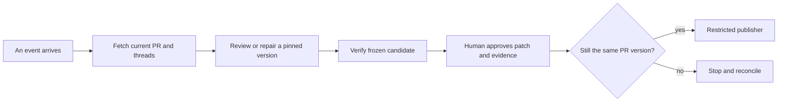

# Automated PR Bot Field Guide

# The one page map

A PR is a proposal to change code. Your bot has to decide whether the change causes a real problem, whether a proposed fix actually removes that problem, and whether the person in charge has authorized the exact tested patch to be published.

Read the change → find a specific problem → try to disprove it → make a small fix → test independently → show the exact patch → get approval → publish and check the result.

The model reasons about code. GitHub stores the change and its discussion. An isolated machine runs checks. Your controller keeps the records and enforces the order. A separate publisher holds permission to write. None of these jobs substitutes for the others.

Use a linter for mechanical rules. Use an AI reviewer for contextual hypotheses. Use tests and other independent evidence to check those hypotheses. Use human judgment when intended behavior, business risk or an unsupported environment is unresolved.

Take the strongest ideas even when their original code is private. Build missing blocks. Your personal and organization versions share the quality design; model transport, infrastructure, cost and permission policy are implementation choices.

Explain it aloud: A confident comment is a claim; a tested patch is evidence; approval is a separate decision.


# How a review-and-fix bot actually works

This guide follows one tiny Python change all the way through a complete bot. The example, commit nicknames, results and approval record are **illustrative; none was executed**. They explain the design, not a performance claim about any product.

The bot has two jobs: investigate whether a proposed change causes a problem, then repair justified problems. Reliable automation also needs a controller that tracks the work, independent checks, and a restricted publisher. Those parts prevent an impressive-looking answer from becoming an unjustified code change.

## 1. Start with a change someone wants to merge

Imagine a project with this owner-approved rule:

> Delivery costs $5 below a $50 subtotal. Delivery is free at $50 or above.

The existing `fees.py` contains:

```python
def delivery_fee(subtotal):
    return 0 if subtotal >= 50 else 5
```

A developer opens a pull request, or PR, proposing a change. Its diff includes:

```diff
 def delivery_fee(subtotal):
-    return 0 if subtotal >= 50 else 5
+    return 0 if subtotal > 50 else 5
```

The `-` line was removed; the `+` line was added. The PR is a place to discuss this proposed change before combining it with the project's main work.

Give the snapshots friendly nicknames:

| Snapshot | Meaning here |
|---|---|
| **B1** | Comparison baseline, containing `>=` |
| **H1** | Proposed branch's current commit, containing `>` |
| **C1** | Candidate repair we will create later |

Real commits have identifiers called hashes. These nicknames are not real hashes. A branch name can move to a new commit; an existing commit identifies fixed contents and history. The controller records actual identifiers so everyone reviews and tests the same version.

GitHub's PR comparison usually starts from the branches' common ancestor. That is different from always comparing with the latest destination-branch contents. The system should record both its comparison baseline and the destination version used for integration checks. [GitHub comparison explanation](https://docs.github.com/en/pull-requests/reference/branches).

**Explain aloud:** “What changed? What behavior could that one character affect? Why is a branch name insufficient to identify what I tested?”

## 2. The reviewer makes a claim, not a verdict from nowhere

The reviewer reads the diff, the surrounding function, relevant tests and the delivery rule. It forms a hypothesis:

> At exactly $50, H1 charges $5 although the rule requires free delivery. The new `>` comparison excludes the boundary value. Restore `>=` and cover the boundary in a test.

That is a useful finding because it contains a location, triggering input, actual behavior, expected behavior and connection to the introduced change. Another person can challenge it.

Compare four kinds of comment:

| Comment | How to handle it |
|---|---|
| “At subtotal 50, this new comparison returns 5 instead of the required 0.” | Investigate the concrete defect |
| “This is bad code. Improve robustness.” | Too vague to authorize a repair |
| “Use the project's required spacing.” | Let a formatter or linter handle a mechanical rule |
| “The business should offer free delivery at $40.” | A product decision requiring owner intent |

A confident tone does not supply missing evidence. Neither does a severity badge. If the developer intended to change the free-delivery threshold, the reviewer must identify that possible requirement change instead of automatically restoring old behavior.

Repository context matters because a correct comparison cannot be determined from punctuation alone. The trusted requirement makes the claim meaningful.

**Explain aloud:** “What evidence makes this a bug rather than a style preference? What information would make me reject the finding?”

## 3. Validation tries to prove the reviewer wrong

A validator investigates the hypothesis before a fixer touches code. It checks whether the rule is current, whether another caller changes the input, and whether the problem already existed.

A tiny reproducer is:

```python
assert delivery_fee(50) == 0
```

Run it separately against B1 and H1. In this teaching example, the expected observations are:

| Input | Required fee | B1 (`>=`) | H1 (`>`) |
|---:|---:|---:|---:|
| 49 | 5 | 5 | 5 |
| 50 | 0 | 0 | **5: failure** |
| 51 | 0 | 0 | 0 |

The comparison shows why testing only 49 and 51 would miss the bug. Checking B1 also matters: if the same failure occurred there, the bot could not honestly call it newly introduced by this PR.

These observations would support a narrow conclusion: the changed comparison breaks the specified boundary case. They would not establish correctness for negative amounts, currency conversion, every caller, or the whole delivery system.

An LLM can propose the reproducer and reason about the result. A test runner must actually execute it before the system reports a test pass. If the environment cannot start, the result is “environment failed,” not “no bug.”

Some problems cannot be reproduced cheaply: device-specific behavior, concurrency failures and missing business requirements are examples. The bot should preserve the uncertainty and request judgment, rather than invent a harmless-looking edit.

**Explain aloud:** “What distinguishes a proposed test, an executed failure and a passing result? Why do I compare baseline and proposed code?”

## 4. A fixer makes a candidate in a separate workspace

After the finding is accepted as actionable, the fixer receives a specific task:

> Restore the documented $50 boundary. Add regression coverage. Keep unrelated behavior unchanged.

It works in a separate checkout or execution environment and proposes:

```diff
-    return 0 if subtotal > 50 else 5
+    return 0 if subtotal >= 50 else 5
```

It might also add `test_fees.py`:

```python
from fees import delivery_fee

def test_free_delivery_starts_at_50():
    assert delivery_fee(49) == 5
    assert delivery_fee(50) == 0
    assert delivery_fee(51) == 0
```

The output is a **candidate repair**, C1. Creating a commit or saying “fixed” does not establish that it works.

Keep the roles separate:

```text
Reviewer: “Here is the suspected problem.”
Validator: “Here is what supports or refutes it.”
Fixer: “Here is a patch addressing the accepted problem.”
Verifier: “Here are checks I independently ran on that patch.”
Publisher: “I can send only the authorized result to GitHub.”
```

A Git worktree separates files and branches; it is not a security sandbox. Repository tests and installation scripts can execute code. They should not receive the user's normal home directory, GitHub write token or other account credentials. An authenticated coding CLI and untrusted test execution need an explicit separation too.

The fixer should stop when the task is ambiguous, the permitted scope is insufficient, or bounded repair attempts fail.

**Explain aloud:** “Why is C1 only a candidate? What could a malicious test do if it inherited my normal machine's credentials?”

## 5. Independent verification checks the candidate, not the story

A clean verifier checks out C1 and runs owner-approved commands. For our example, its report might contain:

```text
Candidate: C1
Original boundary reproducer: failed on H1, passed on C1
Existing fee tests: passed
New boundary test: passed
Unrelated integration checks: not run
```

Again, these are illustrative results, not executed results.

“Independent” means the fixer cannot silently choose easier commands, replace the acceptance rule, edit the verifier's logs or swap the candidate afterward. Another model reading the same conversation is not sufficient independence.

The new test is useful, but the verifier should also use the trusted reproducer and existing checks. Otherwise the fixer could replace `assert fee == 0` with `assert fee >= 0` and declare victory. That weaker assertion would accept the incorrect $5 fee.

Different projects require different verification. A Python function may need unit tests. A numerical library can also need compilation, dtype/shape checks, numerical tolerances and supported devices. A passing Mac test does not prove an Intel GPU path ran.

After verification, freeze C1 and its evidence. Any subsequent edit creates a new candidate and requires corresponding checks. Concrete source projects illustrate why this separation matters: PR-Agent can check replacement applicability and Python syntax, but neither operation runs the project's regression suite. [Inspected validation implementation](https://github.com/The-PR-Agent/pr-agent/blob/729415c68b8ef55df8bcce919a419af7f5cebffb/pr_agent/tools/pr_code_suggestions.py#L1576-L1677).

**Explain aloud:** “Could a patch pass a test while leaving the bug? What exactly must stay unchanged after verification?”

## 6. Approval, push and merge are three different decisions

The human sees the exact diff and evidence, then approves a particular publication:

```text
Repository: example/shop
PR: 17
Expected current head: H1
Approved candidate: C1
Evidence: boundary reproduction + listed regression checks
Unresolved limits: integration checks not run
```

This is a teaching record, not a real approval or command.

The publisher owns the GitHub write credential. The fixer does not. Immediately before publishing, the publisher checks that PR 17 is still open and its head is still H1. The remote branch update must also enforce that expectation, so a concurrent change cannot slip between checking and pushing.

Suppose another developer pushes H2 while approval is waiting. The bot must stop and reconcile. It cannot quietly combine C1 with H2 and claim that the human approved and the verifier tested the new combination.

A push updates the remote feature branch. A merge combines approved work into the destination branch. Approving C1 for a push does not authorize merging the PR, deployment, or a later patch.

This separation appears in useful open architectures: Datadog's review workflow keeps its model job read-only and delegates posting to another job. That demonstrates credential separation for comments; it is not a complete tested-patch approval system. [Inspected job contract](https://github.com/DataDog/code-review-action/blob/fa0c1e83648c82ae0ac78dc1c261af462d9ffcb5/.github/workflows/code-review.yml#L13-L53).

**Explain aloud:** “What happens if the branch changes after approval? Why does permission to push one candidate not mean permission to merge?”

## 7. CI and rereview close the loop

After the authorized push, configured GitHub Actions may run tests and builds. Those automated jobs are CI: continuous integration. The bot waits for the required checks associated with the relevant new revision and reads their actual outcomes. A cancelled, skipped or missing check is different from a pass. [GitHub workflow concepts](https://docs.github.com/en/actions/concepts/workflows-and-actions/workflows), [check outcomes](https://docs.github.com/en/pull-requests/reference/status-checks).

The reviewer then reassesses the original finding against C1. It should see the boundary restored, examine the evidence, and mark its concern addressed according to the repository's policy. The system keeps the original thread and finding identity so it does not repost the same issue merely because line numbers moved.

A resolved conversation does not prove the repair was correct. A reviewer might resolve it by mistake. Likewise, a green test badge can coexist with missing coverage. Completion means the system has the required evidence, records remaining uncertainty, and hands the merge decision to the authorized human.

```text
Exact change → suspected defect → checked evidence → candidate repair
      → independent checks → exact approval → restricted push
      → CI at new revision → rereview → human merge decision
```

**Explain aloud:** “Which step establishes that code reached GitHub? Which establishes that a particular check passed? Which decides whether to merge?”

## 8. A tiny glossary you can use in conversation

| Term | Plain meaning |
|---|---|
| Repository / repo | The project's files plus their recorded Git history |
| Branch | A movable name pointing to a line of development |
| Commit | A recorded snapshot linked to its parent history, identified by a hash |
| Pull request / PR | A proposal and discussion for combining one branch's changes into another |
| Diff | The lines added, removed or changed between selected versions |
| Head | In a PR, the proposed branch; its head commit is its latest recorded version |
| Base | The destination branch; a comparison baseline commit must also be specified |
| Review | An assessment of proposed changes, possibly with comments or a verdict |
| Thread | A conversation attached to a particular comment or code location |
| Check | A reported automated result, such as a test job or security scan |
| CI | Automation that builds/tests changes as they are integrated |
| Access token | A credential permitting access; its permissions and account determine its authority |
| Sandbox | An execution boundary restricting what code can access or affect |
| Merge | Combine development histories/changes into a destination branch |
| Rebase | Replay changes on another starting point, creating new commit identities |
| Merge queue | A controlled sequence that checks proposed merges with other queued changes |

An LLM token means a unit of model text; it is unrelated to an access token.

**Explain aloud:** “Explain a PR using branch, commit, diff, head and base. Then explain why a rebase changes the identity of what was reviewed.”

## 9. Know what each piece of evidence can establish

| Evidence | Supports | Does not establish |
|---|---|---|
| Code inspection | A reasoned hypothesis about behavior | That the code was executed |
| Reproducer failure | A specific failure under stated conditions | That every deployment is affected |
| Candidate test pass | Checked behavior in the recorded environment | Absence of all bugs |
| Syntax check | Code parses/compiles at the checked level | Correct requirements or runtime behavior |
| Human approval | Authorization for its stated artifact/action | Technical correctness by itself |
| Remote commit read-back | Which change reached the branch | Successful tests or permission to merge |
| Resolved thread | Conversation state | Proof that the diagnosis or fix was right |

**Explain aloud:** “Tell the whole story without saying ‘the bot knows it is correct.’ Replace that phrase with the exact evidence collected and the limits still remaining.”


# GitHub review and repair: twenty situations to understand

Verified against current GitHub documentation and public repository source on 2026-10-21. This is a teaching companion to the complete architecture. Examples below are illustrative configurations, not installed workflows. No repository settings were changed, no workflow was run, and no PR was reviewed or modified.

## Start with the objects, then the automation

Imagine a PR as a folder of proposed changes. Its **head** is the latest commit on the contributor’s branch; its **base** is the branch the contributor wants to change. A **SHA** identifies a commit. A branch name moves as people push; a SHA identifies one version. A **diff** compares versions. A **review** can contain an overall decision and multiple inline comments. An inline discussion is a **thread** with its own resolution state. A top-level conversation comment is a different object.

A workflow is a recipe; an event tells GitHub when to consider running it; a job is a unit inside the recipe. A check reports an outcome for a revision. Repository rules decide which outcomes and approvals block merging. Your repair service needs a separate rule for permission to push its candidate. Otherwise it can publish changes before anyone approves the exact patch.



This diagram is the proposed service contract. GitHub supplies events, repository controls and APIs; the application must connect them correctly.

## Twenty scenarios

“Correct strategy” means the proposed behavior of our system. The linked control describes current GitHub behavior, not a claim that either example repository has enabled that setting.

| # | Trigger or situation | Wrong bot behavior | Correct strategy | GitHub control and primary source |
|---|---|---|---|---|
| 1 | A PR opens, reopens, or becomes ready for review | Assume every lifecycle change uses the same default trigger; silently miss draft-to-ready transitions | Select activity types deliberately; fetch current draft/conflict/head state and record why a review did or did not run | `pull_request` defaults to `opened`, `synchronize`, `reopened`; add `ready_for_review` explicitly. [Events](https://docs.github.com/en/actions/reference/workflows-and-actions/events-that-trigger-workflows#pull_request) |
| 2 | Another commit lands during a repair | Finish the old run, then push onto the moving branch | Preserve the original head SHA; invalidate outdated evidence/approval and re-evaluate before publishing | `synchronize` signals head updates. Cancellation reduces wasted work; it does not prove a push is safe. [Concurrency](https://docs.github.com/en/actions/concepts/workflows-and-actions/concurrency) |
| 3 | A reviewer submits “Request changes” containing several comments | Treat the review body as the whole task, or process an unfinished draft review as final instructions | Fetch the submitted review, its comments and current threads; group one task by logical defect and detect conflicting requests | `pull_request_review` has submitted/edited/dismissed activity and review state. [Review events](https://docs.github.com/en/actions/reference/workflows-and-actions/events-that-trigger-workflows#pull_request_review) |
| 4 | An inline comment is edited or deleted | Continue fixing the original wording forever | Version the feedback; re-check applicability and invalidate dependent approval where meaning changed | Inline activity uses `pull_request_review_comment`. [Comment events](https://docs.github.com/en/actions/reference/workflows-and-actions/events-that-trigger-workflows#pull_request_review_comment) |
| 5 | Someone writes `/fix` in the PR conversation | Execute anybody’s comment as an authorized command, or look for an invented `pull_request_comment` event | Use a PR-only comment filter, authenticate the author’s authority, parse a narrow command and reconcile the current task | Conversation comments use `issue_comment`; `github.event.issue.pull_request` distinguishes PR comments. [Issue comment](https://docs.github.com/en/actions/reference/workflows-and-actions/events-that-trigger-workflows#issue_comment) |
| 6 | An external fork proposes build-script changes | Give the runner credentials because the reviewer “needs tests” | Build untrusted code without publication secrets in isolated compute; keep privileged metadata/publication separate | Fork checkout/build execution must not inherit privileged secrets. [Secure use](https://docs.github.com/en/actions/reference/security/secure-use) |
| 7 | A first-time contributor’s workflow waits | Interpret “Approve workflows to run” as approval of the patch or permission for future bot pushes | Explain that this permits CI execution; review the changes first and retain separate code/publisher approval | Write-access maintainers approve eligible waiting runs; configured policy determines when required. [Fork approval](https://docs.github.com/en/actions/how-tos/manage-workflow-runs/approve-runs-from-forks) |
| 8 | Dependabot creates or updates a PR | Assume it receives normal Actions secrets, or that rerunning as a maintainer removes restrictions | Classify the actor/event and select the documented restricted credential path; report unavailable checks honestly | Relevant Dependabot events default to read-only token and Dependabot secrets; rerun actor does not remove restrictions. [Dependabot](https://docs.github.com/en/code-security/reference/supply-chain-security/dependabot-on-actions) |
| 9 | `pull_request_target` is chosen to obtain a write token | Check out the fork and execute its installer/tests with base-repository credentials | Use privileged execution only for trusted operations; move attacker-controlled execution into an unprivileged boundary | Default-base workflow trust is defeated by running fork code. [Security guidance](https://docs.github.com/en/actions/reference/security/securely-using-pull_request_target) |
| 10 | `workflow_run` follows a test workflow | Assume “completed” means passed; execute a downloaded artifact as a trusted script | Check the actual conclusion, repository, run and revision; validate artifact identity/schema and keep it inert | Completion can follow failure; the follow-up can possess greater privileges. [Workflow run](https://docs.github.com/en/actions/reference/workflows-and-actions/events-that-trigger-workflows#workflow_run) |
| 11 | A workflow uses `GITHUB_TOKEN` to create/update a PR | Claim either “CI always runs automatically” or “CI can never run” | Distinguish suppressed `push` runs from the approval-required PR exception; show the maintainer the actual waiting run | Current exception covers PR opened/synchronize/reopened, plus dispatch exceptions. [Token semantics](https://docs.github.com/en/actions/concepts/security/github_token) |
| 12 | A separate GitHub App token causes new events; the bot comments on its own result | Expect recursion protection to prevent every loop | Deduplicate deliveries and tasks, ignore own generated commands, cap retries, and re-read task state rather than bounce comments between bots | App-token-triggered runs can execute without the `GITHUB_TOKEN` approval exception; deliberate loop control remains necessary. [Triggering workflows](https://docs.github.com/en/actions/how-tos/write-workflows/choose-when-workflows-run/trigger-a-workflow), [delivery IDs](https://docs.github.com/en/webhooks/using-webhooks/best-practices-for-using-webhooks) |
| 13 | A required check is renamed or reported by the wrong producer | Match only a friendly “green” label or copy the old check’s result | Identify the required check name/source and applicable revision; keep names stable and unambiguous | Duplicate job names can confuse protection; expected GitHub App may be required. [Protected branches](https://docs.github.com/en/repositories/configuring-branches-and-merges-in-your-repository/managing-protected-branches/about-protected-branches) |
| 14 | A workflow is filtered out, or a test job is skipped | Tell the user that “skipped” proves tests passed | Distinguish missing workflow, skipped job, no collected tests, failure and actual pass; show what executed | Filtered workflows can leave pending requirements; conditional job skips report success. [Check troubleshooting](https://docs.github.com/en/pull-requests/how-tos/merge-and-close-pull-requests/troubleshooting-required-status-checks) |
| 15 | A human approves, then a bot adds another commit | Treat the old approval as permission for the new candidate | Invalidate the application’s hash-bound approval; explain which repository review setting also applies | Dismiss-stale approvals and latest-reviewable-push approval are distinct options. [Review requirements](https://docs.github.com/en/repositories/configuring-branches-and-merges-in-your-repository/managing-protected-branches/about-protected-branches#require-pull-request-reviews-before-merging) |
| 16 | A PR enters a merge queue | Reuse the original PR’s green result for the queue’s combined revision, or enqueue automatically | Report checks for the merge-group revision; leave merge/queue authority outside this repair service | Actions CI needs `merge_group`; the combined change has a different SHA. [Merge queue](https://docs.github.com/en/repositories/configuring-branches-and-merges-in-your-repository/configuring-pull-request-merges/managing-a-merge-queue) |
| 17 | An environment waits for a reviewer | Claim that an environment click approves any patch the job later builds or pushes | Show the exact candidate/evidence separately; publisher must compare the approved identities immediately before writing | An environment gates jobs and secret access. Exact-artifact binding is an additional application requirement. [Environment controls](https://docs.github.com/en/actions/reference/workflows-and-actions/deployments-and-environments) |
| 18 | A file is renamed; a commented line is deleted or moves | Patch the same numeric line in a different version, or resolve the thread merely because it is outdated | Use commit/path/side/range and original context; find the current defect or explain that it is obsolete/uncertain | Comment API retains commit/original location fields; thread outdated/resolved are distinct. [Comments](https://docs.github.com/en/rest/pulls/comments), [thread schema](https://docs.github.com/en/graphql/reference/pulls#pullrequestreviewthread) |
| 19 | The PR has more comments/threads than one API page | Read the first page and say all feedback is addressed | Traverse every relevant connection, including comments inside threads; record incomplete retrieval as unknown | Follow `pageInfo.endCursor` until `hasNextPage` is false; maximum requested page size is 100. [Pagination](https://docs.github.com/en/graphql/guides/using-pagination-in-the-graphql-api) |
| 20 | Events arrive twice/out of order; queued runs compete | Assume cancellation or queue order makes publication atomic | Deduplicate by delivery ID, serialize by PR and compare current head plus approval under the publisher’s lock; reconcile unknown remote outcomes | Default queue replaces pending runs; `queue: max` permits up to 100 waiting, ordered by waiting time, not dispatch order. [Queue semantics](https://docs.github.com/en/actions/how-tos/write-workflows/choose-when-workflows-run/control-workflow-concurrency) |

## Three configurations to read together

These complete, minimal teaching workflows print metadata only. They do not invoke a model, run repository tests, authorize a person, or implement the publisher. Their syntax is taken from current GitHub references; they have not been executed. Action versions and checks would need an approved, pinned implementation before real use.

### A. Keep one current metadata run per PR/ref, and recognize merge groups

```yaml
name: Revision orientation
on:
  pull_request:
    types: [opened, synchronize, reopened, ready_for_review]
  merge_group:
    types: [checks_requested]
permissions:
  contents: read
concurrency:
  group: ${{ github.workflow }}-${{ github.event.pull_request.number || github.ref }}
  cancel-in-progress: true
jobs:
  identify:
    runs-on: ubuntu-latest
    steps:
      - name: Print event and workflow revision
        env:
          EVENT: ${{ github.event_name }}
          REVISION: ${{ github.sha }}
        run: printf '%s\n' "$EVENT" "$REVISION"
```

The key lesson is revision identity. In PR workflows, `github.sha` commonly identifies the synthetic test-merge revision, rather than the contributor’s head. Record both the event revision and `github.event.pull_request.head.sha` when present. The merge-group event supplies its own combined revision. Choose intentionally what each test and approval means; do not silently label every SHA “PR head.” [Event revision table](https://docs.github.com/en/actions/reference/workflows-and-actions/events-that-trigger-workflows#pull_request).

Cancellation is useful for a read-only reviewer: newer work supersedes an old analysis. It does not undo a remote comment or push that already happened. The publisher needs its own lock, expected-old-head check and outcome reconciliation.

### B. Hear different forms of feedback without executing the comment

Placement matters: GitHub only triggers `issue_comment` when this workflow file exists on the repository's default branch. Adding it only to a feature branch will not enable that comment route. [Default-branch requirement](https://docs.github.com/en/actions/reference/workflows-and-actions/events-that-trigger-workflows#issue_comment).

```yaml
name: Feedback orientation
on:
  pull_request_review:
    types: [submitted, edited, dismissed]
  pull_request_review_comment:
    types: [created, edited, deleted]
  issue_comment:
    types: [created, edited, deleted]
permissions:
  contents: read
  issues: read
  pull-requests: read
jobs:
  identify:
    if: github.event_name != 'issue_comment' || github.event.issue.pull_request
    runs-on: ubuntu-latest
    steps:
      - name: Print feedback metadata
        env:
          EVENT: ${{ github.event_name }}
          ACTOR: ${{ github.actor }}
          PR_NUMBER: ${{ github.event.pull_request.number || github.event.issue.number }}
        run: printf '%s\n' "$EVENT" "$ACTOR" "$PR_NUMBER"
```

This only demonstrates event routing. A real controller verifies who may request repairs, reads all current feedback, rejects ambiguous commands and pins the task to the current revision. Passing a PR-only filter does not grant authorization. A comment’s text must never be inserted directly into an executable shell command. GitHub’s guidance recommends safer input handling and limits on privileged untrusted execution. [Secure use](https://docs.github.com/en/actions/reference/security/secure-use).

### C. Queue an approval job, but recognize what this still does not implement

The `workflow_dispatch` workflow must also exist on the default branch before GitHub can receive this manual trigger; the selected run may then target another allowed ref. A feature-branch-only file is insufficient to expose the intended manual route. [Manual trigger requirement](https://docs.github.com/en/actions/reference/workflows-and-actions/events-that-trigger-workflows#workflow_dispatch).

```yaml
name: Candidate approval orientation
on:
  workflow_dispatch:
    inputs:
      pr:
        type: string
        required: true
      candidate_sha:
        type: string
        required: true
      evidence_sha256:
        type: string
        required: true
permissions:
  contents: read
concurrency:
  group: candidate-approval-${{ inputs.pr }}
  cancel-in-progress: false
  queue: max
jobs:
  inspect:
    runs-on: ubuntu-latest
    environment: repair-publication
    steps:
      - name: Print requested identities
        env:
          CANDIDATE: ${{ inputs.candidate_sha }}
          EVIDENCE: ${{ inputs.evidence_sha256 }}
        run: printf '%s\n' "$CANDIDATE" "$EVIDENCE"
```

An administrator must separately configure the environment’s reviewers; writing `environment:` does not create the desired approval policy. The strings above are untrusted requested inputs until the service validates them against its immutable candidate/evidence store. The example has no write permission and publishes nothing. A complete publisher must authenticate the approval, validate its expiry and policy, verify the current branch, then write only the approved object.

Current syntax allows `queue: max` or cancellation of active runs; combining `queue: max` with `cancel-in-progress: true` is invalid. Even a queue cannot guarantee commit arrival order, because it orders by when runs began waiting. [Concurrency reference](https://docs.github.com/en/actions/how-tos/write-workflows/choose-when-workflows-run/control-workflow-concurrency).

## A green badge and an approval each need context

| What you see | What to ask before trusting it |
|---|---|
| `success` | Which command actually ran, against which SHA and environment? |
| `skipped` / `neutral` | GitHub can accept these for required-check purposes; did the required verification execute? |
| `failure`, `timed_out`, `cancelled` | What failed or stopped? Do not translate this into a pass. |
| Waiting or running | The result is not available yet. |

This is a proposed evidence-reading discipline. GitHub's documented check conclusions are a merge-control interface, not a guarantee of test coverage. [Status checks](https://docs.github.com/en/pull-requests/reference/status-checks).

Consider Alice and Bob approving commit A, followed by a bot pushing B. With stale-approval dismissal, a changed diff can invalidate earlier approvals. The latest-reviewable-push option instead requires another authorized person to approve the most recent push without necessarily discarding every earlier review. Neither setting means the bot received permission to publish B before it existed. Our publisher's exact-candidate approval remains separate. [Review settings](https://docs.github.com/en/repositories/configuring-branches-and-merges-in-your-repository/managing-protected-branches/about-protected-branches#require-pull-request-reviews-before-merging).

## Two current details that older tutorials get wrong

**Token-triggered CI:** current GitHub docs distinguish ordinary `push` events caused by `GITHUB_TOKEN` from PR creation/update events. The former do not trigger a new workflow run; the PR `opened`/`synchronize`/`reopened` exception creates runs requiring approval. `workflow_dispatch` and `repository_dispatch` are additional exceptions. An App installation token or PAT can avoid that specific approval prompt when creating/updating PRs; that is a credential-policy choice, not a reason to hand a repair worker a powerful token. [Current token reference](https://docs.github.com/en/actions/concepts/security/github_token).

**A manually dispatched green job may not satisfy a required PR check:** GitHub now documents a restriction on which workflow-job events count for PR ruleset evaluation. A `workflow_dispatch` job on the head branch can pass the same commit yet not satisfy that requirement. External App-created checks have different treatment. Merge queues require their separate event. Therefore distinguish “I ran the tests” from “GitHub accepted the required check.” [Current troubleshooting reference](https://docs.github.com/en/pull-requests/how-tos/merge-and-close-pull-requests/troubleshooting-required-status-checks#checks-from-some-workflow-jobs-are-not-evaluated).

## Real repository examples, pinned rather than guessed

These observations concern workflow source at the pinned default-branch commits. They do not establish current run success, runner hardware inventories, private CI coverage or enabled branch rules.

| Public source | What can be observed | Teaching implication |
|---|---|---|
| [mkl_fft pip build](https://github.com/IntelPython/mkl_fft/blob/1c64f4ed77aed89687f43b66b4ed84035f69919d/.github/workflows/build_pip.yml#L1-L66) | `pull_request` and master `push`; read-only contents; Ubuntu; a Python/pre-release NumPy matrix; MKL installation; pytest | “The test passed” must identify the matrix case, built package and tested revision. |
| [mkl_fft IntelLLVM build](https://github.com/IntelPython/mkl_fft/blob/1c64f4ed77aed89687f43b66b4ed84035f69919d/.github/workflows/build-with-clang.yml#L1-L80) | Separate compiler route, oneAPI installation and package tests; a previous-run cancellation action | A pip job and compiler job cover different paths. A cancellation result is not a test result. |
| [dpnp conda-forge caller](https://github.com/IntelPython/dpnp/blob/d28ce7fc3cc90ef7cb194b8900a173e3fac877ef/.github/workflows/conda-package-cf.yml#L1-L33) | Explicit Linux and Windows calls to a reusable build/test workflow; concurrency cancellation | One parent workflow can produce several platform and matrix checks. Do not infer required check names from the filename alone. |
| [dpnp reusable tests](https://github.com/IntelPython/dpnp/blob/d28ce7fc3cc90ef7cb194b8900a173e3fac877ef/.github/workflows/conda-build-test.yml#L255-L295) | Device/platform smoke commands, package tests, separate tensor tests and bounded retry action | Preserve earlier failed attempts, device information, skips and test counts; final green alone hides that detail. |
| [dpnp open SYCL build](https://github.com/IntelPython/dpnp/blob/d28ce7fc3cc90ef7cb194b8900a173e3fac877ef/.github/workflows/os-llvm-sycl-build.yml#L1-L35) | PR, master push and manual triggers; Ubuntu; SYCL toolchain components; concurrency | A Mac-only check does not exercise this declared Linux compiler/runtime route. |
| [dpnp dependency-bump automation](https://github.com/IntelPython/dpnp/blob/d28ce7fc3cc90ef7cb194b8900a173e3fac877ef/.github/workflows/bump-sycl-deps.yml#L115-L143) | Creates a PR using `github.token`, updates a workflow file, and tells maintainers to trigger validation | Explain the current token/approval and check-eligibility rules before promising that this automation produces every required check. Actual run behavior was not tested here. |

The exact current branch protections, rulesets, required check producers, environment reviewers, Actions approval policy, runner permissions and bypass actors were not inspected. Their state is **unknown**. A public workflow file is not a settings export. If a later authorized settings query returns 403 or 404, preserve “unknown/inaccessible”; do not convert it to “no protection.”

## Five settings worth opening together with a maintainer

At **Settings → Actions → General**, inspect workflow permissions and fork-run approval policy. At **Settings → Rules → Rulesets** and **Settings → Branches**, inspect applicable targets, required checks, review requirements and bypass authority. At **Settings → Environments**, inspect reviewers, self-review policy, branch restrictions and protected secrets. Feature availability varies by plan/repository visibility. [Actions settings](https://docs.github.com/en/repositories/managing-your-repositorys-settings-and-features/enabling-features-for-your-repository/managing-github-actions-settings-for-a-repository), [protection rules](https://docs.github.com/en/repositories/configuring-branches-and-merges-in-your-repository/managing-protected-branches/about-protected-branches), [environments](https://docs.github.com/en/actions/reference/workflows-and-actions/deployments-and-environments).

The discussion should answer five concrete questions: Which exact revision passed which checks? Which person approved which diff? Which identity can write which branch? What invalidates that approval? What does the service do if it cannot prove the answer? Those answers matter more than whether the bot’s comment looks polished.
